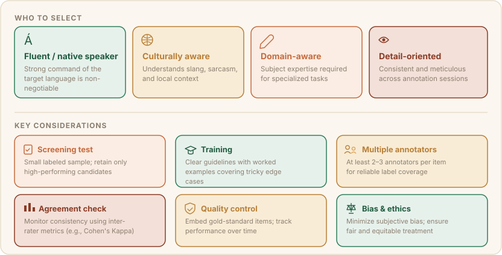
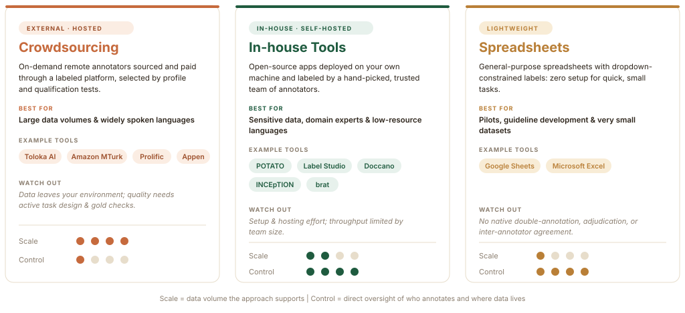

# Annotation

This page covers the human side of building a text-classification dataset: **who** annotates (recruitment and well-being), **with what** (tools), and how to keep labels trustworthy (**agreement** and **quality control**).

:::tip[Key points]

- Put annotator quality before numbers: recruit fluent speakers who know the cultural context and can apply the guidelines consistently.
- Warn annotators about harmful content, ask for opt-in, and let them skip or withdraw without penalty.
- Choose the tool by task, team size, data sensitivity and language support; there is no single best tool.
- Report a chance-corrected agreement measure, and read low scores on subjective tasks in context.
- Pilot first, mix in gold items, and send ties and hard cases to adjudication rather than to code.

:::

## Choosing annotators

The quality and consistency of annotators matter more than their number. Recruit people who are fluent in the target language, familiar with the cultural context and, where needed, with the topic domain. For emotion and hate speech tasks, they must also understand informal language, sarcasm, euphemism and context-dependent expressions. Look for people who are detail-oriented and able to apply the guidelines consistently.



:::tip[Tip]
Use a short qualification round before the main task. The goal is not only to select competent annotators, but also to identify whether the guidelines are clear enough to be applied consistently.
:::

**Before annotation begins, screen annotators for:**
- Language proficiency.
- Domain familiarity.
- Ability to follow instructions carefully.
- Comfort with sensitive or harmful content.
- Availability for training and calibration.

For how to run the recruitment funnel (call, screen, onboard), see [Build the team](../project-management/index.md#5-build-the-team); for recruiting a diverse pool on purpose, see [Recruit for diversity, deliberately](../3_annotation-design/inclusive-bias-aware.md#recruit-for-diversity-deliberately).

## Annotator safety & well-being

Emotion and hate speech tasks expose annotators to offensive and distressing material, so screen for comfort with it (see the checklist above) and show a content warning with an opt-in before the task starts. The full set of safeguards (opt-out, exposure limits, breaks, support and recording skips without personal disclosure) is in [Protect annotators from harmful content](../3_annotation-design/annotation-task-design.md#protect-annotators-from-harmful-content).

## Annotation tools

Text classification data can be annotated using a range of tools, from managed crowdsourcing platforms to self-hosted open-source systems. The choice of tool should depend on the task design, dataset size, number of annotators, required turnaround time, and the availability of qualified annotators.

There is no single best tool. Judge candidates against your task, team, and conditions using [A checklist for choosing a tool](../6_documentation/tooling.md#a-checklist-for-choosing-a-tool), which covers the general questions (sensitivity, volume, team size, review workflow, schema, self-hosting and exports, cost) and the checks that matter for African-language data, such as script support, offline work, and keeping every annotator's labels.

Based on how annotators are sourced and where the data is hosted, annotation tools can be broadly grouped into two categories: crowdsourcing platforms and in-house (self-hosted) tools. The most common options for text classification are described below.

### Crowdsourcing platforms

Crowdsourcing platforms give you access to a large, on-demand pool of remote annotators who are recruited and paid through the platform. Annotators are typically selected based on profile attributes (language, location, demographics, prior approval rating, or qualification tests) rather than being known to you personally. This makes crowdsourcing well suited to large volumes of data and widely spoken languages, where a broad annotator pool is readily available.

Common platforms include:

- Toloka AI: [https://toloka.ai](https://toloka.ai/)
- Prolific: [https://www.prolific.com](https://www.prolific.com/)
- Appen: [https://www.appen.com](https://www.appen.com/)

Amazon Mechanical Turk (MTurk), which much of the older crowdsourcing literature describes, closed permanently on 30 September 2026 ([Amazon Mechanical Turk, 2026](../references.md#mturk-closure-2026)). Its guidance on task design and quality control still applies, but it can no longer be used to run new work.

Many of these platforms support multiple data modalities (text, image, audio, video) and increasingly offer AI-assisted features such as pre-labelling, model-in-the-loop suggestions, and automated quality checks.

**Trade-offs.** Crowdsourcing scales easily and reduces recruitment overhead, but it offers less direct control over annotators and may make it difficult to source native speakers of low-resource languages or specific dialects. It also requires careful task design and qualification filters, and it raises data-privacy concerns because the data is sent to an external platform.

Check what a marketplace can actually filter on before you rely on it for an African language. A filter for your language or dialect may not exist, and the profile filters that do exist are mostly based on answers workers give about themselves. A location filter describes where someone lives now, not which variety they speak. Plan to write and run your own short screening test in the target language, scored against items a trusted native speaker has checked, and pay people for the time it takes. Prolific, for example, offers a custom screening step for groups its built-in filters do not cover, and pays screened-out participants a fixed reward that the researcher sets ([Prolific, 2026b](../references.md#prolific-screening-2026)).

Budget for the platform's fee as well as for worker pay. Some marketplaces calculate a service fee on top of the rewards paid to workers, at a rate that can differ between academic and commercial customers ([Prolific, 2026a](../references.md#prolific-pricing-2026)). Check the current price page when you draw up the budget, because rates change.

### In-house (self-hosted) tools

In-house tools are typically open-source applications that can be customized, deployed, and hosted on your own machine or server. You create accounts for a hand-picked set of annotators (often colleagues, domain experts, or recruited native speakers), giving you full control over who labels the data and where the data lives. This category is preferred for sensitive data, specialized domains, and low-resource languages, where annotator expertise matters more than raw scale.

Common self-hosted tools include:

- POTATO (Portable Text Annotation Tool): [https://github.com/davidjurgens/potato](https://github.com/davidjurgens/potato)
- Label Studio (open-source edition): [https://labelstud.io](https://labelstud.io/)
- Doccano: [https://github.com/doccano/doccano](https://github.com/doccano/doccano)
- INCEpTION (the successor to WebAnno): [https://inception-project.github.io](https://inception-project.github.io/)
- brat: [https://brat.nlplab.org](https://brat.nlplab.org/)

**Trade-offs.** Self-hosted tools keep data fully under your control and can be tailored to bespoke label schemes and guidelines, but they require setup, hosting, and maintenance effort, and the annotation throughput is limited by the size of your recruited team.

### Lightweight tools for small datasets

For small annotation efforts, a dedicated platform may be unnecessary. Spreadsheets (Google Sheets or Microsoft Excel) are a practical, zero-setup option: one column holds the text, and one or more columns capture the label(s), with data validation or dropdown lists used to constrain inputs to the allowed label set. Spreadsheets are easy to share and require no technical onboarding, which makes them convenient for pilot studies, guideline development, and very small in-house tasks.

However, spreadsheets lack quality-control and project-management features, so they are not recommended beyond small or exploratory datasets.



The annotation tool should match the size and sensitivity of the project. For small pilot studies, spreadsheets may be enough. For medium-sized projects that require labelling workflows, Doccano or INCEpTION are often suitable. For large projects with distributed workers, crowdsourcing platforms can offer scale, but they require stronger quality control and privacy planning.

### Specifying the labelling task

Whichever tool you choose, write down exactly what the annotator sees and what they may enter, then set the tool up to match. A single-label sentiment specification is shown in [Annotation Task Design](../3_annotation-design/annotation-task-design.md#a-task-specification). Emotion with intensities needs one rating per emotion, as specified in [Multi-label Emotion Analysis](./emotion-analysis.md#multi-label-emotion-analysis): six emotions, each rated from 0 (absent) to 3 (high), with every emotion rated.

Keep the imported data simple: one JSON object per item, with a stable identifier and the text.

```json
{"id": "ha-0001", "text": "Na gode sosai, wannan labari ya faranta min rai."}
{"id": "ha-0002", "text": "Ban gamsu da yadda aka gudanar da zaben ba."}
```

Make sure the export keeps each annotator's labels separately, with the item identifier, rather than only a merged label. For the emotion-intensity task, one exported record per annotator and item could look like this (0 means absent). Field names differ between tools, so map them to this shape before you compute [agreement](../4_data-quality/index.md#measure-inter-annotator-agreement) or train a model:

```json
{
  "id": "ha-0001",
  "text": "Na gode sosai, wannan labari ya faranta min rai.",
  "annotator": "annotator_03",
  "labels": {"joy": 3, "sadness": 0, "anger": 0, "fear": 0, "surprise": 1, "disgust": 0}
}
```

Whatever tool you use, coordinators should be able to see each item's progress without annotators seeing one another's labels, to filter items that are incomplete, skipped or already reviewed, and to export every annotator's labels together with the source identifiers.

## Inter-annotator agreement

Agreement shows whether the guidelines and labels are reproducible, or just one person's opinion repeated. Read it against the difficulty and subjectivity of the task. For choosing a metric, interpreting scores and what to report, see [Measure inter-annotator agreement](../4_data-quality/index.md#measure-inter-annotator-agreement) in Data Quality; this section gives the worked formulas for text classification.

### Percentage agreement

The simplest measure is percentage agreement: the share of items to which the annotators gave the same label.

```text
Agreement % = (number of items agreed on / total number of items) × 100

Example: two annotators label 1,000 texts and agree on 850 of them.
Agreement % = (850 / 1,000) × 100 = 85%
```

Percentage agreement is easy to understand, but it does not account for agreement that happens by chance, so do not report it on its own.

### Agreement between two annotators

When exactly two annotators label each item, Cohen's kappa is the most common measure. It corrects for the agreement expected by chance:

$$
\kappa = \frac{P_o - P_e}{1 - P_e}
$$

- $P_o$ (observed agreement) is the number of items the annotators agreed on divided by the total number of items.
- $P_e$ (expected agreement) is the agreement expected by chance, given how often each annotator used each label: for each category, multiply the two annotators' proportions for that category, then add these products over all categories.

Cohen's kappa is widely used for sentiment, emotion, hate speech, topic and many other two-annotator classification tasks. For tested Python code (scikit-learn's `cohen_kappa_score`) checked against a published textbook answer, see [Check the code against a textbook answer](../4_data-quality/index.md#check-the-code-against-a-textbook-answer) in Data Quality.

### Agreement among three or more annotators

Many datasets use three or more annotators per item to improve reliability and reduce the influence of any one person.

**Fleiss' kappa** extends chance-corrected agreement to three or more annotators. Strictly, it generalises Scott's pi rather than Cohen's kappa, because it uses one pooled label distribution for the chance term ([Artstein and Poesio, 2008](../references.md#artstein-2008)). It fits when every item receives the same number of annotations:

$$
\kappa = \frac{\bar{P} - \bar{P}_e}{1 - \bar{P}_e}
$$

Here $\bar{P}$ is the mean observed agreement over all items, and $\bar{P}_e$ is the agreement expected if labels were assigned at random in the overall label proportions.

The same Data Quality section has tested code for Fleiss' kappa (statsmodels' `fleiss_kappa`). It takes an items × categories table of counts. If your data has one row per item and one column per annotator, convert it first with `aggregate_raters` from the same module.

**Krippendorff's alpha** is more flexible. It:

- Supports any number of annotators.
- Handles missing annotations.
- Works with nominal, ordinal, interval and ratio labels.

This flexibility makes it a good default for complex designs, for example when not every annotator labels every item ([Artstein and Poesio, 2008](../references.md#artstein-2008)).

### Ordinal and continuous scales

Some labels are ordered: emotion intensity from 0 to 3, a 1-to-5 quality score, or a Likert item from "strongly disagree" to "strongly agree". Plain kappa treats every disagreement the same, so a rating of 2 against 3 counts as badly as 0 against 3. That understates agreement on an ordered scale and hides the difference between annotators who are close and annotators who are far apart. Use a measure that gives partial credit for near misses:

- **Weighted kappa** for two annotators. Disagreements are penalised by how far apart the two ratings are: in proportion to the distance with linear weights, or with quadratic weights, which penalise large gaps much more than small ones. Weighted kappa was introduced for exactly this case ([Cohen, 1968](../references.md#cohen-1968)).
- **Krippendorff's alpha at the ordinal level** for any number of annotators, with missing ratings allowed ([Artstein and Poesio, 2008](../references.md#artstein-2008)).
- **Gwet's AC2**, the weighted form of Gwet's AC1, which is less affected than kappa when one rating dominates, for example when most items have zero intensity ([Gwet, 2014](../references.md#gwet-2014)).
- **A stated tolerance**, such as "two ratings agree if they are within one point". This is easy to explain, but it is not chance-corrected, so report it next to one of the measures above rather than on its own.

For continuous values, such as a score from 0 to 100 or a measured duration, use Krippendorff's alpha at the interval level, or an intraclass correlation coefficient, stating which form you used (for example ICC(2,1)), because the forms give different values ([Shrout and Fleiss, 1979](../references.md#shrout-1979)).

```python
from sklearn.metrics import cohen_kappa_score
import krippendorff, numpy as np

# Two annotators, ordered intensity labels 0-3
y1 = [0, 1, 2, 3, 3, 2]
y2 = [0, 2, 2, 3, 1, 2]
# Pass the full scale: scikit-learn weights by the position of the labels it sees,
# so a level nobody used in this batch would otherwise shrink the distances.
cohen_kappa_score(y1, y2, labels=[0, 1, 2, 3], weights="quadratic")  # or weights="linear"

# Any number of annotators: rows are annotators, columns are items, np.nan for missing
data = np.array([y1, y2], dtype=float)
krippendorff.alpha(reliability_data=data, level_of_measurement="ordinal", value_domain=[0, 1, 2, 3])
krippendorff.alpha(reliability_data=data, level_of_measurement="interval")  # continuous values
```

Whatever you choose, report the measure together with its weighting or tolerance, for example "quadratic-weighted kappa" or "ordinal alpha", because the same ratings give quite different numbers under each. For agreement on other shapes of annotation, such as spans, multi-label sets or free text, see [Match the metric to the annotation shape](../4_data-quality/index.md#match-the-metric-to-the-annotation-shape).

### Multi-label and hierarchical labels

Exact match gives no partial credit. If one annotator chooses `{anger, sadness}` and another chooses `{anger}`, exact match calls it a complete disagreement. For multi-label items, compute Jaccard overlap instead: the intersection size divided by the union size, here $1/2 = 0.5$. Average the per-item Jaccard scores over the dataset, or report kappa separately for each label's presence or absence. Decide in advance how to score an item where both annotators chose no label (Jaccard is undefined there; counting it as full agreement is common) and state the choice. Mean Jaccard is not corrected for chance, so read it like percentage agreement, not like kappa.

For hierarchical labels, expand each selected path to include its ancestors before computing Jaccard. Two sibling leaves then receive more credit than leaves in different branches. Alternatively, report agreement separately at each level. These diagnostics complement, rather than replace, exact full-path agreement when the downstream task requires the complete path.

### Reading and reporting the scores

Kappa bands such as "moderate" or "substantial" are conventions, not proof of quality, and what counts as acceptable depends on how subjective the task is. On subjective tasks such as emotion, sarcasm or offensiveness, lower agreement can reflect genuine differences in interpretation rather than error ([Plank, 2022](../references.md#plank-2022)); see [Resolve disagreement, but read it first](../3_annotation-design/workflow-adjudication.md#resolve-disagreement-but-read-it-first). A dominant class can also give high raw agreement but low kappa, because chance agreement is high ([Feinstein and Cicchetti, 1990](../references.md#feinstein-1990)). Data Quality covers the [conventional bands](../4_data-quality/index.md#how-to-read-the-score) and this [prevalence paradox](../4_data-quality/index.md#watch-for-a-dominant-label).

When you publish the dataset, follow the reporting checklist in [What to report](../4_data-quality/index.md#what-to-report): number of annotators, guideline version, aggregation method, the metric and its weighting with the number of items behind each score, observed and per-class agreement with the class distribution, adjudication, which annotations entered the score, and the release of annotator-level labels.

## Quality control

Control annotation quality before and during annotation, in this order: pilot annotation, guideline revision, main annotation, gold checks, disagreement review, adjudication, and release.

### Pilot annotation

Before large-scale annotation, run a pilot on a small, representative subset to test both the guidelines and the annotators. It shows unclear instructions, colliding labels and annotators who need more calibration while fixes are still cheap; see [Pilot, then iterate the design](../3_annotation-design/training_guidlines.md#pilot-then-iterate-the-design). Add worked examples of the tricky cases the pilot surfaces to the guidelines, such as sarcasm, negation and mixed opinions in sentiment.

### Control (gold-standard) questions

Mix items with known, trusted labels into the stream without flagging them, so each annotator's accuracy can be tracked continuously (see [Use gold data and control checks](../4_data-quality/index.md#use-gold-data-and-control-checks), which also explains how to score gold items per class).

Decide before annotation starts how you will act on the results: how many control items a person must complete before they are judged, whether a low score leads to a warning, a pause and retraining, with human review before any removal, and who makes the final decision. If someone is removed, re-check their earlier work. [Act on annotator signals fairly](../4_data-quality/index.md#act-on-annotator-signals-fairly) sets out this staged process, and [Diagnose where disagreement comes from](../4_data-quality/index.md#diagnose-where-disagreement-comes-from) shows how to find the labels and annotators behind low agreement before you have a gold set.

### Number of annotators and final labels

For a single-choice label, an odd number of annotators (3, 5 or 7) allows a strict majority: 2 of 3, or 3 of 5. With three or more classes a vote can still tie (for example 1-1-1), so send ties to adjudication rather than letting code pick a winner. With only two annotators, either adjudicate disagreements (by discussion or by an expert) or keep only the items both agree on; if you keep only agreed items, report how many you dropped, because the hardest items leave the dataset. Record every adjudication decision and its reason, for transparency.

```python
from collections import Counter

def majority_vote(labels):
    """Return the majority label, or None if the top labels tie (send to adjudication)."""
    counts = Counter(labels).most_common()
    if len(counts) > 1 and counts[0][1] == counts[1][1]:
        return None
    return counts[0][0]

majority_vote(["pos", "pos", "neg"])   # -> "pos"
majority_vote(["pos", "neg", "neu"])   # -> None
```

`Counter.most_common` breaks ties by the order in which labels first appear, so without the check a tie would be settled silently by annotator order.

For choosing between full and sampled overlap, see [Overlap a sample, not everything](../3_annotation-design/workflow-adjudication.md#overlap-a-sample-not-everything).

With redundant labels, a model such as MACE can also estimate how reliable each annotator is ([Hovy et al., 2013](../references.md#hovy-2013)); see [Diagnose where disagreement comes from](../4_data-quality/index.md#diagnose-where-disagreement-comes-from). Keep tracking annotator behaviour over time to catch fatigue and drift ([Close the feedback loop](../4_data-quality/index.md#close-the-feedback-loop)).
