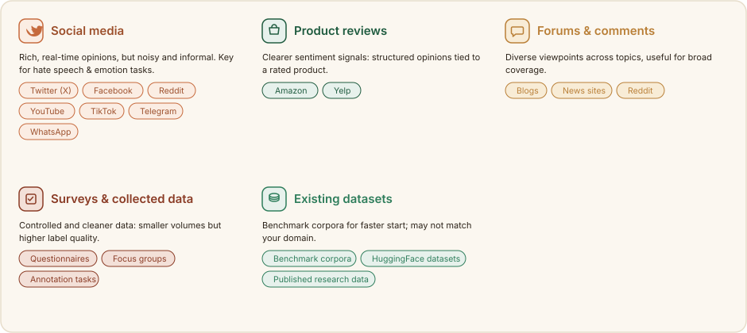
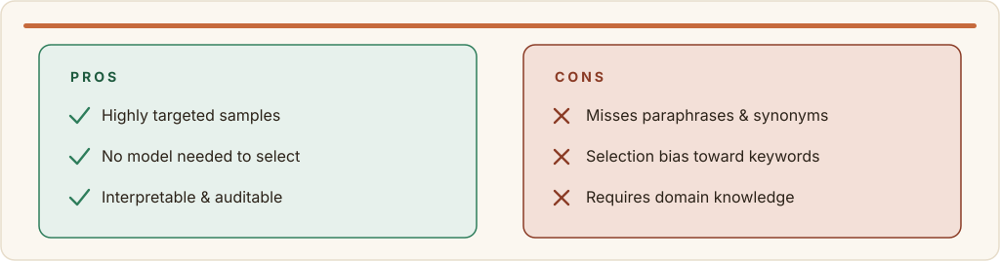
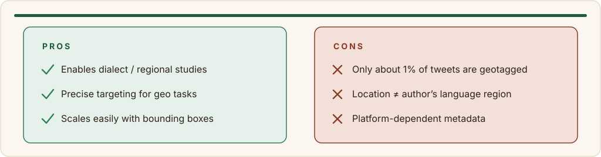
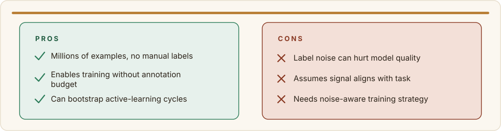
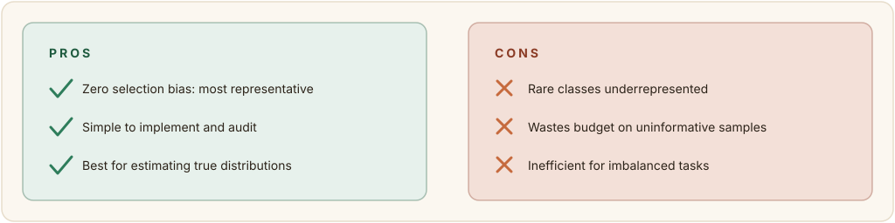
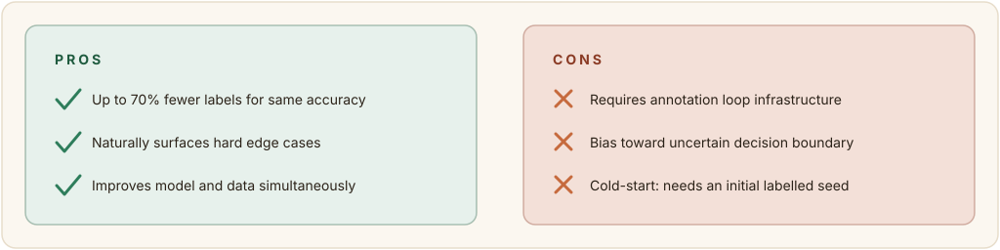
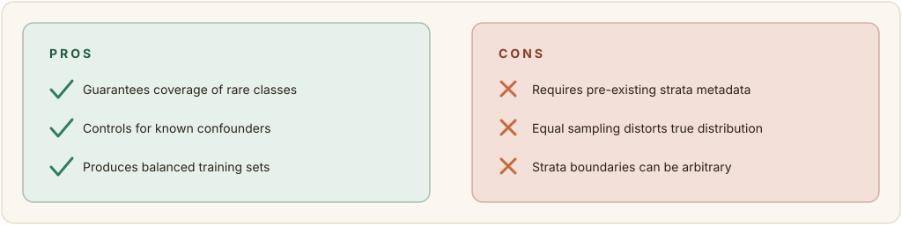
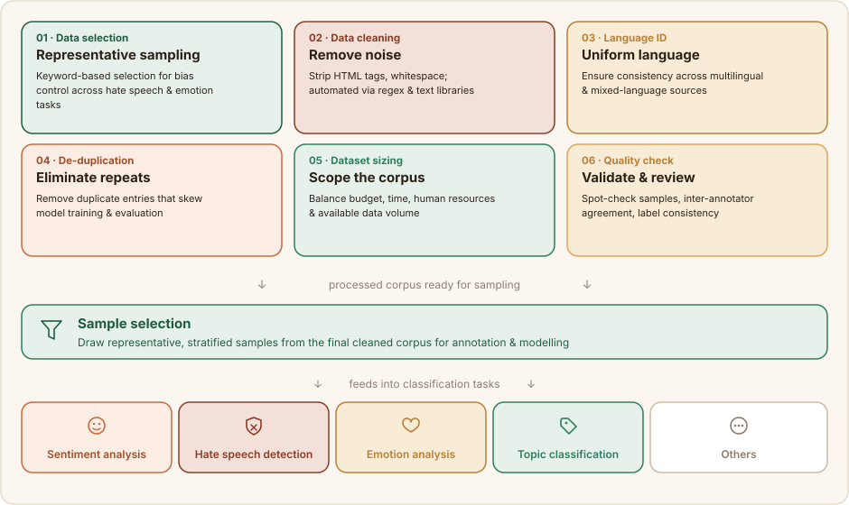

# Collecting & Preparing Data

This page walks through the data stages of a text-classification project end to end: choosing **where** the data comes from, **how** to select and sample it, how to **clean and standardise** it before annotation, and how to keep **quality** under control throughout.

:::tip[Key points]

- Choose sources that naturally contain the phenomenon you want to label, and record their metadata.
- Combine selection methods: keyword or location filters find rare cases, random samples keep the true distribution visible.
- Clean, identify the language and remove duplicates before annotation and before splitting the data.
- Keep the raw collection untouched and work on a processed copy.
- Check class balance and data quality as well as annotation quality.

:::

## Data sources

The best data source depends on the task, language, domain and cultural context. Choose sources that are relevant, ethical and representative of the people whose language you are studying:

| Source | Best suited to | Caveat |
|---|---|---|
| Social media (X, Facebook, Reddit, YouTube, TikTok, Telegram, WhatsApp) | Emotion and hate speech: spontaneous, real-time expression, disagreement and interaction | Noisy, informal language; platform terms of use apply |
| Product reviews | Sentiment: explicit evaluative language | Limited to products and services; may not transfer to other domains |
| Forums, blogs and news comment sections | Longer, context-rich texts with diverse viewpoints | A few very active users may write much of the content; check how many distinct authors you have |
| Surveys and controlled studies | Cleaner data from a specific target population | Smaller and more costly to collect |



:::tip[Tip]
When selecting a source, prefer data that naturally contains the phenomenon of interest. For example, if the goal is to study offensive speech, choose platforms where interpersonal conflict or public debate is common. If the goal is to study sentiment, choose sources where opinions, reviews, and evaluations are frequent.
:::

:::warning[Benchmark datasets]
Benchmark datasets are useful for comparison, but they may not reflect the target language variety, region, or social context. Always check whether the original data distribution matches your intended use case.
:::

## Collection & selection approaches

Data can be collected through APIs, web scraping (with permission), manual collection, or surveys, while preserving useful metadata such as source, time, language, and identifiers for future analysis. Data sources should be relevant to the target domain, language, and cultural context, with careful attention to dataset quality, class balance, and representativeness. Throughout the process, researchers must also address ethical and legal requirements, including privacy, consent, and compliance with platform policies. Data samples can be collected using one of the approaches below.

:::tip[Tip]
Data collection should be guided by the annotation objective and the expected label distribution. For example, if a dataset is likely to contain too few hateful texts, keyword-based filtering or distant supervision can be used to enrich the sample. If the goal is to estimate natural distribution, random sampling or stratified sampling is more appropriate.
:::

**Keyword/Dictionary-based Selection:** Select documents or sentences that contain one or more predefined keywords, phrases, or lexicon entries. For example, in hate speech detection, a list of commonly used hate-related or offensive terms in the target language can be compiled and used to identify potentially relevant texts. This method helps enrich the dataset with task-relevant examples while reducing the amount of irrelevant data. A widely used resource for English emotion-related keywords is the NRC Emotion Lexicon, built by crowdsourcing word-emotion associations ([Mohammad and Turney, 2013](../references.md#mohammad-turney-2013)). Keyword selection also biases the dataset towards explicit cases that contain those words, and classifier scores on popular abusive-language datasets dropped considerably once this bias was reduced ([Wiegand et al., 2019](../references.md#wiegand-2019)). One way to limit the bias is to mix in texts without keywords: an Amharic hate speech project drew 70% of each annotation batch from a keyword-matched pool and 30% from tweets without keywords ([Ayele et al., 2023](../references.md#ayele-2023)).

```python
# Keyword / dictionary-based selection (e.g. hate-speech terms or NRC emotion lexicon)
import re, pandas as pd

lexicon = {"insult1", "slur2", "offensive3"}   # build per target language
pattern = re.compile(r"\b(" + "|".join(map(re.escape, lexicon)) + r")\b", re.I)

df = pd.read_csv("corpus.csv")
df["matched"] = df["text"].str.contains(pattern)
selected = df[df["matched"]]
print(len(selected), "candidate texts enriched for the task")
```



**Location-based Selection:** Gather texts based on the geographic location associated with users or posts. For example, when collecting social media data from X (formerly Twitter), researchers can filter posts originating from specific locations such as Ethiopia, Nigeria, or Kenya. This method is useful for studying regional language variation, local opinions, cultural expressions, or location-specific events, as it helps ensure that the collected data represents the target geographic area. Only a small share of posts carry a location, though. Sloan and Morgan (2015) cite estimates that about 0.85% of tweets are geotagged, and found statistically significant demographic differences between users who share their location and those who do not ([Sloan and Morgan, 2015](../references.md#sloan-morgan-2015)). A location filter therefore returns a small and skewed sample, so combine it with other signals such as language or user profile location.

```python
# Location-based filtering of collected posts (place / bounding box)
TARGET = {"Ethiopia", "Nigeria", "Kenya"}

def in_region(post):
    place = (post.get("place") or {}).get("country")
    return place in TARGET

geo = [p for p in posts if in_region(p)]
print(len(geo), "geotagged posts (note: only a small share of posts are geotagged)")
```



**Distant supervision:** Create labelled training data automatically from existing knowledge sources instead of manual annotation. For example, for emotion classification, social media posts containing hashtags such as **#happy**, **#joy**, or **#sad** can be automatically labeled with the corresponding emotions. Mohammad (2012) built an emotion-labelled Twitter corpus this way from emotion-word hashtags and found that the hashtag labels were consistent with those of trained judges ([Mohammad, 2012](../references.md#mohammad-2012)). This approach enables the creation of large training datasets quickly and cheaply, although some automatically assigned labels may be incorrect or noisy.

```python
# Distant supervision: weak labels from emotion hashtags
HASHTAG_EMOTION = {"happy":"joy", "joy":"joy", "sad":"sadness", "angry":"anger"}

def weak_label(text):
    tags = re.findall(r"#(\w+)", text.lower())
    for t in tags:
        if t in HASHTAG_EMOTION:
            return HASHTAG_EMOTION[t]
    return None

df["weak"] = df["text"].apply(weak_label)
```



**Random Sampling**: Select items uniformly at random from the corpus with no targeting criteria. This is the baseline for any annotation project, ensuring an unbiased estimate of the true corpus-level label distribution.

```python
# Random baseline vs. stratified sampling that preserves class balance
from sklearn.model_selection import train_test_split

# Pure random (unbiased estimate of the true distribution)
rand = df.sample(n=2000, random_state=42)

# Stratified by a known column (guarantees rare classes appear);
# drop rows without a weak label first, because stratify cannot handle missing values
labelled = df.dropna(subset=["weak"])
strat, _ = train_test_split(labelled, train_size=2000,
                            stratify=labelled["weak"], random_state=42)
print(strat["weak"].value_counts(normalize=True))
```



**Active Learning Method**: Iteratively train a model on a small seed set, then use the model's uncertainty to select the most informative unlabelled examples for human annotation next. Uncertainty sampling, which picks the items the model is least sure about, is perhaps the simplest and most commonly used query strategy ([Settles, 2009](../references.md#settles-2009)). The aim is to spend the annotation budget where the model is confused. For when active learning helps, how to keep a random sample alongside it, and what to record about the model, see [Choose what to label next: active learning](../3_annotation-design/model-assisted-annotation.md#choose-what-to-label-next-active-learning).

```python
# Active learning: label where the model is least confident (uncertainty sampling)
import numpy as np

probs = model.predict_proba(unlabeled_X)        # shape (N, n_classes)
margin = np.sort(probs, axis=1)[:, -1] - np.sort(probs, axis=1)[:, -2]
to_label = np.argsort(margin)[:100]       # 100 most ambiguous items
print("Send these to annotators next:", to_label)
```



**Stratified Sampling**: Divide the corpus into strata (subgroups by class, source, time period, or demographic) and sample proportionally or equally from each. Ensures minority classes and subgroups are always represented in the annotation set.



### Choosing a selection method

| Method | Use when | Cost | Label noise | Bias risk |
|--------|----------|------|-------------|-----------|
| Keyword / lexicon | You need specific phenomena such as hate-related expressions or emotion words | Low | n/a | High (toward the keywords) |
| Location-based | The question involves dialect, region or location-specific discourse | Low | n/a | Medium |
| Distant supervision | You need large amounts of weakly labelled data and can tolerate some noise | Low | High | Medium |
| Random sampling | You want an unbiased estimate of class prevalence | Low | n/a | None |
| Stratified sampling | You want balance across classes, sources, time periods or groups | Medium | n/a | Low |
| Active learning | The budget is limited and model uncertainty can pick informative items | High setup | n/a | Toward the decision boundary |

The methods combine well: for example, a keyword-enriched pool mixed with a random sample.

:::tip[Tip]
Always store metadata such as source, timestamp, language, and collection method. This makes later analysis, error inspection, and dataset documentation much easier.
:::

## Processing & sampling

After collection, prepare the texts before annotation:

1. **Select** texts that reflect the diversity of the target population, to limit bias.
2. **Clean** obvious noise such as HTML tags, URLs, extra whitespace and non-text tokens.
3. **Identify the language** and filter out non-target languages, using identifiers built for African languages rather than general-purpose detectors; AfroLID covers 517 African languages and varieties ([Adebara et al., 2022](../references.md#afrolid-2022)).
4. **Remove exact and near duplicates** before splitting into training, development and test sets, to reduce wasted annotation and leakage across splits.
5. **Freeze the text** before annotation starts: if annotators will also mark spans, any later change shifts the stored offsets (see [Scripts, spans and offsets](../sequence-labelling/index.md#scripts-spans-and-offsets)).
6. **Size the dataset** to the research goal, budget, people available and timeline.

For the general cleaning steps, see [Data Cleaning and Preprocessing](../2_data-collection/7_data-cleaning-preprocessing.md#key-steps-in-data-cleaning). Keep the raw collection and work on a separate processed copy; never overwrite the original ([Formats, metadata, and versioning](../6_documentation/data-storage.md#formats-metadata-and-versioning)).



:::tip[Tip]
For hate speech and emotion tasks, keyword filtering can help find likely positive cases, but it should never replace careful annotation, because keywords often miss indirect, ironic, or context-dependent expressions.
:::

### Cleaning pipeline example

```python
import re, hashlib, html

def clean(text):
    text = html.unescape(text)
    text = re.sub(r"https?://\S+", " URL ", text)     # keep a placeholder, don't delete
    text = re.sub(r"@\w+", " @USER ", text)            # anonymise mentions
    text = re.sub(r"\s+", " ", text).strip()           # collapse whitespace
    return text                                       # NOTE: emojis intentionally kept

def dedup_key(text):
    return hashlib.md5(text.lower().encode()).hexdigest()

df["text"] = df["raw"].apply(clean)
df["key"] = df["text"].apply(dedup_key)
df = df.drop_duplicates(subset="key")   # exact duplicates; dedup BEFORE splitting
```

## Quality control

Annotation quality control (pilot, guideline revision, main annotation, gold checks, disagreement review, adjudication and release) is covered in [Annotation: Quality control](./annotation.md#quality-control). On the data side, check two things throughout:

- **Data cleaning:** remove duplicates, irrelevant content, spam and noisy text.
- **Class balance:** check that the label classes are not heavily skewed (for example, far more positive than negative texts), or account for the imbalance during modelling.

Track annotator behaviour over time as well, to catch inconsistency or fatigue early ([Close the feedback loop](../4_data-quality/index.md#close-the-feedback-loop)).

## Further reading

- Kreutzer et al. (2022) audit web-crawled multilingual corpora and find that at least 15 contain no usable text and a significant fraction have less than 50% acceptable sentences ([Kreutzer et al., 2022](../references.md#kreutzer-2022)).
- Gebru et al. (2021) give a questionnaire for documenting how a dataset was collected and processed ([Gebru et al., 2021](../references.md#gebru-2021)).
- Muhammad et al. (2023a) describe how AfriSenti collected and annotated tweets in 14 African languages ([Muhammad et al., 2023a](../references.md#muhammad-2023)).
