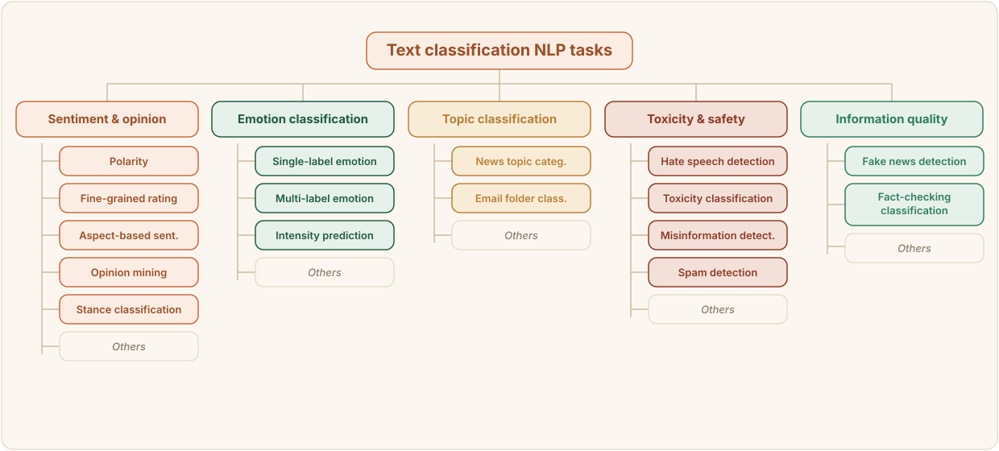

# Defining Text Classification Tasks

Text classification is a supervised NLP task in which a text is assigned one or more labels from a predefined label set. This chapter covers four common tasks: sentiment analysis, emotion analysis, hate speech analysis and intent classification. The tasks can overlap in practice, but each captures something different: sentiment captures polarity, emotion captures affective state, hate speech captures harmful or discriminatory language, and intent captures what a user wants a system to do.

:::tip[Key points]

- Text classification assigns one or more labels from a fixed label set to each text.
- This chapter covers sentiment, emotion, hate speech and intent; topic classification follows the same steps.
- Each task answers a different question, so define the annotation objective before collecting data.
- Do not reuse a dataset for another task without revisiting its label schema and guidelines.

:::

:::info[Scope note]
This chapter is designed for dataset creation and annotation. It does not cover downstream model training in detail, but the annotated outputs can later be used for classification, retrieval, moderation, or analytics pipelines.
:::

## Task distinction

Each task answers a different question. The details are on the task pages.

| Task | Question it answers |
|---|---|
| Sentiment analysis | Is the text positive, negative, neutral or mixed? |
| Emotion analysis | Which emotion or emotions are expressed? |
| Hate speech analysis | Does the text contain hateful, offensive or discriminatory language, and who is targeted? |
| Intent classification | What does the user want a system to do? |
| Topic classification | What is the main theme or domain of the text? |

Topic classification is not covered by its own page here, but the same data and annotation steps apply.

:::warning[Define tasks]
Define the annotation objective before collecting data. A dataset built for sentiment analysis should not be reused for hate speech or emotion analysis without revisiting the label schema and annotation guidelines.
:::
