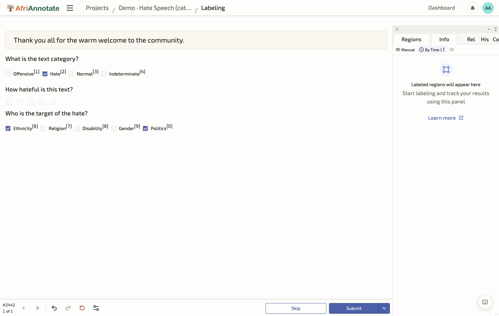

# Hate Speech Analysis

**What is Hate Speech Analysis?**

Hate speech detection is a task that focuses on identifying text that contains hate, offensive, abusive, or discriminatory language directed at individuals or groups based on attributes such as race, ethnicity, religion, gender, nationality, disability or other identity factors. The goal of this task is to automatically classify whether a piece of text expresses hate, hostility, or incitement to harm, often differentiate it from non-hateful content such as criticism, disagreement, or neutral statements. Hate speech detection is widely used in content moderation systems among various social media platforms to reduce online harassment and promote a safer digital communication ecosystem.

Researchers have used different label sets. AfriHate labels posts as hate, abusive or neutral, and marks posts written in another language as indeterminate before removing them ([Muhammad et al., 2025a](../references.md#afrihate-2025)). Amharic datasets by Ayele and colleagues used hate, offensive, normal and unsure ([Ayele et al., 2022](../references.md#ayele-2022); [Ayele et al., 2023](../references.md#ayele-2023)), and later hate, offensive, normal and indeterminate ([Ayele et al., 2024](../references.md#ayele-2024)). Davidson et al. used hate speech, offensive language and neither ([Davidson et al., 2017](../references.md#davidson-2017)). HateXplain uses hate, offensive and normal, and calls a post undecided when all three annotators chose a different class ([Mathew et al., 2021](../references.md#mathew-2021)). Label sets and sampling also carry bias: classifiers trained on five English Twitter datasets flagged tweets in African-American English as abusive more often than tweets in Standard American English ([Davidson et al., 2019](../references.md#davidson-2019)).

The definitions below follow those used in recent African-language datasets ([Ayele et al., 2024](../references.md#ayele-2024); [Muhammad et al., 2025a](../references.md#afrihate-2025)):

- **Offensive speech:** is any form of bad language expressions including rude, impolite, insulting, or belittling utterances intended to offend or harm an individual.
- **Hate speech:** is language content that expresses hatred towards a particular group or individual based on their group identities such as race, ethnicity, religion, gender, disability, political affiliation, or other characteristics. It also includes threats of violence associating group identities.
- **Normal:** is any form of expression that does not contain any bad language belonging to any of the above classifications.
- **Indeterminate:** is any tweet that is not readable or is completely written in a language other than your language of annotation.

Hate speech can have one or several targets. Ayele et al. (2024) and Muhammad et al. (2025a) annotate the target of hateful posts with categories such as ethnicity, politics, religion, gender, disability and other ([Ayele et al., 2024](../references.md#ayele-2024); [Muhammad et al., 2025a](../references.md#afrihate-2025)). The list below adapts these and adds a label for posts whose target is unclear:

- **Ethnic**: if the hatred tweet targets an ethnic group identity
- **Religion**: if the hatred tweet targets a religious group identity
- **Gender**: if the hatred tweet targets a particular gender group identity
- **Disability**: if the hatred tweet targets disabled group identity
- **Politics**: if the hatred tweet targets people/entities due to political ideology
- **Unidentified target**: if the hatred tweet’s target is not clearly identified/known.
- **Other**: if the hatred tweet targets other groups/group identities such as sexual orientation, racism etc.

Some studies also rate how severe a message is. Ayele et al. (2024) rated the offensiveness and hatefulness of each tweet on a 5-point Likert scale, from 1 (least) to 5 (most), and gave normal tweets a score of 0 ([Ayele et al., 2024](../references.md#ayele-2024)).

## Further reading

- Vidgen and Derczynski (2020) review 63 abusive-language training datasets and give practical guidance for building new ones ([Vidgen and Derczynski, 2020](../references.md#vidgen-2020)).
- Poletto et al. (2021) systematically review resources and benchmark corpora for hate speech detection ([Poletto et al., 2021](../references.md#poletto-2021)).
- Wiegand et al. (2019) show how keyword-focused sampling biases abusive-language datasets ([Wiegand et al., 2019](../references.md#wiegand-2019)).
- AfriHate covers hate speech and abusive language in 15 African languages ([Muhammad et al., 2025a](../references.md#afrihate-2025)).
