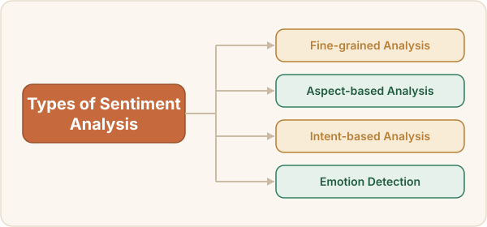

# Sentiment Analysis

Sentiment analysis in this playbook refers to labeling text according to the polarity of the expressed attitude toward a subject, product, event, or experience. The most common labels are positive, negative, neutral, and mixed. Depending on the project, sentiment may be annotated at the document level, sentence level, or aspect level.

A sentiment annotation guideline gives annotators clear instructions and worked examples so that they label the same kinds of text in the same way. This matters even for a task that looks as simple as choosing positive, negative or neutral: without precise instructions, annotators are unsure how to label sarcasm, rhetorical questions, quoted text or neutral reports of bad news, and their labels become inconsistent ([Mohammad, 2016](../references.md#mohammad-2016)). For instance, in a customer feedback project, the guideline helps the team agree on how to read ambiguous phrases. Because models learn from these labels, the quality of the guideline shows up directly in the quality of the models trained on the data.

### Types of sentiment analysis

Sentiment analysis can be annotated into one or more of the following annotation types.

**Fine-grained (Scaling) analysis:**
Graded sentiment analysis assigns scores on a scale, providing a more nuanced view of sentiment intensity. This approach helps gauge the strength of emotions expressed in the text. For example, a review might be labeled as “very positive,” “slightly positive,” “neutral,” “slightly negative,” or “very negative.” SemEval-2016 Task 4 added exactly this kind of five-point scale to tweet sentiment classification ([Nakov et al., 2016](../references.md#nakov-2016)). If you need reliable intensity scores rather than classes, comparative methods such as best-worst scaling have given more reliable sentiment-intensity scores than rating scales for the same number of annotations ([Kiritchenko and Mohammad, 2017](../references.md#kiritchenko-2017)).

**Aspect-based analysis:**
This focuses on identifying sentiment towards specific aspects or features of a product, service, or topic. For instance, in a hotel review, aspect-based analysis might determine positive sentiment towards the location but negative sentiment towards the cleanliness. For a smartphone review, it separately analyzes battery, screen, camera and performance to understand customer sentiment for each aspect. A widely used reference scheme is SemEval-2014 Task 4, where restaurant and laptop reviews were annotated with aspect terms and categories, each with a polarity of positive, negative, neutral or conflict (both positive and negative) ([Pontiki et al., 2014](../references.md#pontiki-2014)).

**Intent-based analysis**

Some guides also describe an intent-based type, which looks at the motive behind a text: whether the author is trying to express an opinion, make a recommendation, ask a question, or express a need. For example, a customer tweets, ‘I wish Company X’s product had a longer battery life.’ This indicates dissatisfaction and a desire for improvement (intent to recommend a feature change), which Company X can use to improve its products. In practice, intent is usually annotated as a separate task with its own label set; see [Intent Classification](./intent-classification).

### Sentiment analysis labels definition

While the types of sentiment targets can differ, the annotation labels can be two (positive and negative), three (positive, negative, and neutral), or all of the labels below. Three labels are the most common choice in benchmarks: the earlier SemEval Twitter sentiment tasks used positive, negative and neutral ([Nakov et al., 2016](../references.md#nakov-2016)), as did the AfriSenti datasets for 14 African languages, annotated by native speakers ([Muhammad et al., 2023a](../references.md#muhammad-2023)). A mixed label (called "conflict" in some schemes) is useful when a text, or one aspect of it, carries both positive and negative sentiment ([Pontiki et al., 2014](../references.md#pontiki-2014); [Mohammad, 2016](../references.md#mohammad-2016)).

- **Positive**: a message that conveys a clearly favorable attitude, such as satisfaction, approval, praise, or happiness toward a subject, product, or experience.
- **Negative**: a message that conveys a clearly unfavorable attitude, such as dissatisfaction, disapproval, criticism, or frustration toward a subject, product, or experience.
- **Mixed**: a message that includes both positive and negative sentiments, either about different aspects of the same subject or within the same statement.
- **Neutral**: a message that expresses no clear positive or negative sentiment, typically presenting factual, descriptive, or objective information without emotional judgment.

Examples of sentiment analysis are as follows:

| Label | Decision rule | Example |
|-------|---------------|---------|
| Positive | Overall attitude is favorable, even with minor complaints. | "I love this phone, best I've owned." |
| Negative | Overall attitude is unfavorable. | "This app keeps crashing, useless." |
| Mixed | Use only when both are clearly present and roughly balanced. | "Great camera but the battery dies fast." |
| Neutral | Default when no evaluative stance is expressed. | "The package arrived on Tuesday." |

The annotation interface should show the full text and context, constrain the choice to the project's labels, and provide a skip or uncertainty route. Test examples containing sarcasm, code-switching, negation and mixed sentiments before scaling. These are where annotators disagree most: in AfriSenti, sarcasm and code-mixing were reported as major sources of disagreement in several languages ([Muhammad et al., 2023a](../references.md#muhammad-2023)). Write a rule for each hard case in the guideline. One option is to give sarcasm and ridicule their own label, so annotators do not have to force them into positive or negative ([Mohammad, 2016](../references.md#mohammad-2016)).

## Further reading

- [Mohammad (2016)](../references.md#mohammad-2016): a short practical guide to the sentence types that are hard to label for sentiment, with two example questionnaires.
- [Pontiki et al. (2014)](../references.md#pontiki-2014): the SemEval-2014 aspect-based sentiment scheme, a starting point for aspect-level guidelines.
- [Kiritchenko and Mohammad (2017)](../references.md#kiritchenko-2017): why best-worst scaling can beat rating scales for sentiment intensity.
