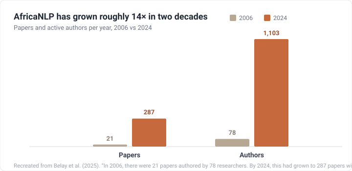

# How to Write a Chapter

[How to Contribute](./how-to-contribute.md) covers the mechanics of making a change: editing on the site, forking, and opening a pull request. This page covers the writing itself: how to structure a page, add sections and subsections, and use the coloured callout boxes (admonitions) that make a page easy to read.

You can write in one of **two formats**:

- **Markdown**: the native format of the playbook. What you type is what gets published. Markdown is not complicated: the basics are below, and the [Markdown Guide](https://www.markdownguide.org/getting-started/) is a good place to start. Choose this if you are comfortable editing text files or using the online editor.
- **Microsoft Word**: draft your chapter in a familiar editor, and a maintainer converts it to Markdown. Best for long chapters or for contributors who do not work with Markdown.

Both produce the same published page. The rules below are written so that a Word draft and a Markdown draft turn into identical output.

:::tip[The golden rule]
**One title, then sections.** Each page has exactly one title: a single `#` heading on the first line after the front matter (`# Speaker Diarization`). A `title:` field in the front matter is optional; if you add one, keep it identical to the `#` heading. Never type a chapter number; the sidebar shows the page's place in the playbook. Everything after the title is a section, starting at `##`. In Word, the title uses the **Title** style and sections start at **Heading 1**.
:::


---

## Writing in Markdown

### Sections and subsections

Headings build the structure of the page and the table of contents on the right. The page title is the only `#`; every section starts one level down:

```markdown
# Page Title            ← the title, once (same as `title:` if the front matter has one)

## A section            ← top-level section (shows in the right-hand menu)

### A subsection        ← nested under the section above

#### A sub-subsection   ← use sparingly; deep nesting is hard to read
```

Rules that keep pages clean:

- **Use a single `#` exactly once**, for the title. Don't number it (`# 3. Data Quality`); the sidebar shows the order, and numbers break when chapters move.

- **Don't skip levels.** A `##` is followed by `###`, not `####`.
- **Keep headings short.** They become menu entries; a full sentence breaks the layout.
- **One idea per section.** If a section runs past a screen or two, split it.

### Citing sources

Cite in the text with the author and year inside parentheses, linked to the work's entry on the [References](../references.md) page: `([Adelani et al., 2022a](../references.md#adelani-2022))`. Use the first author's surname, `et al.` for three or more authors, and a comma before the year. For two authors, name both and join them with "and" (`Fort and Sagot, 2010`). If the work is not yet on the References page, add an entry there in the same pull request.

### Admonitions: the coloured callout boxes

Admonitions are the boxed callouts (like the green "golden rule" box above) that pull a reader's eye to something important. Wrap text in `:::` fences:

```markdown
:::note
Neutral aside or extra context. Gray.
:::

:::tip
Best practice, or what worked on a real project. Green.
:::

:::info
Something the reader needs to know first: a prerequisite or definition. Blue.
:::

:::warning
A common mistake or gotcha. Yellow.
:::

:::danger
Something irreversible or unsafe: data loss, consent, security. Red.
:::
```

Give a box your own heading by putting it in square brackets:

```markdown
:::tip[Contribute]
You don't need to write a whole chapter to help.
:::
```

**Rules:**

- Leave a **blank line before and after** each `:::` fence and around the content inside.
- You can put normal Markdown inside: **bold**, links, lists, code.
- Use them sparingly: **at most one per section**, or the page reads like a warning label.

### When to use which box

| Box | Use it for |
|------|-----------|
| `tip` | Recommended practice, "what worked on a real project" |
| `note` | Side context, optional detail |
| `info` | Prerequisites, definitions, version notes |
| `warning` | Common mistakes, gotchas |
| `danger` | Data loss, irreversible steps, consent, security |

### The Key points box

Every chapter page opens with one **Key points** box, placed right after its introduction paragraph. It gives a reader on a phone the page's main takeaways before they scroll:

```markdown
:::tip[Key points]

- Three to five bullets, each one line.
- Each states one main takeaway of the page.

:::
```

Use only one per page. A chapter's landing page gets one when it gives guidance of its own. Templates, the glossary, the references, case studies, section overview pages and landing pages that only list a chapter's pages do not need one.

### Other things that make a page nicer

- **Code blocks**: always set the language (such as **python** or **bash**) so it gets highlighted, and add a title if helpful. This matters most in technical chapters, such as those on data cleaning or visualisation:

  ````markdown
  ```python title="train.py"
  print("hello")
  ```
  ````

- **Images**: put them in the chapter's **`images/`** folder and always write alt text describing the figure:

  ```markdown
  
  ```

- **Links**: link to other pages with a relative path so the build can check them: `[Core principles](./core-principles)`.
- **Collapsible detail**: hide long, optional content:

  ```markdown
  <details>
    <summary>Full configuration example</summary>

    ...content...

  </details>
  ```

- **Tables**: keep them narrow. Most contributors read on a phone, and wide tables break the layout.
- **No em-dashes**: don't use the long dash. Use a colon, a comma, parentheses or a new sentence instead.

---

## Writing in Microsoft Word

You can draft in **Word** and let a maintainer convert it. To make the conversion clean, use Word's **built-in styles** (the Heading 1 / Heading 2 buttons), not manual bold text or bigger fonts. The converter only understands real styles.

### Headings map one level down

The page title uses Word's **Title** style, so **Word's Heading 1 becomes a section, not the title.** Use this mapping:

| In Word, use… | Becomes in the playbook | Markdown equivalent |
|------|------|------|
| **Title** (once, at the top) | The page title | `# Title` |
| **Heading 1** | A top-level section | `##` |
| **Heading 2** | A subsection | `###` |
| **Heading 3** | A sub-subsection | `####` |
| Normal / Body text | A paragraph | plain text |
| Bulleted / Numbered list | A list | `-` / `1.` |

So: put the title once at the top in the **Title** style, without a chapter number, then start your first **Heading 1** section.

### Admonitions in Word

Word has no built-in admonition, so use the convention below. The simplest, most reliable way is to **type the `:::` fences as plain text**, each on its own line, in a normal (Body) paragraph, *not* styled as a heading:

```text
:::tip[Contribute]

You don't need to write a whole chapter to help.

:::
```

When the document is converted, those lines survive as-is and the playbook renders them as a real coloured box. Keep a blank paragraph before and after the fences, exactly as in Markdown.

### A few more Word tips

- **Images**: paste them inline where they belong, and write a one-line caption underneath each so it can become alt text.
- **Links**: use Word's real hyperlinks (Insert → Link), not bare pasted URLs, so they convert correctly.
- **Don't fake structure**: avoid manual numbering, hand-drawn boxes, or extra blank lines for spacing. Let styles do the work; the layout is applied for you on the site.

---

## Preview before you submit

Whichever format you write in, check how it looks before opening a pull request. The most accurate preview is the live site itself (see [How to Contribute](./how-to-contribute.md) for the one-time setup with Node.js 22 and Yarn):

```bash
yarn start       # opens a live preview at http://localhost:3000
```

The preview reloads as you edit, so admonitions, headings, and images appear exactly as they will once published. Read the page on a narrow window too, since most readers are on a phone.

For the full style rules, see [CONTRIBUTING.md](https://github.com/warakacommunity/playbook/blob/main/CONTRIBUTING.md).
