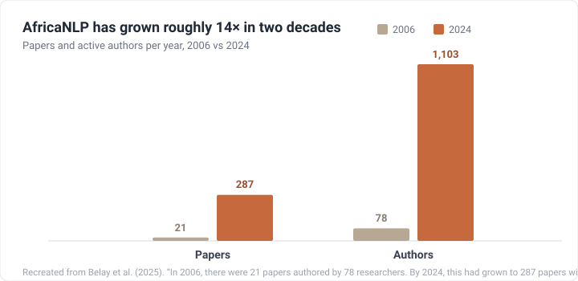
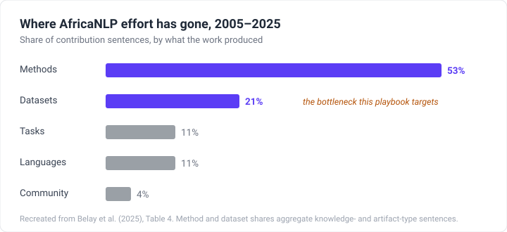

# Introduction

> The bullet was the means of the physical subjugation. Language was the means of the spiritual subjugation.
>
> Ngũgĩ wa Thiong'o, *Decolonising the Mind: The Politics of Language in African Literature* (1986)

Africa is home to almost a third of the world's living languages: about 2,140 of the roughly 7,160 spoken on Earth ([Ethnologue, 2024](../references.md#ethnologue-2024)). Most of them remain out of reach of the systems now reshaping how the rest of the world reads, writes, searches, translates and speaks. Even the best-supported, such as Swahili, Hausa and Amharic, lag far behind high-resource languages.

When a language model mangles Yorùbá, Chichewa or Wolof, the cause is usually not the model but the data. The text and speech these systems learn from barely exist in a usable form.

:::tip[Key points]

- Most African languages have almost no labelled data; even some with tens of millions of speakers have very little.
- Scraping the web will not fix this: what exists online is thin and often wrong.
- Good data has to be built with the people who speak the language.
- Research on African NLP is growing fast, but new datasets are not keeping up with new methods.
- This playbook collects what practitioners have learned so the next team can start sooner.

:::

The world's languages can be sorted into six tiers by how many resources they have ([Joshi et al., 2020](../references.md#joshi-2020)). The bottom tier, the *left-behinds*, has essentially no labelled data and little prospect of being served by current methods. It holds the overwhelming majority of languages, and African languages crowd into it.

Most African languages have no annotated corpus, no benchmark and no tools, even though some have tens of millions of speakers. What they lack is data, because almost no one has built it. The picture still holds, though the field now treats *low-resource* as multidimensional: a matter of tools, speakers, funding and institutional support as much as raw data, with no single agreed definition ([Ranathunga and de Silva, 2022](../references.md#ranathunga-desilva-2022); [Nigatu et al., 2024](../references.md#nigatu-2024)).


## Scraping will not fix this

When a language has no data, the instinct is to go and scrape more of it: crawl a wider slice of the web and trust that coverage will follow. For African languages, that instinct fails.

The web does not contain much African-language text, and what it contains is thin and noisy. An audit of the large multilingual crawls everyone trains on found that for many low-resource languages a large share of the data was mislabelled, machine-translated, or not language at all ([Kreutzer et al., 2022](../references.md#kreutzer-2022)). At the tail, quality collapses along with quantity.

### Build it with the people who speak it

The only sure way to get high-quality data for African languages is to build it with the people who speak them: the people who know the words, the grammar, the idioms and the culture.

One of the main obstacles in AfricaNLP is that the people who speak these languages are often not the ones building the data. Those who build it may not be able to tell what is correct, what is offensive or what is missing. They may not know what matters to the communities behind the language, or how to keep the data they collect from causing harm.

That gap has real consequences. Data built without its speakers can look clean while being quietly wrong, and any model trained on it inherits every mistake. Such errors spread into search results, translations and the everyday tools that millions of people are starting to depend on. Getting the data right decides whether a language is served well, served badly, or left out altogether.

This playbook is a practical, opinionated, step-by-step guide to fixing that problem. It draws on the direct experience of people who speak and understand these languages, and it is written for anyone who wants to build datasets for them, right and safely.

## The field is growing, the data is not keeping up

Over the past two decades, AfricaNLP has grown from a niche interest into an established field. Research output has grown more than tenfold, from about 20 papers a year in 2006 to nearly 300 in 2024 ([Belay et al., 2025](../references.md#belay-2025)).



But more papers have not meant more data. More than half of this work proposes new methods, while only about one in five contributions introduces a new dataset ([Belay et al., 2025](../references.md#belay-2025)). We are getting better at building models faster than we are building the data they learn from.



Methods and datasets are not made the same way. A method can often be reused across languages; a dataset has to be built for each one, from scratch, by people who speak it. That means recruiting annotators, writing guidelines, running quality control and securing consent. It is slow, unglamorous work, and it is rarely funded, least of all for African languages. This playbook exists to make that work easier.

## Why we wrote this playbook

Almost every guide to building datasets quietly assumes English, a generous budget, and a problem someone has already solved once. Little of that holds for African-language projects. Their real conditions are different:

- limited data, often none at all to start from;
- modest or scarce funding;
- volunteer or part-time teams;
- several languages and scripts at once;
- communities who should remain the owners of what they help create;
- decisions to make that the literature never covers.

The AfriPlaybook is the manual we wish we had had. Many of us learned to build datasets for African languages the hard way, through trial and error, with little written down and few people to ask. That is part of why datasets have lagged so far behind methods. This playbook collects what we learned so that the next team can start sooner, avoid the mistakes we made, and build data the world can trust and reuse.

The playbook will keep growing as the community shares what it learns. The more we pool our experience, the cheaper it becomes to build data, and the sooner datasets can catch up with methods.

## Built in the open

The playbook is open source, maintained by the Waraka community, Masakhane and AfricaNLP researchers, and written for everyone who builds datasets for African languages. It is only as good as the people who contribute to it. See [How to contribute](./how-to-contribute.md) for the ways to help and where to ask questions.

If you build datasets for African languages, or want to learn how, you are already part of who this is for. Come and build it with us.

---

## How to cite this playbook

If the AfriPlaybook informs your research, teaching, or project, please cite it.

**BibTeX:**

```bibtex
@misc{waraka2026playbook,
  author       = {{Waraka Community}},
  title        = {AfriPlaybook: A Practical Guide to Building High-Quality Datasets for African Languages},
  year         = {2026},
  publisher    = {Waraka Community},
  url          = {https://afriplaybook.waraka.org/},
  note         = {Open-source community resource}
}
```

**Plain text (APA-style):**

> Waraka Community. (2026). *AfriPlaybook: A Practical Guide to Building High-Quality Datasets for African Languages*. [https://afriplaybook.waraka.org/](https://afriplaybook.waraka.org/)

For other formats (MLA, Chicago, etc.) and a machine-readable [`CITATION.cff`](https://github.com/warakacommunity/playbook/blob/main/CITATION.cff), see the [/cite](/cite) page.

If you reference a specific chapter, please include the chapter title and its URL.
