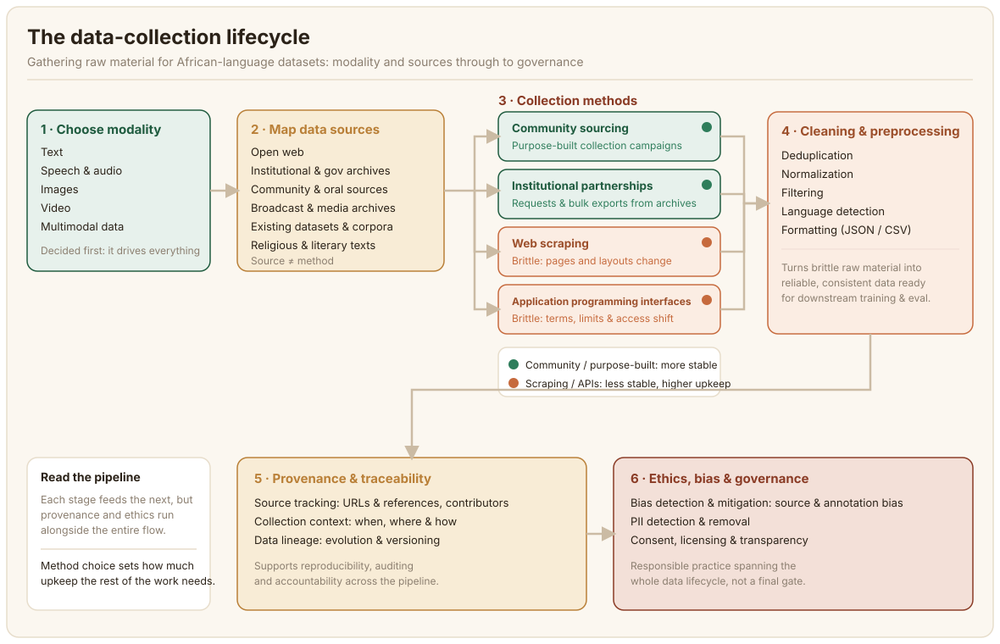

# Data Collection

Every dataset starts the same way: someone has to go and get the raw material. This chapter is about that first step, what the rest of the playbook calls **data collection** or **data curation**. We mean this narrowly: the actual gathering of raw text, images, audio, or video, before anyone has cleaned it, labelled it, or decided what it means. What happens after collection (cleaning, annotation, quality control, and release) is covered in the chapters that follow.

How you collect data depends almost entirely on its **modality**: the format the data takes, whether that's text, images, audio, or video. Each modality has its own sources, its own tools, and its own failure modes, and a method that works well for one (scraping news sites for text) can be close to useless for another (there is no equivalent "scrape the web" shortcut for spoken-language audio in a language with no written tradition).

The pages in this chapter work through the building blocks in order:

| Page | What it answers |
|---|---|
| [Data Modalities](./1_data-modalities.md) | What kind of data (text, speech, images, video) does the task need? |
| [Data Sources](./2_data-sources.md) | Where can that data come from, and how do you compare sources? |
| [Web Scraping](./3_web-scraping.md) and [APIs](./4_application-programming-interfaces.md) | How do the two most common collection methods work, and where do they fall short? |
| [Case Study: Multimodal Data Collection](./5_case-study-multimodal-data-collection.md) | How do these decisions interact when a project spans more than one modality? |
| [Cost and Resource Planning](./6_cost-resource-planning.md) | What does collection cost in time, money and people? |
| [Data Cleaning and Preprocessing](./7_data-cleaning-preprocessing.md) | How do you turn raw data into something usable? |
| [Data Provenance and Traceability](./8_data-provenance-traceability.md) | How do you record where every item came from? |
| [Ethics, Bias, and Governance](./9_ethics-bias-governance.md) | How do you govern the data responsibly? |
| [Offline Field Operations](./10_offline-field-operations.md) | How do you collect and label data where the network comes and goes? |

