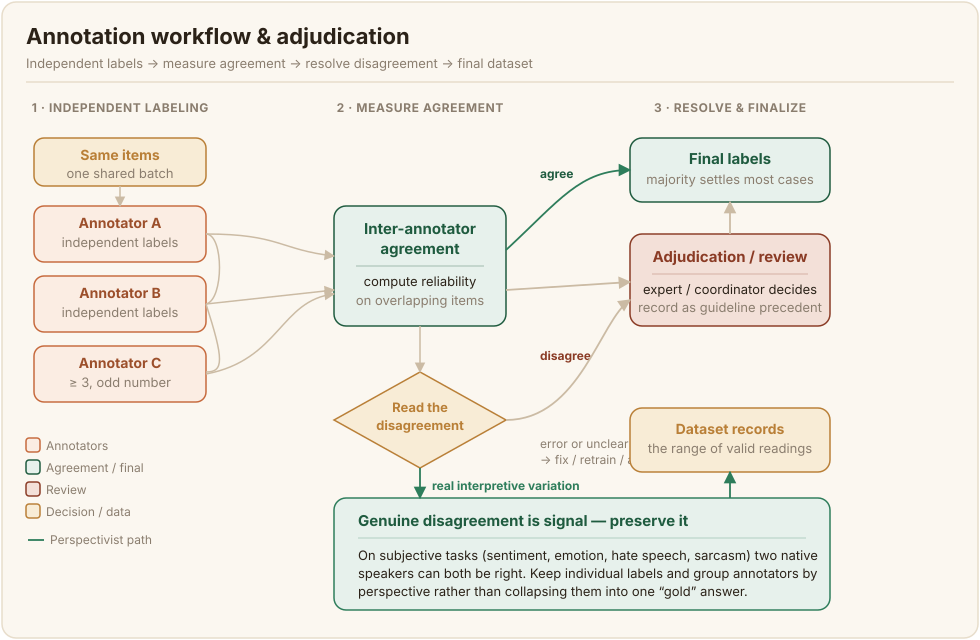

# Workflow and Adjudication

Once the task is designed and annotators are trained, the workflow decides how labels are produced, checked, and finalised. The central questions are how many people label each item, how work is assigned, and what happens when they disagree.

:::tip[Key points]

- Plan how items overlap between annotators: a random overlapped sample is often enough to measure reliability.
- Route items with low agreement to one more annotator or to adjudication, and cap how many extra annotators an item can get.
- Review submitted work, not only disagreements: accept, correct, or reject with a written reason.
- Let annotators contest a rejection once, and log every verdict and appeal.
- Read disagreement before you remove it: on subjective tasks it can be real variation, not error.

:::

## Use multiple annotators per item

A single annotator's label is a single opinion. You cannot tell a confident correct call from a confident mistake. Independent labels on shared items let you measure reliability and resolve errors.

Full redundancy, with several annotators on every item, is one design choice rather than a universal requirement. The MasakhaNER 2.0 named-entity datasets used three native speakers per language, supervised by a language coordinator who helped resolve their disagreements. All annotators and coordinators were paid ([Adelani et al., 2022a](../references.md#adelani-2022)).

| Your goal | Suitable design |
| --- | --- |
| Every item needs a majority or adjudicated label | Full redundancy |
| Monitor reliability on a limited budget | [Sampled overlap](#overlap-a-sample-not-everything) |

Choose by risk, budget and the aggregation you need, and report which design you used.

## Assign work with deliberate redundancy

Decide on purpose how items overlap between annotators. Some overlap is essential: the items that more than one person labels are what let you compute agreement and spot annotators who have drifted.

Mix a small set of trusted, pre-labelled "gold" items into the stream, without flagging them. They give a continuous read on whether each annotator is still applying the guideline correctly (see [Use gold data and control checks](../4_data-quality/index.md#use-gold-data-and-control-checks)).

Plan the assignment so that:

- every item receives its required number of independent labels; and
- no annotator reviews their own work, since self-review hides the very errors review exists to catch.

### Match annotators to language and variety

Send each item only to annotators who speak its language and relevant variety. Otherwise an apparent disagreement may compare people interpreting different linguistic forms. Record the annotator's language and variety with each label, using one fixed list of language and variety codes defined for the project, so agreement can be calculated within a variety and differences between varieties remain visible. If you deliberately mix varieties to study variation, document that design and report the groups separately rather than treating their labels as interchangeable.

### Overlap a sample, not everything

Full overlap on every item is rarely affordable, and it is not needed to measure reliability. A common alternative is to give a random share of items, for example 10 to 30 percent, to several annotators, and to label the rest once.

- The overlapped share gives you the agreement figures and the per-annotator drift signal.
- The single-labelled majority gives you volume.

Draw the overlapped share at random rather than picking it, so that it represents the whole dataset. The playbook's chapters use the same idea at different rates:

| Chapter | Overlap |
| --- | --- |
| [Speech transcription (ASR)](../asr/index.md#quality-assurance-during-collection) | 5 to 10 percent second pass |
| [Sign-language glossing](../sign-language-video/sign-language.md#checking-quality) | 10 to 20 percent |
| [Expert crop-disease labels (agri-advisory case study)](../agri-advisory/diagnosis-labelling.md#who-does-it-and-how) | rolling 30 percent |

Overlap multiplies work, so put the numbers in the budget before you choose. For a dataset of 10,000 items:

| Design | Labels needed | Relative cost |
| --- | --- | --- |
| One annotator per item | 10,000 | 1.0× |
| Three annotators on a 20% sample, one on the rest | 8,000 + 6,000 = 14,000 | 1.4× |
| Three annotators on every item | 30,000 | 3.0× |

Escalation adds more labels for contested items. See [Budget and fund the work](../project-management/index.md#4-budget-and-fund-the-work) for how these figures feed the project budget.

### Escalate items that do not agree

When an item has received all its planned labels, compute how far its annotators agree on that item, for example the share who chose the most common label, or the share of annotator pairs that gave the same label. Use this per-item score only to route work. It is not a substitute for the corpus-level coefficients you report, which the [Data Quality](../4_data-quality/index.md#measure-inter-annotator-agreement) chapter covers. When an item falls below the threshold you set, take one of two routes:

- **Add one more independent annotator.** This suits tasks where a majority vote is the resolution rule. Set a cap on how many extra annotators an item can receive, so that a few truly contested items cannot absorb unlimited labour. An item that still does not settle at the cap goes to adjudication.
- **Send it straight to adjudication.** This suits expert tasks, where another non-expert vote adds little, and tasks where a single wrong label is costly.

Chance-corrected coefficients such as kappa, Krippendorff's alpha and Gwet's AC1 estimate expected agreement from how labels are distributed across many items, so they describe a set of items and have no meaningful value for a single one ([Artstein and Poesio, 2008](../references.md#artstein-2008)). Do not average per-item agreement and present the result as kappa. When one label dominates, read kappa together with raw agreement, per-class agreement and the number of items, as the Data Quality chapter explains for the [prevalence paradox](../4_data-quality/index.md#measure-inter-annotator-agreement).

On subjective tasks, low agreement on an item may be real variation between valid readings rather than error. Before you escalate it away, read the section on [resolving disagreement](#resolve-disagreement-but-read-it-first) below.

### Serve items so the counts stay honest

Whether you hand out work by hand, from a shared spreadsheet or through annotation software, a few rules keep the overlap you planned from drifting. If software assigns the work, check that it follows them.

- Stop serving an item once it has its target number of independent labels. Extra labels cost money, and they give some items more weight than others in the agreement figures.
- Reserve an item for one annotator while they are working on it, so two people do not fill the last slot at the same time.
- Do not give the same item twice to the same annotator as an independent label. If you deliberately repeat an item to measure self-consistency, tag that repeat and exclude it from independent-label counts, targets and inter-annotator agreement.
- Do not count a skip towards the target. A skipped item still needs its labels from someone else.
- Accept work that was validly assigned before the item filled up, even if it arrives late from someone working offline. See [Work that arrives late](../2_data-collection/10_offline-field-operations.md#work-that-arrives-late).
- Let adjudicators work on an item that already has its full set of labels, including any escalation. An adjudication decision is not one more vote, so a full item must not block it.

### Cap each annotator's share

Volunteer and crowd projects tend to rely on a few very productive people. That creates a quiet bias: models trained on such data can learn the habits of the most productive annotators and then do worse on text from people who were not in the training set ([Geva et al., 2019](../references.md#geva-2019)). Their study looked at datasets where workers wrote the text themselves, but the same caution applies whenever one person's choices make up a large part of a dataset.

To limit this bias:

- Set a maximum share of the dataset that any one annotator may contribute, and stop giving them new items once they reach it.
- Combine the cap with [recruiting a diverse pool](./inclusive-bias-aware.md#recruit-for-diversity-deliberately), since a cap only helps if there are other people to take up the work.
- Report the distribution of items per annotator in the [dataset card](../templates/dataset-card.md#4-preprocessing-cleaning-labeling).
- Where you can, keep the annotators of your test set apart from those of your training set, which is the study's own recommendation.

## Track skips and unfinished items

Before launch, decide whether a skipped item goes to another annotator, returns later, or is retired. Retiring every difficult or distressing item biases the dataset towards easy cases, so report that choice rather than hiding it. Record a short reason such as `unclear`, `wrong_language`, `distressing` or `cannot_judge`, and keep "nothing to label here" as a substantive answer, not a skip. Route repeatedly skipped items to the guideline owner or adjudicator.

Track each item as not started, partly labelled, at target, skipped, or stale (assigned but not returned within the time you allow). As with skips, an empty submission does not fill the required label count unless "nothing to label" is an explicit answer. Add skip counts and reasons to your [regular progress review](../project-management/index.md#6-coordinate-and-track), and publish the shares skipped and excluded in the [dataset card](../templates/dataset-card.md#4-preprocessing-cleaning-labeling). Skipping remains a [wellbeing right](annotation-task-design.md#protect-annotators-from-harmful-content): reason codes describe the item, and nobody has to explain a personal reason.

## Review submitted work

Agreement statistics tell you how reliable the dataset is overall. Review decides whether each piece of work that enters review is fit to keep. Review the submission itself, not only the items where annotators disagreed, because in a sampled design most items are labelled only once, and because a guideline rule that the whole team misread produces consistent, wrong work that no agreement check will flag.

A reviewer who is not the annotator gives each submission one of three verdicts:

- **Accept.** The work is correct and stands as submitted.
- **Correct, then accept.** The work is mostly right, and the reviewer fixes the remaining errors. Keep an unchanged copy of the annotator's original next to the corrected version. Record who annotated, who corrected, and when. Show the annotator the difference between their version and the corrected one, so they can learn from it. Attribution for the original work stays with the annotator, with the correction recorded separately.
- **Reject.** The work cannot be used as it is. Every rejection carries a written reason that the annotator can see. The item goes back to the same annotator to revise, because they are the one who needs the feedback.

Review an item only after it has all its planned independent labels. A reviewer who sees an item half-way through cannot judge agreement, and an early verdict can leak into the labels that are still to come.

Once an item is accepted, lock it. Any later edit, by anyone, creates a new version of the item that goes back through review, rather than silently replacing the accepted one. This is what lets you say, at release, exactly which reviewed version of each item is in the dataset.

Send annotators their verdicts promptly and in batches, for example at the end of each review session, rather than one message per item or a single report at the end of the project. Feedback that arrives weeks later cannot change how someone labels the next batch.

The same review pattern appears across the playbook:

- **Staged review.** The [agri-advisory case study](../agri-advisory/quality-consent-release.md#three-stage-qa) applies it in three stages: expert review, linguistic review, then adjudication by the language lead.
- **Free text.** Writing and generation tasks need the same verdicts, applied to free text ([Open-ended generation](../text-generation/generation.md#quality-assurance)).
- **Model drafts.** Drafts produced by a language model need them too. The main risk is a reviewer who accepts whatever is already on the screen ([LLM-Assisted Data](../7_llm-assisted-task/index.md#reviewing-drafts-without-rubber-stamping); for drafts from any model, see [Model-Assisted Annotation](./model-assisted-annotation.md#treat-drafts-as-drafts)).
- **Comparing or rating outputs.** These judgements need their own controls, such as random order and hidden sources: see [Human Evaluation Designs](./human-evaluation-designs.md#controls-for-every-design).

### Decide what gets reviewed: a sample plus escalations

Reviewer time is the scarcest resource in most projects, so plan review as a budget. Keep three rates separate. They answer different questions and need not have the same value.

| Rate | What it measures |
| --- | --- |
| Independent-label overlap rate | Share of items assigned to multiple annotators |
| Submission-review rate | Share of submitted work a reviewer checks |
| Expert-check rate | Share checked by a domain expert |

Two streams of work enter submission review:

1. **A random sample of ordinary work.** Choose the share by risk: for example 20 percent for a routine classification task, and 100 percent for sensitive data, safety-critical labels, or a new annotator's first batches. Decide for each item whether it is in the sample using a fixed rule that depends only on that item, for example a hash of the item ID combined with a fixed seed, kept when the result falls below the sampling rate. Items already in the sample stay in it as new items arrive, anyone can rerun the rule later to audit it, and you can describe it exactly in the dataset card.
2. **Every flagged item, reviewed first.** Flags come from many places: low agreement on an item, a single annotator who disagrees with everyone else, a failed [gold item](../4_data-quality/index.md#use-gold-data-and-control-checks), an automated quality check, a report from another contributor, or a manual flag from an annotator who marked the item as unclear. Flagged items are always reviewed, whether or not they fall in the sample. When the same item is flagged for several reasons, merge the flags into one review task that lists all the reasons. Automated checks filter work for attention; people judge contestable or negative calls. Bulk acceptance must leave flagged items untouched and report how many it skipped. See [Machines filter, humans judge](../4_data-quality/index.md#machines-filter-humans-judge).

Reviewing only the items where annotators disagree saves a great deal of time, but it misses errors that everyone made together, such as a guideline rule that the whole team misread. If you use a "disagreements only" approach, pair it with a small random sample of unanimous items. Within the ordinary sample, you can optionally review the items with the lowest agreement, or the lowest model confidence if you use [model-assisted annotation](./model-assisted-annotation.md), first.

Record the sampling rate, the sampling rule and its seed, and the flag rules in the project documentation and in the [dataset card](../templates/dataset-card.md#4-preprocessing-cleaning-labeling). A reader needs to know whether "reviewed" means every item or one in five. Review is one part of quality control; hand audits of the finished data are covered in [Audit and spot-check by hand](../4_data-quality/index.md#audit-and-spot-check-by-hand).

### Give reviewers a written rubric

Reviewers disagree with each other just as annotators do. A short written rubric keeps their verdicts consistent. Version it together with the annotation guideline, and record which rubric version each verdict used. The rubric should say:

- when to accept, when to correct, and when to reject, with a worked example of each;
- what a rejection comment must contain: what is wrong, which guideline rule it breaks, and what a correct answer would look like;
- how to treat items where the annotator's choice is defensible but not the one the reviewer would have made. On subjective tasks, a reading the reviewer disagrees with is not automatically an error, and it should not be rejected as one.

Track correction and rejection rates per annotator and per label:

- **A high rate for one annotator** calls for feedback or retraining. Treat the rejection rate as its own signal, separate from gold accuracy, and act on it through the staged process in [Act on annotator signals fairly](../4_data-quality/index.md#act-on-annotator-signals-fairly).
- **A high rate for one label**, across many annotators, usually means the guideline is unclear at that point.

Collect the recurring reasons from rejection comments and feed them back into the guideline as corner cases. The [annotation guidelines template](../templates/annotation-guidelines.md#8-adjudication) has fields for the rubric and the verdicts.

### Let annotators contest a rejection

Reviewers make mistakes too. An annotator who believes a verdict is wrong, rather than their work, should be able to ask for one re-review of that verdict, with a written reason. The item goes back to review with the annotator's reason shown first. Where staffing allows, give it to a different reviewer from the one who rejected it, so the second look is a fresh one. The reviewer accepts, corrects, or upholds the rejection, and the annotator is always told the outcome, including when the rejection stands.

Keep the rules simple and state them in the [annotator contract](../templates/annotator-contract.md):

- One re-review per verdict. An upheld rejection is final, so the exchange cannot go back and forth.
- An overturned rejection replaces the earlier verdict and restores the item to the normal accepted-work workflow.
- Every appeal, its reason and its outcome are logged. A cluster of successful appeals on one label or one reviewer is a signal to revisit the guideline or the rubric.

Give annotators a plain rule of thumb: if the reviewer's comment is fair, revise the work; appeal only when the verdict itself is wrong. A rejection without a reason or a route to contest it is unfair to the annotator. It also throws away the disagreement that would have shown you where the guideline needs work.

## Resolve disagreement, but read it first

When annotators disagree, the usual resolution is a majority vote, with an expert or the language coordinator adjudicating the cases a vote cannot settle. Record those adjudication decisions, because they become precedent for the guideline and material for training the next round of annotators.

With only two annotators, a vote cannot settle a disagreement. Either adjudicate it, or keep only the items both agree on. If you keep only agreed items, report how many you dropped, because the hardest items leave the dataset.

Before treating disagreement as something to erase, though, read what it is telling you. Not all disagreement is error ([Plank, 2022](../references.md#plank-2022)). It can come from:

- an ambiguous item;
- a gap in the guideline;
- a genuine mistake; or
- legitimate differences in how people interpret subjective and culturally loaded content.

That distinction matters a great deal for African data, where many of the most valuable tasks are subjective by nature. Sentiment, emotion, hate speech, and sarcasm all depend on dialect, region, and cultural context, and two native speakers from different communities can both be right.

| Where the disagreement comes from | What to do |
| --- | --- |
| An unclear guideline or a genuine error | Fix the guideline or retrain |
| Real interpretive variation | Consider keeping each annotator's label rather than collapsing them into one "gold" answer |

Keeping the individual labels lets the dataset record the range of valid readings instead of flattening minority perspectives out of existence. Recent African work goes further than simply keeping the labels. Grouping annotators by how they agree, rather than reducing them to a majority vote, models these perspectives directly and improves performance on subjective tasks like sentiment, emotion, and hate speech across many languages ([Belay et al., 2026](../references.md#belay-2026)). A label that hides genuine disagreement is less honest than one that shows it.

Disagreement can also come from the scoring itself:

- Exact match gives no credit to two spans that differ by one token.
- Matching only the deepest label in a deep taxonomy counts a shared parent category as a full disagreement.
- A strict similarity threshold on free text can mark close paraphrases as conflicts.

Before you send a batch of low-agreement items to adjudication, look at a few of them. If the annotators made the same judgement and only the metric separates them, switch to a partial-credit metric, score at a coarser level of the taxonomy, or loosen the threshold. Record the change and the reason in the [dataset card](../templates/dataset-card.md#4-preprocessing-cleaning-labeling), then recompute agreement for the whole batch. Change the metric because it misdescribes what annotators did, never only to raise the number.
