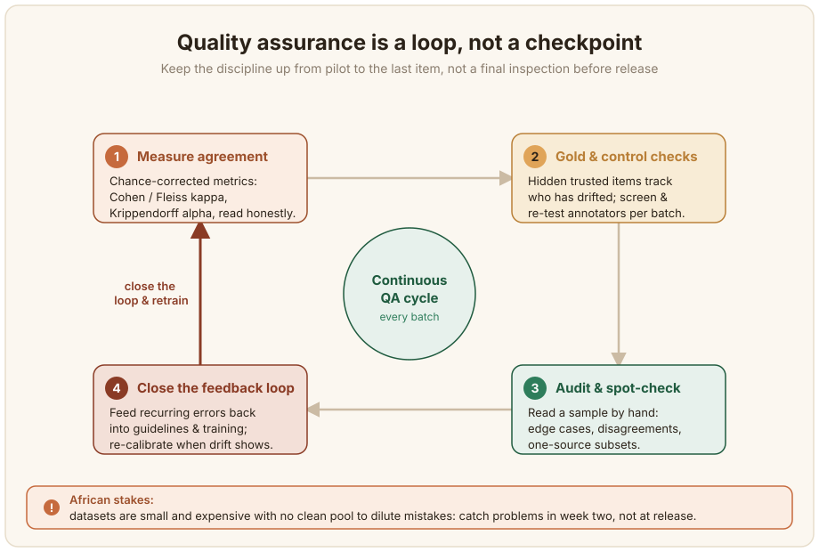

# Data Quality Assurance

Quality is not a final inspection you run before release. It is a discipline you keep up from the pilot to the last item. For low-resource African data the stakes are higher than usual, because every example is expensive to produce and there is no vast pool of clean data to dilute mistakes. When a large web crawl was audited, a striking share of the low-resource text turned out to be mislabelled, machine-translated, or not the target language at all ([Kreutzer et al., 2022](../references.md#kreutzer-2022)). A small, carefully assured dataset is worth far more than a large one nobody checked. This page covers the assurance side: measuring agreement, using gold data, auditing by hand, and closing the loop.



## Measure inter-annotator agreement

When several people label the same items, agreement tells you whether the labels are reliable or just one person's opinion repeated. Raw percentage agreement is easy to read but misleading, because some agreement happens by chance, so use a chance-corrected measure: [Cohen's kappa](https://scikit-learn.org/stable/modules/generated/sklearn.metrics.cohen_kappa_score.html) for two annotators, [Fleiss' kappa](https://www.statsmodels.org/stable/generated/statsmodels.stats.inter_rater.fleiss_kappa.html) for three or more, and [Krippendorff's alpha](https://pypi.org/project/krippendorff/) when annotations are missing or the labels are ordinal. Production-grade work often targets an alpha above 0.8, though the right threshold depends on how subjective the task is. African datasets show the full range in practice. MasakhaNER reached high agreement by training annotators in workshops where they discussed disagreements ([Adelani et al., 2022a](../references.md#adelani-2022)), AfriSenti held sentiment agreement above 0.70 ([Muhammad et al., 2023](../references.md#muhammad-2023)), the Thiomi multimodal corpus kept Fleiss' kappa above 0.82 ([Thiomi Dataset, 2026](../references.md#thiomi-2026)), and AfriHate reported Randolph's kappa between 0.46 and 0.81 across its hate-speech datasets ([Muhammad et al., 2025](../references.md#afrihate-2025)). Lower numbers are not automatically a failure: on genuinely subjective tasks they can reflect real interpretive variation rather than sloppiness ([Plank, 2022](../references.md#plank-2022)). The worked formulas and code live in the task chapters; here the point is to choose the right metric and read it honestly.

Once you have chosen the metric, computing it on an exported annotation file is short. Tools using the Label Studio configuration format export annotations as JSON, so a task carries the labels every annotator gave it. The script below builds the annotator-by-item matrix from that export and reports the right statistic for the number of annotators, using established libraries rather than a hand-rolled formula.

```python
import json
from collections import defaultdict

from itertools import combinations

import krippendorff                       # pip install krippendorff
import numpy as np                        # pip install numpy
from sklearn.metrics import cohen_kappa_score   # pip install scikit-learn


def load_labels(export_path: str, from_name: str = "sentiment") -> dict:
    """Return {task_id: {annotator: label}} for independent human labels.

    This example assumes the export marks gold with `ground_truth`, cancelled
    annotations with `was_cancelled`, and skips with `was_skipped` or an empty
    result. Adapt these field names to your export and document the mapping.
    Model drafts belong in `predictions`, which this loader never reads.
    """
    by_task = defaultdict(dict)
    with open(export_path, encoding="utf-8") as f:
        tasks = json.load(f)
    for task in tasks:
        for ann in task.get("annotations", []):
            if (ann.get("ground_truth") or ann.get("was_cancelled")
                    or ann.get("was_skipped") or not ann.get("result")):
                continue
            who = ann.get("completed_by")
            if who is None:
                raise ValueError(f"Task {task['id']} has an annotation without an annotator")
            for result in ann.get("result", []):
                if result.get("from_name") != from_name:
                    continue
                choices = result.get("value", {}).get("choices", [])
                if not choices:       # no answer for this field: not a label
                    continue
                by_task[task["id"]][who] = choices[0]  # single-choice task
    return by_task


def agreement(by_task: dict) -> None:
    """Score each annotator pair on its own shared items, then use alpha
    for the full, possibly incomplete annotator-by-item matrix."""
    annotators = sorted({a for labels in by_task.values() for a in labels})
    if len(annotators) < 2:
        print("Agreement needs at least two annotators.")
        return

    for a, b in combinations(annotators, 2):
        shared = [t for t, labels in by_task.items() if a in labels and b in labels]
        if not shared:
            print(f"{a} vs {b}: no shared items")
            continue
        y1 = [by_task[t][a] for t in shared]
        y2 = [by_task[t][b] for t in shared]
        if len(set(y1 + y2)) < 2:
            print(f"{a} vs {b}: {len(shared)} shared items; kappa undefined "
                  "because only one label was used")
            continue
        kappa = cohen_kappa_score(y1, y2)
        print(f"{a} vs {b}: Cohen's kappa {kappa:.3f} on {len(shared)} shared items")

    # Encode labels numerically so np.nan can mark missing assignments.
    # Alpha uses the incomplete matrix; it does not discard those items.
    labels = sorted({label for values in by_task.values()
                     for label in values.values()})
    label_ids = {label: i for i, label in enumerate(labels)}
    matrix = np.array([
        [label_ids[by_task[t][a]] if a in by_task[t] else np.nan
         for t in by_task]
        for a in annotators
    ], dtype=float)
    try:
        alpha = krippendorff.alpha(reliability_data=matrix,
                                   level_of_measurement="nominal")
        if np.isnan(alpha):
            print("Krippendorff's alpha is undefined for these labels.")
        else:
            print(f"Krippendorff's alpha: {alpha:.3f}")
    except (AssertionError, ValueError) as error:
        print(f"Krippendorff's alpha is undefined for these labels: {error}")


if __name__ == "__main__":
    agreement(load_labels("annotations_export.json"))
```

Each pairwise figure uses only the items that pair actually shared; it never drops items merely because a third annotator missed them. Report the shared-item count beside every coefficient. Krippendorff's alpha uses the incomplete multi-rater matrix directly. If you report Fleiss' kappa instead, first define a fixed-rater complete subset explicitly and report its size; do not silently turn a sampled-overlap design into a complete-case subset. Empty inputs, pairs with no shared items, and degenerate one-label inputs need an explicit "undefined" result rather than a misleading number.

Before you trust any agreement code on project data, run it on a textbook example whose answer is published, and pin the library versions you used. Implementations differ in small ways that change the number: whether the chance term uses each annotator's own label distribution (Cohen) or one pooled distribution (Scott, Fleiss), and whether it counts every category the scheme offers or only the ones observed ([Artstein and Poesio, 2008](../references.md#artstein-2008)). The two checks below use the worked examples from the Wikipedia articles on [Cohen's kappa](https://en.wikipedia.org/wiki/Cohen%27s_kappa) (50 items: 20 yes-yes, 5 yes-no, 10 no-yes, 15 no-no, giving observed agreement 0.70, chance agreement 0.50 and kappa 0.40) and [Fleiss' kappa](https://en.wikipedia.org/wiki/Fleiss%27_kappa) (10 subjects, 14 raters each, 5 categories, giving kappa 0.210). Keep them as a test next to your script and rerun them after every library upgrade.

```python
import numpy as np
from sklearn.metrics import cohen_kappa_score            # pip install scikit-learn
from statsmodels.stats.inter_rater import fleiss_kappa   # pip install statsmodels

# Cohen's kappa: 20 yes-yes, 5 yes-no, 10 no-yes, 15 no-no -> 0.40
a = ["yes"] * 25 + ["no"] * 25
b = ["yes"] * 20 + ["no"] * 5 + ["yes"] * 10 + ["no"] * 15
assert round(cohen_kappa_score(a, b), 3) == 0.400

# Fleiss' kappa: subjects x categories counts, 14 raters per subject -> 0.210
table = np.array([[0, 0, 0, 0, 14], [0, 2, 6, 4, 2], [0, 0, 3, 5, 6],
                  [0, 3, 9, 2, 0], [2, 2, 8, 1, 1], [7, 7, 0, 0, 0],
                  [3, 2, 6, 3, 0], [2, 5, 3, 2, 2], [6, 5, 2, 1, 0],
                  [0, 2, 2, 3, 7]])
assert round(fleiss_kappa(table, method="fleiss"), 3) == 0.210
```

Decide what enters the score before comparing batches or languages. Include only independent human annotations, not model drafts, gold checks, cancelled work or skips. The loader treats an empty result as no label; if blank is a substantive answer in your task, represent it with an explicit label instead. State whether two blanks count as agreement, whether a one-sided skip removes that pair-item or counts as disagreement, and how pairs with no shared items are handled. This example drops skipped and blank annotations and reports pairs without overlap as unscorable. Keep those conventions fixed and publish them with the score. To evaluate a model, add its output as a separate annotator in a dedicated comparison; draft acceptance alone is not evidence that the model is trustworthy.

A dominant label can produce high raw agreement but low kappa, because the annotators' label margins inflate the agreement expected by chance. This is the prevalence paradox ([Feinstein and Cicchetti, 1990](../references.md#feinstein-1990)). Kappa still usefully discounts easy agreement on the dominant class, so do not replace it with raw agreement. Report observed agreement, per-class agreement and the number of scored items alongside it. Gwet's AC1, or AC2 for ordered labels, is an optional additional coefficient when prevalence makes kappa difficult to interpret; compute it using every category the scheme offers, including unused ones ([Gwet, 2014](../references.md#gwet-2014)). AfriHate reports Randolph's free-marginal kappa, which its authors chose because it suits tasks with several annotators per item; like AC1, its chance term depends on the number of categories, so state the count you used ([Muhammad et al., 2025](../references.md#afrihate-2025)). On a small overlap sample, any coefficient can be unstable: report `n` and, where possible, a confidence interval rather than treating a few dozen items as a precise estimate.

Reading agreement once at the end hides the drift this chapter warns about. The same export carries an annotation timestamp, so the same matrix can be split by batch or by time and scored separately, which is exactly how the Setswana sentiment corpus surfaced annotators slowly diverging across its eight batches ([Abdulmumin et al., 2026](../references.md#abdulmumin-2026)). For ordinal labels, use ordinal alpha or weighted kappa rather than the nominal measures above.

On an ordered scale, such as emotion intensity from 0 to 3, give partial credit for near misses with ordinal alpha or weighted kappa, and say which weighting you used; [Ordinal and continuous scales](../11_text-classification/annotation.md#ordinal-and-continuous-scales) has the options and code.

### Match the metric to the annotation shape

Kappa and alpha assume that each annotator picks one value per item. Many tasks produce something else: several labels, a span, a box, a time segment, or a free-text answer. Choose the comparison that fits the shape of the annotation, then aggregate it. The table gives a starting point, and the linked chapters say more; some of them include worked code.

| Annotation shape | Compare two annotators with | Where to read more |
|---|---|---|
| Single choice | Cohen's or Fleiss' kappa, or Krippendorff's alpha | [Text classification](../11_text-classification/annotation.md#inter-annotator-agreement) |
| Multiple labels per item | Jaccard overlap of the label sets, or kappa per label (present or absent) | [Emotion analysis](../11_text-classification/emotion-analysis.md#multi-label-emotion-analysis) (guidance only, no code yet) |
| Hierarchical labels | Agreement at each level of the hierarchy, or Jaccard on the paths expanded to include their ancestors | [Diagnosis labelling](../agri-advisory/diagnosis-labelling.md#quality-control) uses strict exact match on the full path |
| Ordinal ratings | Weighted kappa or ordinal alpha | [Ordinal and continuous scales](../11_text-classification/annotation.md#ordinal-and-continuous-scales) |
| Pairwise winner/tie preferences | Nominal kappa or alpha after mapping the displayed A/B choice to candidate identity; check position bias | [Human evaluation designs](../3_annotation-design/human-evaluation-designs.md#agreement-and-reporting) |
| Ordered preference strengths | Ordinal alpha or weighted kappa | [Human evaluation designs](../3_annotation-design/human-evaluation-designs.md#agreement-and-reporting) |
| Rankings of the same candidate list | Kendall's tau, with the handling of ties stated | [Human evaluation designs](../3_annotation-design/human-evaluation-designs.md#ranking-several-candidates) |
| Text spans | Entity-level F1, or span overlap | [NER](../sequence-labelling/ner.md#annotation-and-agreement) |
| Relations between spans | F1 over (head, tail, type) triples, on the same adjudicated spans | [Relations and coreference](../sequence-labelling/relations.md#agreement-and-automatic-checks) (with code) |
| Boxes, polygons, masks | IoU, after pairing the regions one to one | [Object detection](../image-data/object-detection.md#agreement-when-an-image-has-many-objects) (with code), [Segmentation](../image-data/segmentation.md#annotation-and-evaluation) |
| Keypoints | OKS or PCK after pairing the objects, reported per point; check for left/right swaps | [Keypoints and pose](../image-data/keypoints-pose.md#agreement-and-evaluation) (with code) |
| Time segments | Temporal IoU, reported at more than one threshold | [Video](../sign-language-video/video.md#known-limitations-to-watch-for) (guidance only, no code yet) |
| Transcripts | CER or WER between the two transcripts | [ASR second-pass review](../asr/index.md#quality-assurance-during-collection) |
| Free text (translations, summaries, descriptions) | chrF or normalised edit distance; an embedding similarity only if the model has been checked on the language | [Machine translation](../machine-translation/index.md#evaluate-translation) |

Keep two things apart. The first is the comparison: the score for one pair of annotations on one item, such as IoU, F1 or CER. The second is how you aggregate those scores into one figure for the dataset: a mean over annotator pairs and items, or a chance-corrected coefficient. Krippendorff's alpha can take any distance function, so it can serve as the coefficient for many of these shapes ([Artstein and Poesio, 2008](../references.md#artstein-2008)). Say which comparison and which aggregation you used, because "agreement was 0.8" means little without both. Items that only one annotator labelled carry no information about agreement and drop out of every one of these measures, so report how many items the figure rests on.

When an item has several regions or spans, pair them one to one before scoring, and count every unpaired region as a disagreement; comparing only the first or last region hides most of the disagreement. [Agreement when an image has many objects](../image-data/object-detection.md#agreement-when-an-image-has-many-objects) gives the full procedure.

Treat free-text scores with care. A chrF or edit-distance score between two translations shows how far apart they are on the surface, and two good translations can differ a lot. These scores have no conventional benchmarks, even rough ones like those used for kappa. Use them to find the items that need an adjudicator to read them, as the ASR chapter does with its CER check, not as a reliability figure to compare with kappa.

If annotators corrected model drafts rather than labelling from scratch, their agreement partly measures the shared draft. Compute it on items both annotators labelled from scratch; see [Treat drafts as drafts](../3_annotation-design/model-assisted-annotation.md#treat-drafts-as-drafts).

## Diagnose where disagreement comes from

A single agreement figure tells you whether there is a problem, not where it is. Before you retrain anyone or rewrite the guideline, break the disagreement down. The same export that produced the agreement figure is enough for this, and it works before you have any gold items.

- **Agreement per field and per label.** Compute agreement separately for each labelling field, and for each label within a field. Sort them with the most contested first, and show how many items each figure rests on, because a label used on five items can look terrible by chance.
- **Which labels get swapped.** For a single-choice field, build a confusion matrix between annotators: each cell counts the pairs where one person chose label A and the other chose label B. Large cells off the diagonal show the pairs of labels that people confuse.
- **Who disagrees with whom.** Build a matrix of pairwise agreement between annotators, and give each person their agreement with their peers, pooled over the items they shared so that a peer met on a single item does not count as much as one met on hundreds. A row that is low across the board points to one person. A single low cell points to a pair who read the guideline differently.
- **Outlying annotators.** Flag someone only when they are below an absolute floor *and* well below the group mean. A hard batch lowers everyone's agreement, and the second condition stops it from flagging the whole team.
- **The hardest items.** List the items with the lowest agreement. They are the best material for adjudication, for worked examples in the guideline, and for the next training session.

The functions below extend the script above: paste them under `load_labels` in the same file, and replace the earlier `__main__` block with the one at the end. Each takes the `by_task` dictionary that `load_labels` returns, so you can run them once per field by changing `from_name`. They use observed agreement rather than a chance-corrected coefficient, because the aim is to locate problems, not to report reliability.

```python
from collections import Counter, defaultdict
from itertools import combinations

import pandas as pd   # pip install pandas


def label_agreement(by_task: dict) -> pd.DataFrame:
    """Per label: over the items where anyone chose it, the mean share of
    annotators who chose it. 'items' is how many items the figure rests on."""
    share, support = defaultdict(float), Counter()
    for labels in by_task.values():
        if len(labels) < 2:            # a single label says nothing about agreement
            continue
        for label, n in Counter(labels.values()).items():
            share[label] += n / len(labels)
            support[label] += 1
    rows = [(lab, share[lab] / support[lab], support[lab]) for lab in support]
    return pd.DataFrame(rows, columns=["label", "agreement", "items"]).sort_values("agreement")


def confusion(by_task: dict) -> pd.DataFrame:
    """Annotator-vs-annotator confusion: cell (A, B) counts pairs where one
    person chose A and the other chose B. Off-diagonal cells are swaps."""
    pairs = Counter()
    for labels in by_task.values():
        for a, b in combinations(labels.values(), 2):
            pairs[(a, b)] += 1
            if a != b:
                pairs[(b, a)] += 1
    return pd.Series(pairs).unstack(fill_value=0)


def annotator_agreement(by_task: dict, min_shared: int = 20):
    """Observed pairwise agreement between annotators, the number of items
    each pair shared, and each person's agreement with their peers. The peer
    figure pools items over all pairs (agreements / shared items), so a peer
    met on one item does not count as much as one met on 200; pairs with
    fewer than min_shared items are left out of it."""
    agree, total = Counter(), Counter()
    for labels in by_task.values():
        for (a, la), (b, lb) in combinations(sorted(labels.items()), 2):
            total[(a, b)] += 1
            agree[(a, b)] += la == lb
    people = sorted({p for pair in total for p in pair})
    matrix = pd.DataFrame(index=people, columns=people, dtype=float)
    shared = pd.DataFrame(0, index=people, columns=people)
    pooled_agree, pooled_total = Counter(), Counter()
    for (a, b), n in total.items():
        matrix.loc[a, b] = matrix.loc[b, a] = agree[(a, b)] / n
        shared.loc[a, b] = shared.loc[b, a] = n
        if n >= min_shared:
            for p in (a, b):
                pooled_agree[p] += agree[(a, b)]
                pooled_total[p] += n
    peer = pd.Series({p: pooled_agree[p] / pooled_total[p] for p in pooled_total},
                     dtype=float)
    return matrix, shared, peer


def flag_outliers(peer_mean: pd.Series, floor: float, gap: float) -> pd.Series:
    """Flag only annotators who are below an absolute floor AND well below the
    group, so a hard batch that lowers everyone does not flag everyone."""
    return peer_mean[(peer_mean < floor) & (peer_mean < peer_mean.mean() - gap)]


def hardest_items(by_task: dict, k: int = 15) -> pd.DataFrame:
    """The k items with the smallest majority, for review and guideline work."""
    rows = [(t, Counter(l.values()).most_common(1)[0][1] / len(l), len(l))
            for t, l in by_task.items() if len(l) >= 2]
    df = pd.DataFrame(rows, columns=["task", "majority_share", "annotators"])
    return df.sort_values("majority_share").head(k)


if __name__ == "__main__":
    by_task = load_labels("annotations_export.json", from_name="sentiment")
    print(label_agreement(by_task))
    print(confusion(by_task))
    matrix, shared, peer_mean = annotator_agreement(by_task)
    print(matrix.round(2))
    print(shared)                  # how many items each pair figure rests on
    # Illustrative cut-offs only: set yours from the distribution you observe.
    print(flag_outliers(peer_mean, floor=0.6, gap=0.1))
    print(hardest_items(by_task))
```

Each finding points to an action. A contested label or a large off-diagonal cell usually means the guideline needs a clearer definition or a worked example. If two labels are swapped again and again, consider whether they should be merged, or whether one of them should be split into clearer cases. A single annotator who is far from everyone else needs a conversation and recalibration, not automatic removal.

Look at outliers by hand before you act. An annotator who disagrees with the majority may be a speaker of a minority dialect with a legitimately different reading of the text, and removing them would erase that view from the data. The [Workflow and Adjudication](../3_annotation-design/workflow-adjudication.md#resolve-disagreement-but-read-it-first) page explains how to tell interpretive variation from error.

When you have many annotators per item and no gold set, a statistical model can estimate how competent each annotator is from the labels alone. MACE is a widely used example: it learns, without gold labels, which annotators are trustworthy and what the most likely correct label is, and it can take a few control items into account when you have them ([Hovy et al., 2013](../references.md#hovy-2013)). Treat its estimates as one more signal to read, not as a verdict on a person.

## Use gold data and control checks

A gold standard is a set of items whose correct labels you already trust. Mixed into the annotation stream without being flagged, gold items give a continuous, per-annotator read on who is still applying the guideline and who has drifted, so you can retrain or remove an annotator before their errors spread through the data. Build the gold set carefully, because it becomes your reference for everything else, and remember that even gold is imperfect: audits of benchmark datasets find error rates from under one percent to over ten, depending on the task. Screen annotators the same way you check them, by having candidates pass a short annotation test before the main task and by re-showing a few items to measure each person's self-consistency.

When an applicant is someone you do not know, for example through an open call (see [Build the team](../project-management/index.md#5-build-the-team)), judge them on checked evidence rather than self-reported skills. Useful evidence includes how much of their past work a reviewer validated, how often reviewers accepted it, and how they scored on gold items. Quote a rate only when it rests on enough items; below the minimum you set, say "insufficient data" and show the raw counts, because three accepted items out of three should not be shown as a 100% acceptance rate. Leave out unresolved disputes and departures caused by a change in pay rate: they are one-sided or say more about the project than the person. Share a contributor's track record with another project only if the contributor opts in, and without naming the organisations they worked for, since that can itself be sensitive.

Score each annotator against gold with per-class precision, recall and F1, and report macro-F1 across classes. Overall accuracy can hide repeated errors on a rare but important class, such as abusive posts or an uncommon disease. Put the score, minimum support and threshold that trigger retraining or a pause in the guideline, then follow the staged review below rather than acting on one small sample.

Replenish the gold pool regularly: items become less useful once annotators have seen or memorised them. When an adjudicated item becomes gold, record its source item, adjudicator, decision and guideline version. Never score someone against gold derived from their own label; use an independent adjudication or another item instead.

### Act on annotator signals fairly

"Retrain or remove" is a decision about a person's work and often their income, so make it a process that is written down, announced in advance, and applied the same way to everyone. The steps below are recommended practice rather than a published standard.

**Wait for enough evidence.** Do not judge anyone until they have completed a minimum number of gold items or reviewed annotations. A score from a handful of items is mostly noise. Treat "not enough data yet" as its own state, different from a low score, and say so on any report.

**Observe before you set a floor.** In the first phase, record each annotator's scores without acting on them. Set the floor once you can see how the scores are spread across the team, and tell annotators the rules before they take effect. A floor chosen before you have seen any data is a guess, and a floor changed silently feels arbitrary to the people it affects.

**Keep signals separate.** Accuracy on gold items, the rate at which reviewers reject someone's work, abandoned assignments, and long inactivity measure different things. Give each its own rule and its own threshold. In particular, keep reviewer verdicts out of the skill score: a rejection can reflect the reviewer's reading as much as the annotator's, and the two signals fail in different ways.

**Choose how the score moves.** A cumulative score over all of a person's gold items is stable but slow to show drift. A score over a rolling window, such as the last few weeks, catches drift sooner but swings more on small samples. Pick one on purpose and state which one you use.

**Act in steps.**

1. Send a warning that names the signal and the threshold, and give a grace period.
2. If the score stays low, pause the person's access to new items. A pause can be undone.
3. Retrain them on the guideline's worked examples, then check them on a short calibration set of gold items.
4. Reinstate them when they pass, and reset the old score so the earlier low period does not pull them straight back under the floor.

Remove someone only after a person, not an automated rule, has reviewed the case. When you do remove someone, re-check the work they submitted before the problem was detected, as you would for any annotator who fails gold items.

**Keep a record.** Save each evaluation with the threshold that was in force at the time. If you later change the floor, you can still explain every past decision.

**Explain without leaking gold.** An annotator who is warned should be able to see what they got wrong. Show the errors, but never reveal gold items that are still in use. Any gold item you show to an annotator is now known, so retire it from the gold set.

**Know when not to automate.** With a small team, a coordinator who reads everyone's work weekly is faster and fairer than automatic rules. On subjective tasks, such as sentiment, emotion or hate speech, disagreement with a gold label may be a valid reading rather than an error (see [Diagnose where disagreement comes from](#diagnose-where-disagreement-comes-from)), so a low score there should start a conversation, not a pause.

The [agri-advisory case study](../agri-advisory/quality-consent-release.md#thresholds) keeps these signals separate. Low agreement increases double labelling and review of the affected crop or annotator, while low accuracy on hidden gold images triggers the pause, retrain and calibrate loop ([Diagnosis Labelling](../agri-advisory/diagnosis-labelling.md#quality-control)). The worked example pauses automatically on gold accuracy, without a warning step; projects using that shortcut still need human review before removing anyone.

## Audit and spot-check by hand

Aggregate agreement can look healthy while something systemic is quietly wrong, so do not trust the numbers alone. Pull a sample and read it. Spend the time on the places problems hide: the edge cases, the items where annotators clustered into disagreement, and any subset from a single source or annotator. The web-crawl audit is the cautionary tale here, since a brief human look at a sample exposed whole languages that automated pipelines had passed as clean ([Kreutzer et al., 2022](../references.md#kreutzer-2022)). A few hours of careful reading catches failures that no metric will surface on its own. This audit of the finished data is separate from the review of each submission during annotation; for how to sample that review and which flagged items always enter it, see [Decide what gets reviewed](../3_annotation-design/workflow-adjudication.md#decide-what-gets-reviewed-a-sample-plus-escalations).

For speech, many problems can be caught automatically before anyone listens: clipped, silent, truncated or very noisy clips. The checks, thresholds and what to do when a clip fails are collected in [Audio Quality Control](../asr/audio-quality-control.md), the shared home for audio QC across the speech chapters.

## Machines filter, humans judge

Automated checks can reject a file that is demonstrably corrupt, but a borderline quality score, language identification or model pre-screen is a reason for human review, not a silent rejection. The same applies to contestable crowd verdicts. Keep the original item and the check's reason available to the reviewer.

A bulk acceptance must skip flagged items, report the exact number skipped, and leave them in the review queue. Bulk acceptance is hard to undo and can release payment for work nobody checked. Make bulk or destructive actions deliberate: show what will change and require explicit confirmation. When a flag closes, record whether a person confirmed the problem or marked it as a false alarm. Closing a flag must not change the label. Review false-alarm rates for each check and use them to tune thresholds; a check that cries wolf too often stops being useful. The [agri-advisory speech workflow](../agri-advisory/speech-layer.md#quality-control) shows how automated checks, peer decisions and reviewer escalation can work together. For model drafts specifically, see [Reviewing drafts without rubber-stamping](../7_llm-assisted-task/index.md#reviewing-drafts-without-rubber-stamping).

## Close the feedback loop

Quality assurance is a loop, not a checkpoint. Track agreement over the life of the project rather than only at the end, feed every recurring error back into the guidelines and the next round of training, and re-calibrate when annotators drift apart. Include confirmed and false-alarm outcomes from automated flags in that feedback, so the checks improve as well as the annotations. Drift is real and measurable, and a single end-of-project agreement score can hide it. In a Setswana sentiment corpus, overall agreement looked healthy at κ = 0.76, yet items labelled within a minute of each other reached κ = 0.98 while items labelled more than a day apart fell to κ = 0.65, a clear sign that annotators slowly diverged across the eight batches of the project ([Abdulmumin et al., 2026](../references.md#abdulmumin-2026)). The reason to monitor continuously is economic as well as statistical: a problem caught in week two costs a fraction of the same problem discovered at release, when it has already contaminated the whole dataset ([Sambasivan et al., 2021](../references.md#sambasivan-2021)).

Alongside the shared group chat, keep questions and feedback in a thread attached to the item, and to the specific span, box or field where useful. Annotators can ask for clarification or explain a borderline call, and reviewers answer in the same place. Track open threads so questions do not disappear in chat history, and close a thread only once it has an answer. At a fixed interval, such as each weekly review, harvest recurring questions into the guideline FAQ and worked examples, with the guideline version in which each answer appeared, and announce the change in the group chat so everyone sees it, not only the person who asked.

## Report readiness as separate measures

Do not collapse readiness into one score. Report coverage against the planned items and language or domain cells, mean agreement with its support, the share of items verified by a reviewer, and label balance per field. Where gold labels exist, add per-class precision, recall and F1 plus macro-F1, with class support and the gold-set version. Keep "not yet scored" distinct from zero.

For a categorical field with $k$ planned categories and observed proportions $p_i$, normalised Shannon entropy is:

$$
H_{\mathrm{norm}} = \frac{-\sum_{i=1}^{k} p_i \log p_i}{\log k}
$$

Treat $0 \log 0$ as 0, so a planned category with no items adds nothing to the numerator but still counts in $k$. A value of 1 means perfect balance across the planned categories; keeping zero-item classes in $k$ lowers the score, so an unseen category remains visible. The measure is undefined for one class or an empty field, and balance is not itself correctness or adequate coverage. This adapts the Shannon evenness form described by [Frerebeau (2025)](../references.md#frerebeau-2025), which divides by the logarithm of the number of observed categories rather than planned ones.
