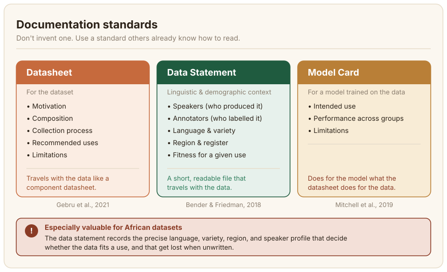

# Documentation and Reporting

A dataset without documentation is hard to trust and easy to misuse. Documentation lets someone else understand what your data is, judge whether it fits their purpose, and use it responsibly. It also lets you defend how it was made years later. For African-language data, where context and provenance carry extra weight, good documentation is not optional paperwork. It is part of the dataset.

:::tip[Key points]

- Use an established standard (datasheet, data statement, model card) rather than inventing your own.
- Name languages and varieties precisely: language, script, region and register.
- State limitations and failure cases openly.
- Record where the data came from, from whom, under what consent, and with which tool it was labelled.

:::



## Use a standard, do not invent one

Three established standards cover most of what a dataset needs. Using them means others already know how to read your documentation.

| Standard | What it describes |
|---|---|
| **Datasheet** | A dataset's motivation, composition, collection process, recommended uses and limitations. It travels with the data the way a datasheet travels with an electronic component ([Gebru et al., 2021](../references.md#gebru-2021)). |
| **Data statement** | The linguistic and demographic context NLP data needs: who the speakers and annotators are, which language varieties are covered, and how that shapes what the data can be used for ([Bender and Friedman, 2018](../references.md#bender-friedman-2018)). |
| **Model card** | A model trained on the data: its intended use, its performance across groups, and its limitations ([Mitchell et al., 2019](../references.md#mitchell-2019)). |

For African datasets the data statement is especially valuable. The precise language, variety, region and speaker profile decide whether the data fits a given use, and they are exactly the details that get lost when nobody writes them down.

:::tip[Template: Dataset card]
A datasheet you fill in and release with your data. It follows Datasheets for Datasets and adds questions for African-language projects, such as who collected the data, under what consent, and in which language variety and script. [Open the dataset card template](../templates/dataset-card.md).
:::

## Document the things people most need, and most often omit

Whatever template you use, these things matter most and are most often skipped:

- **Languages and varieties, precisely.** Name the language, script, region and register, not a vague label like "Swahili".
- **Limitations and failure cases.** Every dataset has gaps, biases and conditions where it should not be used. Stating them is a strength, not an admission of weakness.
- **How the data was collected.** Record where the data came from, from whom, under what consent, and how it was processed. This is the provenance the [data governance](../data-governance/index.md) chapter depends on.
- **The labelling tool.** Say which annotation tool, spreadsheet or script was used to label the data, its version, and how it was configured, and keep a screenshot of the labelling screen. The [dataset card template](../templates/dataset-card.md#4-preprocessing-cleaning-labeling) has a field for it.

A data statement captures exactly these linguistic and demographic details in a short, readable file that travels with the data. This is a fuller, human-facing companion to the machine-readable [dataset card](../2_data-collection/8_data-provenance-traceability.md) from Data Collection, and a starting template looks like this:

```yaml
# data-statement.yaml  (after Bender & Friedman, 2018)
languages:
  - name: Hausa
    iso639_3: hau
    script: Latn
    region: Kano, northern Nigeria
    register: news / formal written

curation_rationale: >
  Collected to support sentiment analysis for northern Nigerian media.

speakers:                 # who produced the source language
  description: professional journalists writing for a news outlet
  varieties: Kananci (the Kano dialect)

annotators:               # who labelled it
  count: 5
  background: native Hausa speakers from Kano, university-educated
  recruitment: recruited and paid per the project's consent form

speech_situation:
  medium: written text (published articles)
  time_period: 2024-2026

known_limitations: >
  Formal register only; under-represents spoken and rural varieties.
```

The `speakers` and `annotators` blocks are the heart of it: naming who produced and who labelled the data, with their variety and background, is what tells a reuser whether the dataset fits their context, and it is exactly what gets lost without a template. This and the other reusable templates are listed in [Templates you can fork](../templates/index.md).
