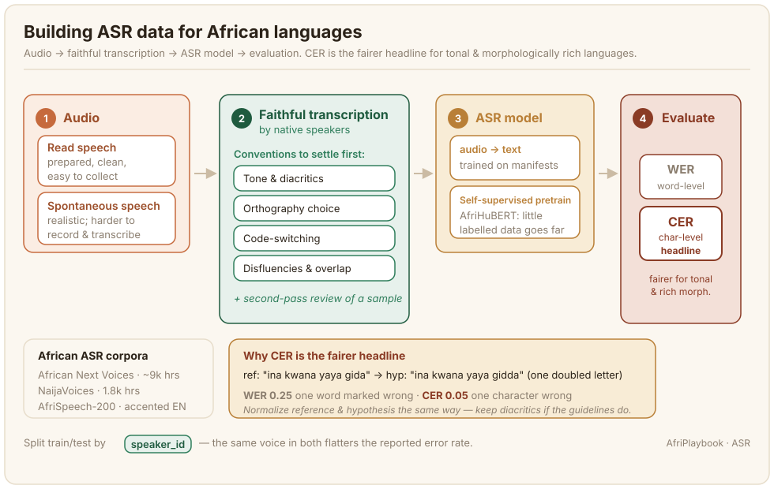

# Automatic Speech Recognition (ASR)

ASR turns spoken audio into text. It is the most developed speech task for African languages and the gateway to the rest, because transcription is the bridge from a recording to something a machine can read. This page covers the deeper how-to: what the data actually looks like, the collection and transcription pipeline, the language-family constraints that shape recording decisions, the quality-assurance workflow, evaluation, and deployment realities.

Before building an ASR corpus, check what already exists with [Before You Start](../before-you-start/index.md). That chapter helps you decide whether to reuse, extend, or build; this page details how to carry out the path you choose. The shared recording, consent, and transcription groundwork sits in the [Speech overview](../sections/speech.md), and the general pipeline in the Foundations chapters.



## What the data looks like

ASR learns from audio paired with accurate transcripts. The kind of audio matters: read speech, where people read prepared sentences, is clean and easy to collect but does not match how people actually talk, while spontaneous speech is realistic but harder to record and transcribe. African ASR now has both, and the recent surge in purpose-built corpora is the main reason the task has moved fastest. African Next Voices recorded roughly 9,000 hours of everyday speech across eighteen languages in Kenya, Nigeria, and South Africa ([African Next Voices, 2025](../references.md#african-next-voices)), NaijaVoices added 1,800 hours of Igbo, Hausa, and Yorùbá ([Emezue et al., 2025](../references.md#emezue-2025)), and Google's WAXAL released a large multilingual African speech set for ASR and TTS ([WAXAL, 2026](../references.md#waxal-2026)). Domain- and accent-focused sets fill the gaps: AfriSpeech-200 gathered 200 hours of accented English for clinical and general use across thirteen countries ([Olatunji et al., 2023](../references.md#afrispeech-2023)), Kallaama covers agricultural speech in three Senegalese languages ([Gauthier et al., 2024](../references.md#kallaama-2024)), Zambezi Voice covers four Zambian languages ([Sikasote et al., 2023](../references.md#zambezi-2023)), and Mozilla's Common Voice crowdsources read speech for several African languages. Self-supervised models like AfriHuBERT now let a little labelled data go further by pretraining on raw audio first ([Alabi et al., 2025](../references.md#afrihubert-2025)).

ASR datasets are usually distributed as a manifest: one record per utterance pointing at an audio file and its transcript, with the metadata a trainer needs. Keeping duration and sample rate in the manifest lets you filter and batch without re-reading every file. Each record is one line in the file, shown indented here for readability:

```json
{
  "audio_filepath": "clips/hau_0001.wav",
  "text": "ina kwana, yaya gida?",
  "duration": 3.2,
  "sample_rate": 16000,
  "language": "hau",
  "languages_present": ["hau", "eng"],
  "speaker_id": "spk_017",
  "speaker_profile": {
    "age_band": "25-34",
    "gender": "prefer_not_to_say",
    "language_varieties": ["hau_kano", "hau_standard"]
  },
  "speaker_profile_release_consent": "speaker-profile-v1",
  "speech_type": "spontaneous",
  "original_file": "originals/hau_0001.wav",
  "original_sample_rate": 48000,
  "original_codec": "pcm_s16le",
  "source_recording_id": "rec_hau_0042",
  "segment_index": 7,
  "segment_start": 312.48,
  "segment_end": 315.68,
  "prompt_id": null,
  "up_votes": 2,
  "down_votes": 0,
  "validation": "valid",
  "timing": "utterance"
}
```

The last group of fields records where the clip came from and how it was checked. `original_file` and `original_sample_rate` point at the archived recording the training copy was derived from, and `original_codec` says how it was stored ([Capture high, derive down](#capture-high-derive-down)). `source_recording_id`, `segment_index`, `segment_start` and `segment_end` place a clip cut from a longer recording within that recording, in seconds ([Segmenting long recordings](#segmenting-long-recordings)). `prompt_id` links a read clip to the sentence it was read from, and stays empty for spontaneous speech. The vote counts and `validation` record the outcome of [peer validation](#peer-validation-of-crowd-recordings). `timing` says whether the clip has word-level or only utterance-level timestamps ([Time alignment](#time-alignment-word-and-phoneme-timestamps)).

Recording `speaker_id` is what lets you split train and test by speaker, which matters more than it looks: if the same voice appears in both, the reported error rate flatters the model, because it has heard that speaker before.

The `speaker_profile` fields above are optional and illustrative. Include them only where the speaker deliberately supplied them and accepted the named, versioned row-level release consent. Otherwise omit the whole profile object and its consent field, rather than exporting empty values. Use coarse categories, allow "prefer not to say", and never copy one speaker's profile onto a multi-speaker clip. See [Make speaker profiles optional and deliberate](../sections/speech.md#make-speaker-profiles-optional-and-deliberate).

## What "African-language speech" actually varies on

Every ASR corpus decision cascades through the model. The variation African languages carry, and that generic ASR pipelines routinely under-serve, sits along four axes.

- **Tone and diacritics carry lexical meaning.** In Yorùbá, Igbo, Ewe, Fon, Twi, and most Bantu languages, dropping a tone diacritic on the reference transcript teaches the model to drop it on inference, and downstream users end up with technically-correct-looking text that mispronounces or mis-parses the intended word. Establish the tone convention in the annotation guidelines, verify it against a linguistic reference, and enforce it in evaluation normalisation.
- **Code-switching is the rule, not the exception.** Real African-language speech mixes local languages with English, French, Arabic, or a regional lingua franca. A monolingual corpus produces a model that fails immediately on code-switched input; a mixed corpus needs explicit code-switch marking or the model learns confused acoustic-to-orthographic mappings.
- **Dialect and variety matter more than the language name suggests.** Kiswahili in Tanzania differs from Kiswahili in Uganda and Kenyan coastal; Nigerian English is not South African English. Corpora built in one variety and deployed in another degrade in ways that per-language error rates miss.
- **Recording environment sets the ceiling.** Studio-recorded corpora produce models that fail on phone-microphone input; Common Voice-style community recordings are closer to real-world audio and generalise better despite being noisier. Match the training recording condition to the deployment condition.

## Recording pipeline

Two broad recording modes serve ASR: read speech (speakers reading prepared prompts) and spontaneous speech (interviews, radio, natural conversation). Both are valid, but the choice cascades into everything downstream.

**Read speech** is the fastest path to a corpus and the cheapest to transcribe (the transcript is the prompt). It is the right choice when the deployment target is broadcast-adjacent (announcements, prepared speeches, formal contexts) or when the project is early and needs any usable model quickly. Prompts must be curated for phonetic coverage: every phoneme in every position, including tone contrasts. See [TTS · Phonetic coverage](../text-to-speech/index.md#phonetic-coverage-what-enough-means-per-language-family) for the per-family constraints.

**Spontaneous speech** matches how people actually talk and produces models that generalise to real deployment surfaces (voice notes, phone calls, market conversations). It is 3–5x more expensive to transcribe per hour of audio than read speech, and requires a code-switching-aware transcription convention. Use when the deployment target is anything other than prepared speech.

**Session structure.** For read-speech recording, sessions of 60 to 90 minutes with breaks work better than four-hour marathons; vocal fatigue produces silent quality drift. For spontaneous speech, capture in natural chunks (interview turns, broadcast segments) and cut them into utterance-level clips afterwards (see [Segmenting long recordings](#segmenting-long-recordings)). Train ASR on 16 kHz mono copies: for the training copy, higher sample rates buy nothing for speech recognition and inflate storage. Capture and archive the originals at a higher rate, though, and derive the 16 kHz copies from them (see [Capture high, derive down](#capture-high-derive-down)).

**Community-recording models.** For at-scale African-language corpora, the Common Voice pattern (a web/mobile client that presents prompts and captures contributions from any speaker with a microphone) is the reference. NaijaVoices, African Next Voices, and Common Voice itself all use variants of this pattern. The Common Voice technical description ([Ardila et al., 2020](../references.md#ardila-2020)) is the design reference; adapt but do not skip its contribution-model discipline (per-clip validation by other speakers before a clip enters the released set).

### Give feedback while the speaker can still re-record

Show a simple input-level or peak meter during recording, with plain-language warnings for clipping, input that is too low, and long silences. Use the same corpus-purpose thresholds as the [audio quality-control checks](./audio-quality-control.md#decide-the-corpus-purpose-first), so the recorder does not reject noise that a robust ASR corpus is meant to retain. A clean-speech project may additionally warn when the background is not quiet enough. Let the speaker correct the problem and re-record before submission; do not wait for a later validator to discover it.

After the take, a speaking-rate check can flag an unusually fast or slow recording for review. Measure rate in syllables per second where you can count syllables, or in characters per second as a simpler stand-in. Avoid words per second: in agglutinative languages one written word can carry several morphemes, so a word count says little about how fast someone spoke. Compare a recording with others of the same prompt or language, and treat an outlier as a prompt for human listening, not an automatic rejection. On a low-end device, a basic level meter and a re-record button are the minimum useful feedback.

### Choose an elicitation style

Use one collection task per style and attach its prompt ID to every recording. The style determines both the speech you obtain and the transcription work that follows:

| Style | Output | Transcription cost | Suitability |
|---|---|---|---|
| Read aloud | A prepared sentence read verbatim | Low: the prompt is the starting transcript | Phonetic coverage, benchmarks, early corpora |
| Prompted question | A short answer to a question | Medium: a verbatim pass is needed | Everyday vocabulary and short spontaneous answers |
| Long-form monologue | A sustained narrative or explanation | High: segmentation and verbatim transcription | Prosody, discourse, and natural domain speech |
| Listen-and-repeat | A repeated sentence or phrase | Low to medium: check against the heard prompt | Speakers who can hear a prompt but cannot read it; check for accent carryover |
| Translation-to-speech | A spoken rendering of a source sentence | High: both sides need checking | Interpreting and speech-translation pairs |
| Image-prompted description | A description of a picture or scene | Medium to high: unconstrained wording | Literacy-sensitive collection and grounded descriptions |

For spontaneous recordings, validators check audibility, the intended language or languages, one main speaker, and that the start and end are not cut off. The transcript comes from a separate verbatim pass, not from the validator's summary. Offer listen-and-repeat or picture prompts where literacy varies, and record the elicitation style so that read, repeated, and spontaneous speech are not silently mixed. Listen-and-repeat can carry the prompt reader's accent into the recording, so monitor it as a separate condition. The [agri-advisory speech layer](../agri-advisory/speech-layer.md) combines two styles on one item: a cued question, where a speaker sees a photo and a field question and asks it in their own words, and a read-aloud answer.

### Sourcing prompt sentences from the community

Read-speech projects usually run out of usable prompt text before they run out of willing speakers. Translated sentences are a poor substitute, because they carry the word order and vocabulary of the source language. The Common Voice paper describes a Sentence Collector: any language community could submit sentences, automatic checks screened them for length, foreign alphabets and numbers, and each sentence needed approval from two of three reviewers before it entered the recording pool ([Ardila et al., 2020](../references.md#ardila-2020)). The same pattern works for any project:

- **Submission with a source and licence.** Each sentence comes with a statement of where it came from: the contributor wrote it, or it comes from a source whose licence is compatible with the planned release. Record this per sentence, not per batch.
- **Peer review before use.** Other native speakers approve each sentence before anyone records it. Reviewers check spelling, orthography and diacritics against the project's conventions, whether the sentence sounds like something a person would say, offensive content, personal data such as real names and phone numbers, and whether it can be read aloud comfortably in one go.
- **A per-language length limit.** Set a maximum in words or in characters, whichever suits the script and the morphology. A word count means little for a language that writes long agglutinated words, or one that does not separate words with spaces. Tie the limit to recording length: Common Voice, for example, caps recorded clips at 15 seconds ([Mozilla Common Voice, 2024](../references.md#mozilla-cv-clip-length-2024)).
- **Provenance on every recording.** Give each accepted sentence an ID and carry that ID, with its source and licence, into every recording made from it. The prompt ID is also what lets you keep each sentence in only one split (see [Evaluation](#evaluation)), and it belongs in the lineage record described in [Data provenance and traceability](../2_data-collection/8_data-provenance-traceability.md#data-lineage).
- **A licence that matches the release.** Common Voice accepts only public-domain sentences, because it releases its datasets under CC0 ([Mozilla Common Voice, n.d.](../references.md#mozilla-cv-playbook-text)). That rule follows from its release licence and is not a recommendation for yours: see [Licence selection](../legal-consent/index.md#licence-selection). A project releasing under an attribution or non-commercial licence should state the licence for contributed sentences up front and have contributors agree to it when they submit.

The result is a prompt set written in the language rather than translated into it. Check the accepted pool for phonetic coverage as described in [TTS · Phonetic coverage](../text-to-speech/index.md#phonetic-coverage-what-enough-means-per-language-family).

### Capture high, derive down

The quality of the original recording is the ceiling for every copy made from it, so keep the original and work on copies:

- **Capture and archive the original at a higher sample rate**, in a lossless format (WAV or another PCM container) where the capture path allows it. 48 kHz is a sensible choice, not a rule. Common Voice collects at 48 kHz, although it collects and releases MP3 rather than a lossless format, because MP3 is the most widely supported audio format on the web ([Ardila et al., 2020](../references.md#ardila-2020)).
- **Derive the training copies at export.** Convert to 16 kHz mono for ASR training when you build a release. The original stays untouched, so a later TTS or speaker project can derive a different copy from the same recording.
- **Process copies, never the original.** Loudness normalisation, silence trimming and resampling run on derived copies and never overwrite the archived file. Record each step in the transformation log ([Data provenance and traceability](../2_data-collection/8_data-provenance-traceability.md#a-transformation-log-that-travels-with-the-data)).
- **Record the codec when you cannot avoid a lossy one.** Browser and phone capture often produces Opus in WebM, AAC in M4A, or MP3. Store the codec, and the bitrate for a lossy one, with the original (in the manifest, as `original_codec` above, or in the provenance record), so later users know what the audio went through.
- **Convert MP3 to PCM WAV before time-aligned annotation.** MP3 encoders and decoders add delay and padding samples at the start and end of a file. The LAME encoder writes the leading padding into a header tag that a decoder can use to trim it ([Taylor, 2000](../references.md#lame-tech-faq)). Decode once, with a decoder that reads the encoder tag and removes the leading delay, check that the decoded length matches the expected duration, and annotate the WAV. Otherwise timestamps from one tool may not line up with the audio played in another.

The quality-control page covers the checks to run on originals and copies: [Audio quality control](./audio-quality-control.md).

### Segmenting long recordings

Interviews, radio programmes and field sessions arrive as files of an hour or more, and transcription wants clips of a few seconds. Cut them before annotation:

- **Let silence detection suggest the cuts, and let a person decide.** Set a loudness threshold and a minimum pause length. Place each suggested cut in the middle of a pause, not at its edge, so the clip keeps a little room tone at both ends. A person then listens and confirms, moves or removes each cut. Never cut inside a word.
- **Bound the clip length.** Set a minimum and a maximum segment length for the project. Merge very short fragments with a neighbour; split long turns at the next pause.
- **Cut losslessly from the archived original**, then derive training copies from the clips as above.
- **Store provenance on every clip:** the source recording ID and file name, the clip's index, and its start and end in seconds within the original. Keep the original until the clips have been checked against it. These fields let anyone trace a clip back to its source ([Data provenance and traceability](../2_data-collection/8_data-provenance-traceability.md#data-lineage)).
- **Check the segment boundaries.** Where the workflow is segment-then-transcribe, check that segments do not overlap, that no stretch of speech falls between two segments, and that the start and end times survive export unchanged.
- **Plan for heavy files.** Measure each file's duration and size before assigning it, and flag the heavy ones. Annotators working on phones or on metered data should get short clips, or a precomputed waveform with streamed audio, rather than a two-hour file to download.

When a long recording has several speakers, take the turn boundaries from diarization rather than cutting by silence alone (see [Speaker Diarization](../speaker-diarization/index.md)). For video, frame-accurate cutting depends on how the file is encoded: see [Sign language · Recording](../sign-language-video/sign-language.md#recording). [Long video](../sign-language-video/long-video.md) is the video counterpart of this section: chunking with provenance, shot boundaries, frame sampling and audio-video sync.

## Distinctive annotation: transcription is the hard part

For ASR the annotation is transcription, and its conventions decide the dataset's quality. Settle them before you start: how to write tone and diacritics, which orthography to follow when a language has more than one, how to mark code-switching into a colonial language, and how to handle disfluencies, false starts, and overlapping speech. These are not edge cases for African languages, they are the norm, and inconsistent transcription quietly teaches the model the wrong spelling of half its vocabulary. Transcribers must be native speakers, and a second-pass review of a sample is worth its cost.

Cut long recordings into clips first ([Segmenting long recordings](#segmenting-long-recordings)); for word or phoneme timestamps inside a clip, see [Time alignment](#time-alignment-word-and-phoneme-timestamps).

A transcription config plays the audio and gives the transcriber a text box, plus tick-boxes for the conditions that the conventions above need to be applied to consistently. Capturing those conditions as structured labels, rather than leaving them implicit in the text, lets you measure how much of your data is spontaneous, code-switched, or noisy:

```xml
<View>
  <Audio name="audio" value="$audio"/>
  <TextArea name="transcript" toName="audio" rows="3"
            editable="true" required="true"
            placeholder="Transcribe exactly what is said, following the guidelines"/>
  <Choices name="languages_present" toName="audio" choice="multiple">
    <!-- Populate these choices from the project's controlled ISO 639-3 list. -->
    <Choice value="hau"/>
    <Choice value="eng"/>
    <Choice value="other_language_needs_review"/>
  </Choices>
  <Choices name="conditions" toName="audio" choice="multiple">
    <Choice value="Code-switching"/>
    <Choice value="Overlapping speech"/>
    <Choice value="Background noise"/>
    <Choice value="Disfluency or false start"/>
    <Choice value="Unclear, needs review"/>
  </Choices>
</View>
```

The `$audio` value is the `audio_filepath` from the manifest above, so the same file feeds collection, transcription, and training without reformatting.

### Use drafts without losing the reference

Segment a long recording first, then optionally pre-fill each segment with a draft from a usable recogniser. A draft can save typing, but it can anchor the transcriber to the recogniser's wording in the same way that post-editing machine translation can anchor a translator. Keep a from-scratch audit sample, and record whether each transcript was written from scratch or post-edited, together with the draft or model version where applicable. The primary guidance is in [Model-assisted annotation](../3_annotation-design/model-assisted-annotation.md#by-modality); the related translation workflow is in [Machine translation](../machine-translation/index.md#annotate-translations).

The transcription interface should provide keyboard-controlled playback, adjustable speed, a waveform where useful, and a text field that preserves the target script and diacritics. It should save drafts and export the audio identifier, transcript, annotator and any quality flags together.

**Transcription conventions to fix in writing before annotation begins:**

- **Orthography and script.** Which convention applies (Latin vs. Ajami for Hausa, Ge'ez vs. Latin transliteration for Amharic). Mixing scripts within a single corpus teaches the model a bimodal spelling distribution that later inference cannot reproduce.
- **Diacritic and tone marking.** Preserve fully, normalise to Unicode NFC, or strip, with the reasoning documented and enforced in evaluation. See the [non-Latin scripts in real UIs](../deployment/non-latin-scripts.md) chapter for the deployment-side implications.
- **Canonical spelling list.** Maintain a living list of proper names, place names, loanwords and code-switched terms, visible during transcription and extended during adjudication. Inconsistent spellings inflate WER and CER and fragment the vocabulary; the same reviewed list can feed a TTS pronunciation lexicon.
- **Languages present and code-switching notation.** Record every language heard in `languages_present`, chosen from a controlled list of ISO 639-3 codes limited to the languages expected in the project's country or region. Store codes such as `pcm` (Nigerian Pidgin), not free-text language names ([SIL International, n.d.](../references.md#iso-639-3)). ISO 639-3 gives a language and all its dialects one code, so if the project distinguishes varieties, record them in a separate field with a documented, project-defined list (as `language_varieties` does in the manifest above). Provide a controlled `other_language_needs_review` route for a missing language or variety, and resolve it during adjudication rather than inventing a new code. Mark the span-level switch using the project's inline-tag, separate-field or no-marking convention, and apply it consistently; the text equivalent is in [Sequence labelling](../sequence-labelling/index.md#language-identification-of-code-switched-text).
- **Disfluencies and false starts.** Verbatim transcription including fillers (`um`, `eh`, restarts) produces models that transcribe those tokens, which is useful for some downstream tasks and noise for others. Decide up front and document.
- **Numbers, dates, abbreviations.** Written as spoken, in the target language. Same discipline as the [TTS chapter's normalisation section](../text-to-speech/index.md#text-preparation-and-normalisation).
- **Speaker-turn overlaps.** Two speakers talking over each other: transcribe both with a turn marker, or split into per-speaker clips, or discard. Document the rule.

## Time alignment: word and phoneme timestamps

A transcript says what was said; an alignment says when. Word and phoneme timestamps are needed for TTS training, pronunciation and prosody studies, subtitle-style corpora, and for checking that a long transcript matches its audio. Placing every boundary by hand is slow, so align automatically first and have people correct the result.

**Start with an automatic aligner.** Three families of tools are in common use:

- **CTC segmentation** uses a speech model trained with connectionist temporal classification (CTC) to find where each part of a transcript sits in the audio. Its authors used it to extract aligned utterances from unsegmented recordings, as part of a German ASR training set of over 1,700 hours ([Kürzinger et al., 2020](../references.md#kurzinger-2020)).
- **Multilingual CTC alignment models.** The MMS project aligned recordings in more than 1,100 languages with a CTC alignment model and a forced-alignment implementation that runs on long audio files on GPUs ([Pratap et al., 2023](../references.md#pratap-2023)). For a language with no aligner of its own, a multilingual model is the usual starting point.
- **Lexicon-based forced aligners** such as the Montreal Forced Aligner train acoustic models on your data and produce word and phone boundaries ([McAuliffe et al., 2017](../references.md#mcauliffe-2017)). They need a pronunciation lexicon, so they suit languages where one exists or can be built.

**Correct only what is wrong.** Native speakers review the aligned output and fix the boundaries that are misplaced, rather than re-placing every boundary. On noisy or overlapping audio, where exact boundaries are hard to hear, have annotators mark the span of speech and assign the words to it instead of fixing each word edge.

**Declare the tier hierarchy.** Decide which tiers exist and how they nest, for example utterance, then word, then phoneme; or utterance with a translation tier beneath it. A child segment must lie inside its parent's interval. Run a check that lists every child segment outside its parent's start and end time, and fix these before release. The tier model, with its tier types, is described in detail on the [sign language](../sign-language-video/sign-language.md#tiers-and-tier-types) page; spoken-language alignment uses the same ideas.

**Export to a standard format.** ELAN's `.eaf` format ([Wittenburg et al., 2006](../references.md#wittenburg-2006)) and Praat's TextGrid format ([Boersma, n.d.](../references.md#praat-textgrid)) both store multiple time-aligned tiers and are read by most speech and phonetics tools.

**Record what timing each item has.** Aligners do not yet work well for many African languages, and an aligner that works on read speech may fail on spontaneous speech. Store per item whether its timing is word-level or only utterance-level (the `timing` field in the manifest above), so users of the corpus know what they can rely on. The [agri-advisory speech layer](../agri-advisory/speech-layer.md#quality-control) is a worked example that records this per clip.

## Quality assurance during collection

Quality problems caught during transcription cost minutes. The same problems caught at model training cost weeks. Build a per-batch review workflow before the corpus starts.

### Decide the corpus purpose first

Decide whether the corpus is for robust ASR or clean TTS before setting any threshold: for robust ASR, keep real-world noise, log low signal-to-noise ratio and minor clipping as warnings, and hard-reject only corrupt clips. The comparison table, the capture settings to turn off, and the single threshold table shared by the automated checks, the recording instructions and the validators' criteria card (see [Peer validation](#peer-validation-of-crowd-recordings)) are on [Audio quality control](./audio-quality-control.md#decide-the-corpus-purpose-first).

### Batch review checks

- **Per-clip second-pass review.** A second transcriber, independent of the first, listens to a random 5–10% sample of each batch and re-transcribes. Compute per-clip character error rate between the two transcripts; anything above a threshold (typically CER > 0.05) is flagged for adjudication. This is the single cheapest quality signal.
- **Per-condition sampling.** The `conditions` labels in the transcription config are not just for the trainer's benefit. Sample the flagged clips separately (all "code-switching" flagged, all "background noise" flagged) and review them together. Systematic transcription errors surface in these focused reviews that random sampling misses.
- **Per-speaker balance.** Track cumulative recorded minutes per speaker and flag imbalances. A corpus where three speakers account for 40% of the data will produce a model that flatters those voices and fails on others.
- **Duration and audio-quality checks at ingest.** Automated per-clip duration checks, clipping detection and loudness measurement, judged against the [threshold table](./audio-quality-control.md#tier-1-signal-checks-on-every-clip) for the corpus purpose. Loudness normalisation and silence trimming run on the derived training copies, never on the archived original ([Capture high, derive down](#capture-high-derive-down)). A clip that is clipped badly enough to fail the table should be re-recorded, not "fixed" in post.
- **Weekly IAA measurement**: inter-annotator agreement on the sample second-pass reviewed batch. Falling IAA over time is the earliest signal that transcription guidelines are drifting or annotator fatigue is setting in. Two human transcripts have no true reference, and CER or WER changes depending on which one you treat as the reference, because it divides the edit distance by the reference length. For a symmetric score, divide the character or word edit distance by the length of the longer transcript instead. That score is never higher than CER or WER on the same pair, so state which normalisation you use and calibrate the adjudication threshold for it rather than carrying over the CER threshold from the second-pass check.

### Keep prompt and speaker diversity at assignment time

- Do not assign the same sentence to the same speaker twice, and cap how many recordings each sentence can receive. Prefer many speakers reading fewer sentences over a few speakers reading the whole prompt pool.
- Let contributors skip or return a prompt they cannot read, hear or say comfortably. A skip is not a failed recording.
- Enforce the speaker-and-prompt duplicate rule again at acceptance, not only when ordering prompts. This catches retries and concurrent assignments.
- Keep the caps in the collection report. Capped repeats reduce the number of rows lost when prompt-disjoint train, development and test splits are constructed ([Evaluation](#evaluation)).

### Peer validation of crowd recordings

When many contributors record, a small review team cannot listen to every clip. Crowd-sourced corpora therefore have contributors validate each other's recordings, after the automated checks have removed the clips no one could use. People should never spend time confirming that an empty file is empty.

**How Common Voice does it.** Listeners mark each audio-and-transcript pair as correct or incorrect. A clip is valid when it first gets two up-votes and invalid when it first gets two down-votes, and at most three people listen to any clip. Any clip or sentence can be skipped or reported as a problem. Only valid clips go into the official train, dev and test sets; clips that have not collected enough votes by release time are released separately, and the up- and down-vote totals ship with the data ([Ardila et al., 2020](../references.md#ardila-2020)).

**Judge against a written criteria card.** Validators make a yes-or-no decision, so they need to know exactly what "yes" means. Derive the card from the same specification as the recording instructions and the threshold table, and keep it visible while people judge. A card you can copy and adapt:

```text
Say YES only if all of these hold:
  - Every word is audible.
  - The speech matches the prompt exactly (read speech only).
  - There is one main speaker.
  - The recording is not cut off at the start or the end.

For a robust-ASR corpus, also:
  - Background noise and background voices are fine, as long as the speech is clear.

For a clean-TTS corpus, also:
  - The background is quiet.
  - The volume is steady through the clip.

For spontaneous speech (no prompt):
  - Drop the "matches the prompt" rule.
  - Check that the speaker is speaking the project's language.
```

**Escalate what the crowd cannot settle.** A project can add a review layer on top of the votes: clips with split votes, clips the crowd rejected, and clips someone reported go to an experienced reviewer, who can confirm or override the crowd. Record each override with who made it, when, and why. This hybrid follows the escalation pattern in [Workflow and Adjudication](../3_annotation-design/workflow-adjudication.md#escalate-items-that-do-not-agree). Clips still unresolved at release time stay out of train, dev and test.

**Make judging easy to do well.** Keep clips within a bounded duration so each can be judged in one listen, let validators replay a clip, and make the validation screen work on a phone, since many contributors will have no other device. Never show contributors their own clips, and do not count two votes from the same person on one clip ([Workflow and Adjudication](../3_annotation-design/workflow-adjudication.md#serve-items-so-the-counts-stay-honest)). Deliberate repeat items for a consistency check, as in [Speech Emotion Recognition](../speech-emotion-recognition/index.md#quality-assurance), are the exception, and their second judgement is not counted as a vote.

The [agri-advisory speech layer](../agri-advisory/speech-layer.md#quality-control) shows this protocol in a real project: two agreeing native-speaker votes validate a clip, a reviewer settles split votes, and field noise alone is never a reason to reject.

## Evaluation

ASR is scored by error rate against a reference transcript. [Word Error Rate (WER)](https://en.wikipedia.org/wiki/Word_error_rate) is standard but punishes morphologically rich languages unfairly, since one wrong morpheme can mark a whole word wrong, so report [Character Error Rate (CER)](https://en.wikipedia.org/wiki/Word_error_rate#Character_error_rate) alongside it. CER is more forgiving and more informative for the agglutinative and tonal languages common on the continent. As always, a human listen to a sample catches failures, such as a systematically mis-transcribed dialect, that an aggregate error rate hides.

**Split by speaker and, for read speech, by prompt.** An error rate means something only if the test speakers and the test sentences are new to the model. For read or prompted corpora, no speaker and no prompt sentence should appear in more than one of train, dev and test: if the same sentence is read by one speaker in train and another in test, the model can score well by remembering the sentence rather than recognising the speech. When you keep several recordings of each sentence, split by connected components of shared speakers and prompts, and record in the dataset card how many recordings were dropped. The method and code are in [Data integrity · Read speech: keep speakers and prompts apart](../8_model-building/data-integrity.md#read-speech-keep-speakers-and-prompts-apart).

Both rates are one function call each with `jiwer`, and computing them side by side makes the WER-versus-CER gap visible:

```python
# pip install jiwer
import jiwer

references = ["ina kwana yaya gida"]
hypotheses = ["ina kwana yaya gidda"]   # one doubled letter

print(f"WER: {jiwer.wer(references, hypotheses):.3f}")  # 0.25: one word marked wrong
print(f"CER: {jiwer.cer(references, hypotheses):.3f}")  # 0.05: one character wrong
```

One spelling slip turns into a quarter of the words being "wrong" under WER but only a twentieth of the characters under CER, which is exactly why CER is the fairer headline number for morphologically rich and tonal languages. Normalize the reference and hypothesis the same way before scoring, and make that normalization match your transcription conventions: if the guidelines keep diacritics, the scorer must keep them too, or it will reward the model for dropping the tone marks the dataset worked to capture.

**Beyond aggregate error rate.** Aggregate CER hides where a model fails. Report per-speaker, per-domain (read vs. spontaneous), per-code-switching-condition, and per-dialect CER separately, and flag any subgroup with a materially higher error rate. A model whose overall CER is 12% but whose women-speakers CER is 22% is a model that will silently under-serve half its users.

**Diacritic-preservation check.** For tone languages, run a separate evaluation with tone marks stripped from both reference and hypothesis, and compare to the diacritic-preserving CER. A large gap means the model is systematically dropping tone marks and the aggregate CER is optimistic.

**Human review as a final gate.** Automatic metrics catch consistency; human listeners catch content failures: a systematically mis-transcribed loanword, a dialect the model treats as a different language, a background noise that flips a specific phoneme. Budget a per-release listening pass on 200 random utterances by native speakers before publishing metrics. When listeners compare two systems' transcripts or rate them on a scale, design that judgement like any other human evaluation, with random order and hidden system names (see [Human Evaluation Designs](../3_annotation-design/human-evaluation-designs.md)).

## Deployment realities

For a language covered by [Meta MMS](https://huggingface.co/facebook/mms-1b-all), the out-of-the-box model is usually the fastest path to a usable system. Fine-tune the language-specific MMS adapter on your best available in-domain speech data; measure on a 200-500-utterance native-speaker-verified in-domain evaluation set. For high-resource languages with domain match, Whisper large-v3-turbo is often the production default for its size class.

**On-device deployment.** For phone-tier deployment (edge devices, offline apps), on-device ASR runtimes matter. [whisper.cpp](https://github.com/ggerganov/whisper.cpp) is the reference for Whisper-family models across CPU, ARM, and Apple Silicon with quantised model support. On Android Go and mid-range phones, whisper-tiny quantised or a distilled MMS adapter is the achievable target. See the [edge devices](../deployment/edge-devices.md) chapter for the phone-tier map and runtime choices.

**WhatsApp voice notes** are an increasingly common African deployment surface: users voice-note more comfortably than they type in complex diacritics or Ajami/Ge'ez scripts. ASR on voice notes is often more useful than a keyboard input for the same user population. See the [SMS, USSD, and WhatsApp](../deployment/sms-ussd-whatsapp.md) chapter for the deployment integration details.

**Streaming vs. batch.** Real-time transcription (streaming) is a different engineering problem from batch transcription. Whisper and MMS are batch-first; streaming ASR needs either a streaming-native architecture (Conformer, RNN-T) or a chunked-and-stitched approximation with the accuracy tradeoff that implies. Decide streaming vs. batch at project scoping, not after model training.

## What breaks: common failure modes

- **Diacritic-flat transcripts, tone-flat model.** Transcribers dropped diacritics inconsistently and the model learned to omit them. Fix: audit tone marks in a batch review before continuing collection.
- **Speaker or prompt leakage across splits.** Same speaker, or for read speech the same prompt sentence, in train and test; error rate flatters. Fix: split by `speaker_id` and `prompt_id`, not by clip, and assert that neither crosses a split (see [Evaluation](#evaluation)).
- **Corpus-domain vs. deployment-domain gap.** Model trained on read speech, deployed on spontaneous WhatsApp voice notes; error rate triples. Fix: match training recording condition to deployment condition, or budget a domain-adaptation fine-tune.
- **Systematic dialect blindness.** Aggregate CER looks acceptable; per-dialect breakdown shows one variety at 3x the average error. Fix: per-dialect evaluation is not optional; if your target deployment covers multiple varieties, the corpus needs to too.
- **Code-switching collapse.** Monolingual corpus, model fails immediately on real user code-switched input. Fix: include a proportion of code-switched examples in training, marked consistently.
- **Post-quantisation degradation on-device.** Fine-tuned in float16, deployed at INT8: accuracy drops sharply. Fix: measure at deployment precision from the start; see [compute-poor training](../compute-poor/index.md) for the quantisation discipline.
- **Gender or age imbalance in speaker mix.** Corpus skews to one demographic; model under-serves the others in deployment. Fix: track speaker demographics in the manifest and enforce balance at collection time.
