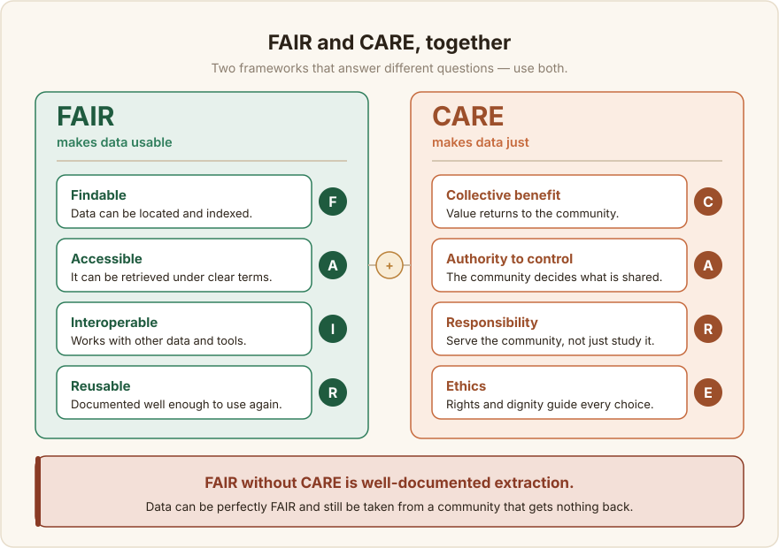

# Data Governance

Data governance is the set of decisions about who controls a dataset: who may access it, who may use it, who profits from it, and who is accountable when something goes wrong. For African-language data these are not legal formalities to add at the end. They decide whether a dataset strengthens a community or quietly extracts from it. The data comes from people, from their voices, words, and knowledge, and governance is how those people keep a say in what they helped create.

This matters more here than in well-resourced settings, because the same openness that helps a low-resource language can also expose it. A freely downloadable corpus is easy to reuse, and just as easy to scrape into a commercial model that returns no benefit, credit, or say to the speakers. African NLP communities have been clear about this. The Masakhane community holds that Africans should decide what data represents their communities, retain ownership of it, and know how it is used ([Masakhane](../references.md#masakhane)). Governance is how that principle turns into practice.

:::tip[Key points]

- Decide with the community, in writing, who controls the data and who answers re-use requests.
- Get informed consent at the point of collection; it can rarely be added later.
- Choose a licence on purpose, and license data separately from code.
- Protect the people in the data, contributors and annotators alike: collect little, pseudonymise, restrict access.
- Make sure credit and benefit flow back to the speakers.

:::

## Govern for the community, not just the dataset

### Community ownership and self-determination

The people whose language it is should have the final say over how their data is used. This means treating native speakers as co-owners, not suppliers of raw material. The commitment runs through the continent's strongest data efforts:

- the early Masakhane translation work ([Nekoto et al., 2020](../references.md#nekoto-2020));
- AI4D's African Language Program, which built open datasets through community challenges and short research fellowships ([Siminyu et al., 2021](../references.md#siminyu-2021));
- large speech corpora such as NaijaVoices, recorded by community members rather than scraped ([Emezue et al., 2025](../references.md#emezue-2025)).

It also reflects a wider call to decolonise language technology by centring the communities whose languages are at stake, instead of treating them as data sources ([Bird, 2020](../references.md#bird-2020)).

Self-determination is not a single veto at release. It shapes every earlier choice: what gets collected, from whom, on what terms, and who may use the result.

### FAIR and CARE, together

Two frameworks should guide a dataset's design, and they answer different questions:

- **FAIR** asks whether data is Findable, Accessible, Interoperable, and Reusable. It is now a baseline expectation for research data ([Wilkinson et al., 2016](../references.md#wilkinson-2016)). But FAIR says nothing about power or justice: data can be perfectly FAIR and still be taken from a community that gets nothing back.
- **CARE** was written to fill that gap. Its four commitments, Collective benefit, Authority to control, Responsibility, and Ethics, assert the right of Indigenous Peoples to govern data about them ([Carroll et al., 2020](../references.md#carroll-2020)).

Use both. FAIR makes the data usable; CARE makes it just. FAIR without CARE is well-documented extraction.

> The 'CARE Principles for Indigenous Data Governance' (Collective Benefit, Authority to Control, Responsibility, and Ethics) empower Indigenous Peoples by shifting the focus from regulated consultation to value-based relationships that position data approaches within Indigenous cultures and knowledge systems to the benefit of Indigenous Peoples. This shift ultimately promotes equitable participation in processes of data reuse, which will result in more equitable outcomes.
>
> ([Carroll et al., 2020](../references.md#carroll-2020))

CARE was written for Indigenous Peoples' data, and it asks three questions of any dataset: whom the data serves, who benefits from it, and who has authority over its use ([Imperial College London](https://www.imperial.ac.uk/research-and-innovation/support-for-staff/scholarly-communication/research-data-management/care-data-principles/) gives a short summary). An African-language project can ask the same questions on behalf of the community whose language it records. In practice, that means treating the community as a rights-holder, not only as a data source. Each principle maps to a decision in this chapter:

| Principle | What it asks | In your project |
| --- | --- | --- |
| **Collective benefit** | The data should benefit the community it comes from, through development, better governance, and fairer outcomes. | Agree what returns to the speakers before you collect. See [Benefit-sharing and credit](#benefit-sharing-and-credit). |
| **Authority to control** | The community's rights and interests in its data are recognised, and the community governs how the data is used. | Write down who decides, and keep that authority with the community. See [Governance models](#governance-models). |
| **Responsibility** | People who work with the data build respectful relationships, grow local skills, and respect the community's language and worldview. | Hire and train locally, and tell the community how its data is being used. |
| **Ethics** | The community's rights and wellbeing come first at every stage of the data's life, including uses nobody has planned yet. | Review possible harms before collection and again before each release. See [A lightweight ethics review](#a-lightweight-ethics-review). |

A community can also state its own conditions on a dataset. [Local Contexts](https://localcontexts.org/about/) provides Traditional Knowledge and Biocultural labels for this purpose, which travel with the data and tell a reuser what the community permits.

The findability half of FAIR has a practical home in African NLP. Lanfrica's African AI Atlas tracks datasets, models, and papers that would otherwise sit scattered across repositories, PDFs, and dead project pages, so that work already done can be found and reused instead of rebuilt from scratch ([Lanfrica](../references.md#lanfrica)).

## Consent and rights

### Informed consent

Anyone who contributes data, whether a voice recording, a translation, an annotation, or a photo, should know before they contribute:

- what the data is for;
- who will be able to use it;
- whether it will be public;
- that they may decline or withdraw without penalty.

This is not optional for the recording-based collection common in African-language work, where the contributor's own voice or image is the data.

NaijaVoices shows what good practice looks like. To build an 1,800-hour Igbo, Hausa, and Yorùbá speech corpus from more than 5,000 voice donors, it trained community facilitators in the ethics of data collection and informed consent. Those facilitators explained the project, its purpose, and the intended use of the data to each contributor before any recording began ([Emezue et al., 2025](../references.md#emezue-2025)).

Settle informed consent, fair compensation, and clear data-rights terms together, at the point of collection. The Esethu Framework is one example: it paid its isiXhosa contributors a fair rate, and its licence keeps ownership of the data with the community while setting written terms for research and commercial use ([Esethu Framework, 2025](../references.md#esethu-2025)). Adding consent afterwards is usually impossible, which makes this an early decision rather than a late one.

### Rights over sourced and contributed data

Be clear about which kind of data you hold, because the rights differ sharply:

| Kind of data | Examples | Whose rights apply |
| --- | --- | --- |
| **Contributed** | Recordings, transcriptions, and labels people make for your project | The consent and terms you agree with the contributors |
| **Sourced** | Text pulled from the web, social media, or archives | Someone else's: copyright, platform terms of service, and often no clear licence at all |

African NLP practitioners have flagged copyright and access as a central, unresolved problem, since much of the available text sits in a legal grey zone and "publicly visible" is not the same as "free to redistribute or train on" ([Carnegie Endowment, 2024](../references.md#carnegie-2024)). When the rights are unclear, record the uncertainty rather than hide it.

## Licensing

A licence tells the world what may and may not be done with your data. In African NLP the common failure is not the wrong licence but a missing or unclear one, and an unlicensed dataset is effectively unusable, because a reuser cannot tell whether they are allowed to touch it ([Lanfrica, "Licensing as a Barrier"](../references.md#lanfrica-licensing)). Choose on purpose.

The playbook's default for open release is CC BY 4.0. Use CC BY-NC or stricter terms, including the community licences below, by exception: when the community requires it, when consent covers non-commercial use only, or when the material is sacred or sensitive. Make that choice deliberately and record the reason in the dataset card; the [licensing decision tree](../governance-toolkit/licensing-decision-tree.md) walks through it.

### Data and code are licensed differently

Software licences such as MIT or Apache-2.0 are not built for data, and a code licence on a corpus leaves its reuse rights unclear. Put a data licence, such as a Creative Commons or community licence, on the data, and keep it separate from any code licence. The common licence types and what each allows are in [Licensing and Compliance](../6_documentation/licensing.md#common-licence-types-for-nlp-datasets); when each one is defensible for community-derived data is in [Licence selection](../legal-consent/index.md#licence-selection).

### African and community licences

Fully open CC licences assume the goal is maximum reuse. For low-resource African data, maximum reuse often means a well-funded foreign lab can take the corpus, train on it, and give nothing back to the speakers. A newer class of community-centred licences exists to close that gap, and the most developed of them is African.

The Nwulite Obodo Open Data License (NOODL) takes its name from the Igbo for "raising, reviving, and building the community," and it was written to address the inequitable openness that standard licences impose on African dataset creators ([NOODL, 2025](../references.md#noodl-2025)). Its central idea is to set terms by who the reuser is. Users in Africa and other developing nations may reuse the data freely on a share-alike basis and distribute adaptations within the region. Users outside those regions accept the same share-alike terms and must also return royalties or other benefits to the African dataset owners. Openness becomes reciprocal rather than a one-way export.

The Esethu license, from Lelapa AI, Way With Words, and Data Science for Social Impact, adds an economic loop: licensing revenue is reinvested into expanding the dataset and supporting local employment, so the resource and its community grow together ([Esethu Framework, 2025](../references.md#esethu-2025)). Both build on the precedent of Te Hiku Media's Kaitiakitanga License for Māori data, which treats data as cared for rather than owned, directs benefit back to the source community, and forbids uses such as surveillance or unconsented corpus-building ([Te Hiku Media](../references.md#tehiku-kaitiakitanga)). Consider one of these whenever a plain CC licence would mean giving up the community's say, or its share of the value its data creates.

### Attribution and reuse

Whatever licence you pick, require attribution and record provenance: where the data came from, who contributed it, and on what terms. Provenance lets downstream users credit the source and respect the conditions, and it lets you prove years later that the dataset was built legitimately. Recording it is covered in [Documentation](../6_documentation/documentation.md).

## Privacy and sensitive data

### Personally identifiable information

African-language collection routinely captures personal data: names and places in text, and, unavoidably, voices in audio and faces in images, which identify a person directly. Collect as little as the task needs, anonymise where you can by masking names and stripping metadata, and never treat a recorded voice as anonymous. Where identifiable data is essential, it has to rest on explicit, informed consent, and the consent terms must travel with the data. For images and video, [Visual privacy](../image-data/visual-privacy.md) covers what in a frame can identify someone, how to strip file metadata, and where blurring fails.

The people who label the data need protecting too. An export from an annotation tool usually records who made each label, often as a name, an email address, or an account ID. Released as they are, these fields show which person called a post hateful, and in hate-speech, political, or religious data that can put an annotator at risk. Replace them with pseudonyms before the data leaves the team:

- **Stable within a project.** Each annotator keeps the same pseudonym throughout one dataset, so per-annotator agreement, drift over time, and the individual labels you keep for subjective tasks (see [Resolve disagreement, but read it first](../3_annotation-design/workflow-adjudication.md#resolve-disagreement-but-read-it-first)) all still work.
- **Different across projects.** The same person gets a different pseudonym in each dataset, so nobody can link their labels across releases. A common way to get both properties is a keyed hash: compute the pseudonym from a secret key, the annotator's account ID, and the project ID, rather than from the account ID alone, which anyone could hash again.
- **Stable across versions.** Keep the same key for every version of a dataset (v1.0, v1.1, and so on). Changing the key changes every pseudonym and breaks comparisons between versions; it is the project ID in the hash, not a new key, that keeps pseudonyms different across datasets.
- **Reversible only on purpose.** If no one should ever be able to re-identify an annotator, keep no table that maps pseudonyms to people, and remember that the key itself works like a mapping for anyone who also holds the list of account IDs. If you do need to trace labels back, for example to answer a withdrawal request or investigate a quality issue, keep the mapping and the key under access control, separate from the released data.

Pseudonyms are not anonymity on their own. In a small team, extra fields such as an annotator's region, dialect, or gender can single a person out, so release only the annotator attributes the dataset really needs. Crediting annotators by name in the [dataset card](../templates/dataset-card.md) (see [Benefit-sharing and credit](#benefit-sharing-and-credit)) is compatible with this, as long as the list of names cannot be joined to the labels. Keep internal administrative and working-hours records out of the public release. Decide all of this in the [ethics review](#a-lightweight-ethics-review) before annotation starts, and record in the dataset card which annotator fields were pseudonymised and how.

### Data about your annotators

Annotators are data subjects too. A project may hold their identity and contact details, country and age band, payment and mobile-money details, device and connection logs, quality scores, review outcomes and suspension reasons. Explain these uses before work starts, collect only what payment, coordination and quality control need, and set a retention period for each category. Do not collect identity-document photographs unless there is a stated, necessary purpose and a deletion date.

For when to ask background questions and how to link the answers to labels through pseudonymous IDs, see [Record annotator context, with consent](../3_annotation-design/inclusive-bias-aware.md#record-annotator-context-with-consent).

Tell annotators which answers are required, which are optional, and who can see them. Restrict per-person quality scores, review histories and payment records to the people who need them; annotators must not see one another's records. If you select annotators from a pool of applicants, tell unsuccessful applicants why. Keep identities out of releases unless a person has separately chosen to be credited by name.

Publish a [privacy notice](../templates/privacy-notice.md) that covers contributors and annotators. A notice explains processing; it does not replace consent where consent is the basis for the processing.

### Sensitive and restricted content

Some knowledge should not be public even when it is easy to collect. Sacred or ceremonial material, culturally restricted knowledge, health information, and politically dangerous speech can all put contributors at real risk. This is what CARE's Authority to control protects: the community, not the collector, decides what may be shared and what stays closed ([Carroll et al., 2020](../references.md#carroll-2020)). When unsure, ask the community and default to not releasing.

### The law that applies: African data-protection regimes

Governance is now law as much as ethics. A recorded voice is personal data, so most projects fall under at least one national data-protection law, and, in countries that have ratified it, the African Union's Malabo Convention ([Malabo Convention, 2023](../references.md#malabo-2023)). Check the law of every country your contributors are in, not only your own. See the [country reference](../legal-consent/index.md#data-protection-laws-in-africa-quick-country-reference).

### Securing data during annotation

Data has to be kept safe while people are working on it, not only when it is released. During annotation, copies of the data sit in browsers, on laptops and phones, in exports, and in chat threads, and each copy is a place where it can leak. Choose the controls by how risky the data is, and set them before any data is handed out:

| Data | Controls to consider |
| --- | --- |
| Highly sensitive data (health, children, political or religious views) where annotators can work online | Keep the data online only, with no copies on personal devices and none cached in the browser; sign people out of sessions left idle; ask people to sign in again before they export; let only coordinators export. |
| Personal data that must be worked on offline (for example, field speech in low-connectivity areas) | First check that the consent terms and the applicable law allow data on devices (see [Decide whether data may live on devices](../2_data-collection/10_offline-field-operations.md#decide-whether-data-may-live-on-devices)). If they do: encrypt local copies; let each annotator keep the data on one device only; delete downloaded data after a set period, once the annotator's work has synced. |
| Low-risk demos and practice items for training annotators | Ordinary precautions are usually enough. |

Some precautions apply whatever the risk level:

- Use full-disk encryption on field laptops and phones.
- On shared or internet-café machines, make sure the annotator syncs their work and local data is cleared when they log out.
- Keep task links out of search engines and public channels, and never paste access tokens or passwords into group chats.
- Remove access and change shared passwords and access tokens when someone leaves the project.

Tightening the rules later does not recall copies already on people's devices, which is why the decision belongs at the start of the project. For working offline safely, see [Offline field operations](../2_data-collection/10_offline-field-operations.md) and [Offline and patchy-connectivity NLP](../deployment/offline.md).

### Who has access

Give each person the least access their work needs. In practice:

- **Separate the roles.** Distinguish who manages the project, who reviews, who annotates, and who only observes. People who handle payments or records do not need access to the task data.
- **Keep access narrow.** Grant access one project at a time, and start new joiners at the lowest suitable level. Annotators see only their assigned work; outside contributors see their own work, not other people's records.
- **Limit exports.** Only named coordinators should be able to download the full data.
- **Treat links and tokens as passwords.** A shared sign-up link, an access token or an API key can let anyone in. Make tokens limited to one project and to a set time where possible, and replace shared links once a group has joined.
- **Plan for continuity.** Name a second person who can take over ownership if the lead leaves.
- **Review regularly.** Check who can reach the annotation tool, shared drives and chat groups at least monthly and at every phase change.

For leave or a quality review, suspend access rather than deleting the account, so it can be restored. When someone leaves or is removed, revoke their access the same day, explain the reason for any removal, decide what happens to their past annotations under their agreement, and record the change in the [accountability log](#keep-an-accountability-log).

### Keep an accountability log

Keep a dated record of governance decisions and changes:

- people added or removed, and role changes;
- consent given or withdrawn;
- payments and rate changes;
- policy changes;
- data exports.

Each entry records who did it, when, to whom or what, and any old and new values, such as a role before and after. A spreadsheet is enough for a small project, as long as past entries cannot be quietly edited: add new rows, never change old ones, and protect the file's history.

Never put passwords, tokens or other secrets in the log. Keep it only as long as the applicable law and the project's [privacy notice](../templates/privacy-notice.md) allow. Say what the log deliberately leaves out, such as the contents of individual annotations; label history belongs in [data provenance](../2_data-collection/8_data-provenance-traceability.md#label-level-change-history).

### Make the rules enforceable

Some rules should hold for every project in an organisation or community, rather than be left to each project lead. For example:

- no export or public release without a licence and a consent text;
- exports only by named people;
- media stored only in approved locations, not linked from third-party sites.

Write these down as fixed rules, separate from the choices each project may make for itself, and record every change to them in the log. Where your tools cannot enforce a rule, write down the manual check and name the person who signs it off.

The staff of a tool provider or hosting service should not see project data by default. If they need access to give support, the data owner grants it for a stated reason and a fixed period, can withdraw it at any time, and records it in the log. Include these controls in the [tooling checklist](../6_documentation/tooling.md#a-checklist-for-choosing-a-tool).

## Ethics and harm avoidance

### A lightweight ethics review

Before collection starts, work through a short and honest review: who could be harmed by this dataset, how, and what would reduce the risk. It does not need to be a formal institutional board, which many community projects cannot access, but it does need to happen before data is gathered, while choices are still cheap to change. How the work is done, and who is consulted along the way, often decides whether a community is genuinely served or merely studied, which is what CARE's Responsibility and Ethics commitments ask you to attend to ([Carroll et al., 2020](../references.md#carroll-2020)).

### Bias, representation, and harm

Ask who is represented in the data and who is missing, across dialects, regions, genders, and ages, because those gaps become the blind spots of any model trained on it. Tasks that involve harmful content, such as hate speech or offensive language, carry a second duty of care toward the annotators who have to read it, met through content warnings, opt-outs, and support (see [Protect annotators from harmful content](../3_annotation-design/annotation-task-design.md#protect-annotators-from-harmful-content)). Documenting known biases plainly is part of governance, not an admission of failure.

## Community ownership and benefit-sharing

### Governance models

Decide in writing who decides, and keep that authority with the community. In practice this can be a community advisory board, a designated language lead for each language, or a formal data-trust arrangement. The right model depends on the project's scale and the community's structure. What matters is that the decision rights are explicit and held by the people whose language it is, rather than defaulting to whoever happens to host the files.

Plan now for the re-use requests that will come later, for example:

- a company wants to train a model on the corpus;
- a foreign university wants to remix it into a larger multilingual release;
- a government asks for a filtered version.

Before any such request arrives, name the decision body and its process (for example majority vote, unanimous consent, and consultation timelines) in the release documentation. After release, the community keeps the decision rights while a named steward carries out the day-to-day duties; [Who owns the long tail](../9_dataset-lifecycle/maintenance.md#who-owns-the-long-tail) explains that split and how to plan for succession.

### Benefit-sharing and credit

Governance is hollow if value only flows outward. Benefit-sharing means the gains from a dataset, whether recognition, compensation, capacity, tools, or a share of downstream value, return to the contributors and their community. This is the organising idea behind the Kaitiakitanga License's principle that benefit flows to the source, the Esethu framework's reinvestment of licensing revenue into the dataset and local jobs, and NaijaVoices' "data farming" model, a reciprocal relationship in which the communities that provide the data are engaged in, and benefit from, its collection ([Te Hiku Media](../references.md#tehiku-kaitiakitanga); [Esethu Framework, 2025](../references.md#esethu-2025); [Emezue et al., 2025](../references.md#emezue-2025)). At a minimum, credit the annotators, speakers, and communities by name in datasheets and publications. They are co-creators, and naming them is the cheapest benefit-sharing there is.

:::note[How this connects]
Governance decisions made here set the terms for everything downstream: what you may [collect](../2_data-collection/1_data-modalities.md), how you run [annotation](../3_annotation-design/annotation-task-design.md), and what you record in [Documentation](../6_documentation/documentation.md). Get governance right early and the rest of the project stands on solid ground.
:::
