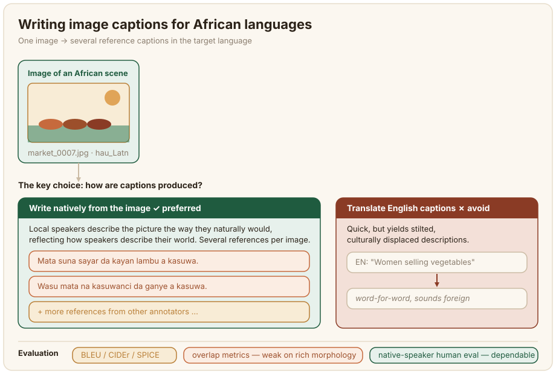

# Image captioning

*Last reviewed: 2026-07-07.*

Image captioning describes an image in fluent text. It is the multimodal cousin of text generation, and it inherits both that task's difficulty in low-resource languages and the vision task's dependence on relevant images. For African languages a good caption is not just grammatical, it is culturally apt, naming what is in the picture the way a local speaker would.

:::tip[Key points]

- Have native speakers write captions from the image; translated captions sound stilted and culturally displaced.
- Collect several reference captions per image.
- Overlap metrics miss correct captions in rich morphology; native-speaker evaluation is the dependable measure.
- Ground phrases to image regions only where a use needs the regions.
- Use images of local scenes, and recruit annotators who know the visual context.

:::



## What the data looks like

A captioning dataset pairs images with one or more reference captions in the target language. The crucial choice is how the captions are produced:

- **Translating English captions** is quick, but yields stilted, culturally displaced descriptions.
- **Writing captions natively from the image** gives text that reflects how speakers actually describe their world.

AfriCaption took the translation route at scale. It machine-translated Flickr8k captions into 20 African languages, including Hausa, Igbo, Yorùbá, Ewe, Luganda and Kinyarwanda. It kept one of the five English captions per image, chosen by semantic similarity to the others, filtered the translations, and had native speakers rate adequacy for Yorùbá, Igbo, Hausa and Ewe ([AfriCaption, 2025](../references.md#africaption-2025)). This gives broad coverage, but the images are still Flickr8k photos. As with all African vision work, captions of images that show African scenes and objects matter more than captions of borrowed Western photos.

A record pairs an image with several reference captions, since one caption cannot represent the many valid ways to describe a picture:

```json
{
  "image": "images/market_0007.jpg",
  "captions": [
    "Mata suna sayar da kayan lambu a kasuwa.",
    "Wasu mata na kasuwanci da ganye a kasuwa."
  ],
  "language": "hau_Latn",
  "source": "local-collection"
}
```

Collecting more than one caption per image is worth the cost, because the overlap metrics below reward a generated caption that resembles any reference, and a single reference unfairly penalizes a correct caption phrased differently.

## Annotation and evaluation

Captioning annotation means writing descriptions. Native speakers should write, not translate. The guidelines must fix:

- the level of detail;
- how to handle content the annotator is unsure about;
- how many captions each image gets, since one caption underrepresents the many valid ways to describe a picture.

**Task specification: image caption**

| Setting | Value |
|---|---|
| Annotator sees | The image |
| Annotator gives | A caption of a few lines, describing the image the way a local speaker naturally would |
| Choice | Free text; required |
| Notes | Several annotators caption the same image, to collect multiple references |

### Evaluation metrics

No automatic metric is enough on its own. Overlap metrics share BLEU's weakness on morphologically rich languages and cannot see a caption that is fluent but wrong. Native-speaker human evaluation remains the dependable measure, exactly as in [text generation](../text-generation/index.md).

| Metric | What it measures | Use it for |
|---|---|---|
| [BLEU](https://en.wikipedia.org/wiki/BLEU), [CIDEr](https://github.com/salaniz/pycocoevalcap), SPICE | Overlap with the reference captions (SPICE compares the objects, attributes and relations they mention) | Comparison with published results; weak on rich morphology |
| **CLIPScore** ([Hessel et al., 2021](../references.md#hessel-2021-clipscore)) | Caption-image alignment, with no reference captions | A second opinion; check that the model handles your language first |
| **BERTScore** ([Zhang et al., 2020](../references.md#zhang-2020-bertscore)) | Semantic similarity to the references in the target language | Partly corrects overlap metrics' blindness to morphology |

Neither CLIPScore nor BERTScore replaces human evaluation; both help to track regressions during development.

For agreement between human captions, surface overlap can understate agreement because several wordings may describe the same image correctly. Use chrF between caption pairs as one diagnostic ([Popović, 2015](../references.md#popovic-2015)), and an embedding-based similarity only after checking that the model handles the target language. Common chrF implementations weight recall above precision by default, so the score changes when you swap the two captions; for agreement, compute it in both directions and average, or set the weight so precision and recall count equally. Spot-check a sample by hand, especially where language coverage is weak, and do not interpret these scores as interchangeable with kappa. The [agreement table in Data quality](../4_data-quality/index.md#match-the-metric-to-the-annotation-shape) lists the measures for other annotation shapes.

## Grounding caption phrases to image regions

A plain caption says what is in the image but not where. Grounded captioning data adds that link: each noun phrase in a caption that names something visible ("a woman", "the green buckets") is tied to the image region it describes, usually a bounding box. Flickr30k Entities is the reference example. It added 244,035 coreference chains and 275,775 bounding boxes to the 158,915 captions of the 31,783 Flickr30k images, linking mentions of the same entity across the five captions of each image ([Plummer et al., 2017](../references.md#plummer-2017)). ReferItGame collected a related kind of data, referring expressions for single objects, through a two-player game in which one player described an outlined object and the other had to click on it ([Kazemzadeh et al., 2014](../references.md#kazemzadeh-2014)).

### When grounding is worth the cost

Grounding is much more expensive than captioning. Pont-Tuset et al. estimate that the two Flickr30k Entities stages took about 643 seconds per image (235 seconds to mark the entities and 408 to draw the boxes), not counting the time to write the captions ([Pont-Tuset et al., 2020](../references.md#pont-tuset-2020)). Budget for it only when a use needs the regions:

- **Evaluation of phrase localisation or grounded captioning**, where a model must point to what it names.
- **Checking object hallucination.** With grounded references you can see whether a generated caption names things that have no region in the image.
- **Training detectors or region-text models** for objects and local names that standard label sets lack, such as local dishes, tools or garments.

For a plain captioning model, grounding adds little. A common compromise is to ground only the evaluation split, or a few hundred images of it, and leave the training captions ungrounded. A cheaper alternative exists: Localized Narratives has annotators describe the image aloud while moving the mouse over what they describe, so each word gets a mouse-trace segment. It took about 145 seconds per image on average, including manual transcription, but a trace is a rough path, not a box, and annotators often circle around an object or move the mouse slightly before or after they name it ([Pont-Tuset et al., 2020](../references.md#pont-tuset-2020)). Use traces when coarse location is enough. Use boxes when you will score localisation with overlap thresholds.

### What a grounded record looks like

Store mentions as character offsets into the caption text, group them into chains, and attach boxes to chains rather than to single mentions. Record mentions that should have no box with an explicit reason, so that "no box" is never confused with "not yet annotated". The excerpt below shows two chains; a full record would also cover the produce ("kayan lambu", "ganye"):

```json
{
  "image": "images/market_0007.jpg",
  "captions": [
    "Mata suna sayar da kayan lambu a kasuwa.",
    "Wasu mata na kasuwanci da ganye a kasuwa."
  ],
  "mentions": [
    {"id": "m1", "caption": 0, "start": 0, "end": 4, "text": "Mata", "chain": "c1"},
    {"id": "m2", "caption": 1, "start": 5, "end": 9, "text": "mata", "chain": "c1"},
    {"id": "m3", "caption": 0, "start": 33, "end": 39, "text": "kasuwa", "chain": "c2"},
    {"id": "m4", "caption": 1, "start": 34, "end": 40, "text": "kasuwa", "chain": "c2"}
  ],
  "chains": [
    {"id": "c1", "type": "people", "boxes": [[112, 40, 210, 380], [260, 52, 351, 377]]},
    {"id": "c2", "type": "scene", "boxes": [], "no_box_reason": "scene"}
  ]
}
```

Fix the text normalisation (for example, Unicode NFC) before computing offsets, and never edit a caption after mentions are marked without re-checking them. The [formats page](../image-data/formats-and-merging.md#coordinate-conventions-that-break-conversions) covers box coordinate conventions.

### How to annotate it

Flickr30k Entities did not ask one worker to do everything at once. It split the work into small tasks and checked each one ([Plummer et al., 2017](../references.md#plummer-2017)). The same order works with any annotation tool:

1. **Mark the mentions.** Flickr30k Entities took noun-phrase chunks from an automatic chunker as candidates. For many African languages, a chunker may not exist or may be unreliable, so annotators mark the spans themselves. The guidelines must say where a mention starts and ends when the noun carries prefixes or suffixes, or is written together with a preposition or possessive. The span rules from [named-entity work](../sequence-labelling/ner.md) carry over.
2. **Link mentions that refer to the same thing** across the captions of one image. Ask pairwise "same entity?" questions instead of asking someone to build whole chains, then have a second person check each chain with more than one mention. Flickr30k Entities assumed that two mentions in the same caption, or of different coarse types such as people and vehicles, are not coreferent. This cut the number of questions. See [coreference annotation](../sequence-labelling/relations.md#coreference-as-a-special-case) for the general method.
3. **Decide whether a box is needed.** Mentions of the whole scene ("at the market"), of things outside the frame, and of actions or abstract ideas get no box. Record which reason applies.
4. **Draw the boxes.** Draw one box per entity that can be told apart, and one box around a group whose members cannot (a crowd, a pile of tomatoes). Apply the same tightness, occlusion and crowd rules as for detection; [Box and region rules](../image-data/region-guidelines.md) sets these out.
5. **Check quality and coverage.** A second person judges each new box (tight, not a duplicate) and then whether all required boxes are present. Flickr30k Entities asked for a second opinion before accepting "all boxes drawn", and a third to break ties.

### How to check it

- **Automatic checks.** Every offset must match its mention text, every chain with a visual type must have at least one box or a recorded no-box reason, and every box must lie inside the image.
- **Gold items.** Flickr30k Entities mixed verification questions with known answers into the jobs, and kept only workers who maintained accuracy on them ([Plummer et al., 2017](../references.md#plummer-2017)). The [gold data section](../4_data-quality/index.md#use-gold-data-and-control-checks) explains how to run this fairly.
- **A click test.** Borrow the ReferItGame idea for a sample: show a second annotator the image and one phrase, ask them to click on what it names, and treat a miss as a sign that the phrase is ambiguous or the box is wrong ([Kazemzadeh et al., 2014](../references.md#kazemzadeh-2014)).
- **Box agreement.** For a doubly annotated sample, compare boxes for the same mention by overlap (IoU), as in [merging boxes from several annotators](../image-data/formats-and-merging.md#merging-boxes-from-several-annotators).
- **Report the residual error.** Even after these checks, the Flickr30k Entities authors estimated that about 8% of their images contained some chunking or coreference error ([Plummer et al., 2017](../references.md#plummer-2017)). Publish a hand-checked estimate for your own data in the dataset card.

Grounding raises the privacy stakes. A phrase that names or describes a person, tied to a box around that person, makes the record more identifying than the caption alone. Apply the [visual privacy rules](../image-data/visual-privacy.md#consent-for-people-in-images) before grounding people.

## The 2026 modelling landscape

Prompting a general multimodal LLM is now the workable captioning baseline, not a fine-tuned encoder-decoder captioner. The model options, licences and closed-API caveats are shared with VQA and are set out in [Models for image-text tasks in 2026](./index.md#models-for-image-text-tasks-in-2026). For captioning specifically:

- **Start with PaliGemma 2,** which was pretrained with multilingual captioning among its core tasks ([Steiner et al., 2024](../references.md#steiner-2024-paligemma2)), alongside Qwen2.5-VL.
- **For an AfriCaption language,** prompt-evaluate on AfriCaption data, then LoRA fine-tune the stronger model on it. Its captions are filtered machine translations of Flickr8k, so also test on native captions of local images.
- **For a language AfriCaption does not cover,** native speakers must check any translated captions against the image.
- **Avoid fine-tuning on unchecked machine translations of English captions** (for example from COCO). They can teach the model English-shaped captions of Western scenes.

## What it will actually cost you

Captioning data is expensive per record because native writing is skilled work, and multi-reference captions cost more than single-reference ones.

The figures below are rough, order-of-magnitude planning estimates from practitioner experience, not measured or published figures. Use them to start a budget conversation, then replace them with your own quotes and pilot numbers.

- **Prompt-only evaluation of open MLLMs on an AfriCaption language.** One to two person-weeks; ten to forty GPU-hours across the candidate models.
- **LoRA fine-tuning an MLLM on AfriCaption data.** Two to four person-weeks; twenty to eighty GPU-hours.
- **A natively written captioning set for a new African language** (1,000-3,000 images × 3-5 captions each). Six to fifteen months elapsed; six to fifteen person-months. Native captioning is slower than translation; budget accordingly.
- **A defensible evaluation-only captioning set** (500-1,000 images × 3-5 captions each). Three to six months; two to five person-months.
- **Human evaluation of generated captions.** One to two person-weeks per evaluator per 200 items. Captioning evaluation is faster than VQA evaluation because the evaluator does not have to reason about the question-answer match.

## Known limitations to watch for

- **BLEU and CIDEr under-report caption quality in morphologically rich languages.** A correct caption that uses a different inflection or affix from the reference gets little or no n-gram credit. Report a semantic metric such as BERTScore alongside, and treat human evaluation as final.
- **MLLMs describe Western scenes better than African scenes.** A model that captions a European kitchen well may misname the objects, the setting and the activities in a Nigerian market. The failure is visual coverage, not language coverage. Evaluate on target-context images specifically.
- **Fluent captions can be badly wrong.** A grammatically perfect Yorùbá caption that misidentifies the dish in the image is a worse failure than a broken caption that names the dish correctly. Fluency is not a proxy for correctness; the review protocol must treat these as separate axes.
- **Translated captions carry their source.** A model fine-tuned on machine-translated captions of an English corpus learns grammatical target-language text with English-shaped content and Western scenes. If you use translated data such as AfriCaption, test the model on natively written captions of local images.
- **Consent for identifiable people is essential.** A caption that identifies a person by name, community or role turns an image record into personally identifiable data. Guidelines must forbid identifying captions unless explicit consent has been obtained.
- **Cultural naming matters.** A dish with three names in three languages, a garment with community-specific meaning, or a ceremony named only by insiders: all of these produce brittle captioning if the annotator is not from the community. Recruit annotators from the visual context, not just the language.

## Further reading

- AfriCaption ([AfriCaption, 2025](../references.md#africaption-2025)): a 20-language African captioning dataset built by filtered machine translation of Flickr8k, with a baseline model. Read it before designing a new captioning collection.
- PaliGemma 2 ([Steiner et al., 2024](../references.md#steiner-2024-paligemma2)): a workable open MLLM baseline for captioning.
- CLIPScore ([Hessel et al., 2021](../references.md#hessel-2021-clipscore)): the reference-free caption-image alignment metric; a second-opinion signal alongside BLEU.

<details>
<summary>Additional references</summary>

- [Qwen2.5-VL blog (Alibaba, 2025)](https://qwenlm.github.io/blog/qwen2.5-vl/) and Qwen2-VL ([Wang et al., 2024](../references.md#wang-2024-qwen2vl)): a strong open MLLM family for multilingual captioning.
- InternVL 2.5 ([Chen et al., 2024](../references.md#chen-2024-internvl25)): the competing OpenGVLab MLLM family.
- BERTScore ([Zhang et al., 2020](../references.md#zhang-2020-bertscore)): a reference-based semantic metric for captions in the target language.
- Molmo and PixMo ([Deitke et al., 2024](../references.md#deitke-2024-molmo)): a fully open MLLM with open weights, data and code.

</details>
