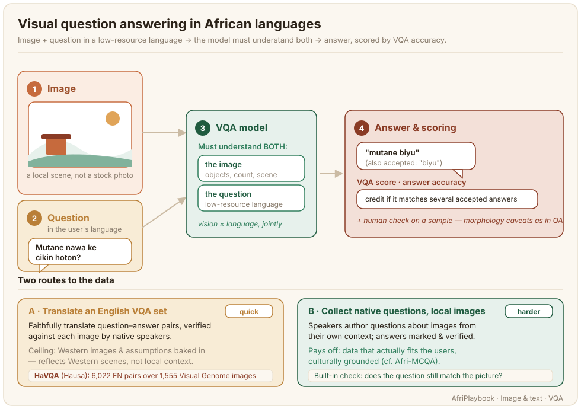

# Visual question answering

*Last reviewed: 2026-07-07.*

Visual question answering (VQA) asks a model a question in natural language about an image and expects an answer: what colour is the car, how many people are there, what is the person doing. For African languages it is a demanding test, because the model must understand both the image and a question posed in a low-resource language at the same time.

:::tip[Key points]

- Translating an English VQA set is the quick route, but it keeps Western images and assumptions.
- Native speakers must check every translated question and answer against the image.
- Keep several accepted answers per question, so inflected forms are not marked wrong.
- Translated benchmarks over-report quality; test on local images and native questions.
- Diagnose language failures and image failures separately.

:::



## What the data looks like

A VQA dataset is images, questions about them, and answers, usually many questions per image. The first substantial African resource, HaVQA, built Hausa VQA by carefully translating 6,022 English question-answer pairs over 1,555 Visual Genome images. The translations were kept faithful to what the images show ([HaVQA, 2023](../references.md#havqa-2023)).

That translation route is the pragmatic starting point, but it has a ceiling. The images and questions come from a Western dataset, so they reflect Western scenes and assumptions. Collecting questions written natively by speakers about images from their own context is harder, but it produces data that actually fits the users. Cultural multimodal benchmarks push in that direction:

- **CVQA** covers 31 languages, including Amharic, Oromo, Swahili, Igbo and Kinyarwanda, with culturally relevant images and native questions ([Romero et al., 2024](../references.md#romero-2024-cvqa)).
- **Afri-MCQA** has about 7,500 question-answer pairs in 15 African languages, written by native speakers ([Tonja et al., 2026](../references.md#tonja-2026-afrimcqa)).

A record links an image to a question and the answers people gave, with a list of answers so the scoring below can credit any accepted form:

```json
{
  "image": "images/vg_001234.jpg",
  "question": "Mutane nawa ke cikin hoton?",
  "answers": ["mutane biyu", "biyu"],
  "language": "hau_Latn",
  "source": "HaVQA"
}
```

Keeping several accepted answers per question matters here for the same morphology reason as in text question answering: "biyu" and "mutane biyu" are both correct, and a single gold answer would mark one of them wrong.

## Annotation and evaluation

VQA annotation means writing questions and marking correct answers, or translating them and verifying them against the image. Native speakers must do this, because a translated question that no longer matches the picture is worse than useless. Before starting, define how to handle open-ended answers, synonyms and inflected forms.

The task shows the image with a box for the question and one for the answer. A native speaker can write a new pair or, on the translation route, retype and correct a translated pair against the picture. The check that the pair still matches the image is an explicit, required choice:

**Task specification: VQA question-answer pair**

| Setting | Value |
|---|---|
| Annotator sees | The image (and, on the translation route, the translated question and answer to correct) |
| Annotator gives | A one-line question about what the image shows; a one-line correct answer; a match judgement |
| Choice | Question and answer: free text, editable. Match judgement: exactly one of "Question and answer match the image" / "Does not match, discard"; required |

VQA is scored by answer accuracy, often with the VQA score. It collects 10 human answers per question and counts an answer fully correct if at least 3 people gave it ([Antol et al., 2015](../references.md#antol-2015)). The same morphology caveats apply as in text question answering, so the [Exact Match and token-F1 approach](../text-generation/question-answering.md) carries over. Check a sample by hand alongside the automatic number.

## The 2026 modelling landscape

General multimodal LLMs now handle VQA by prompting. The model options, licences and closed-API caveats are shared with captioning and are set out in [Models for image-text tasks in 2026](./index.md#models-for-image-text-tasks-in-2026). Two points are specific to VQA:

- **Answers that point to a place.** If the answer must refer to a location in the image, include Molmo, whose 2D pointing data supports grounded answers ([Deitke et al., 2024](../references.md#deitke-2024-molmo)).
- **Fine-tuning data.** If prompting falls short, LoRA fine-tune on HaVQA (Hausa) or a translated Visual Genome subset for your language. Still have native speakers check 200+ outputs: automatic VQA scores on translated benchmarks over-report quality.

## What it will actually cost you

VQA data is expensive per record because every record touches an image, a question and an answer, and every one needs a native speaker's judgement that all three are consistent.

The figures below are rough, order-of-magnitude planning estimates from practitioner experience, not measured or published figures. Use them to start a budget conversation, then replace them with your own quotes and pilot numbers.

- **Prompt-only evaluation of open MLLMs (PaliGemma 2, Qwen2.5-VL) on HaVQA or a translated benchmark.** One to two person-weeks; ten to forty GPU-hours for inference across the candidate models. Colab Pro / Kaggle is enough for 7B-class models at inference; 28B/72B needs a dedicated GPU.
- **LoRA fine-tuning an MLLM on HaVQA for a covered language.** Two to four person-weeks; twenty to eighty GPU-hours. Adapter weights can be released independently of the base model, which sidesteps some redistribution restrictions.
- **Extending HaVQA to a new African language via careful translation.** Three to eight months elapsed; three to eight person-months of question-authoring and image-verification work. Translation without image-verification produces training data that is worse than no data: every translated question has to be checked against the image by a native speaker.
- **Building a natively-authored VQA corpus** (500-2,000 image-question-answer triples). Six to twelve months elapsed; five to twelve person-months. Native question-authoring is skilled work; two to four expert authors + adjudicators is the workable team size. Cost per record is 3-5x higher than for translated corpora.
- **Human evaluation of VQA outputs.** Two to three person-weeks per evaluator per 200 items. VQA evaluation is slower than sentiment or NER evaluation because the evaluator has to look at the image, read the question, read the model's answer, and judge the joint correctness.

## Known limitations to watch for

- **Translated benchmarks over-report quality.** A model that scores well on HaVQA is scoring well on Hausa translations of Visual Genome images, not on Hausa questions about Hausa scenes. Benchmarks built natively from local images and questions are much harder: open-weight models score near zero on open-ended VQA in native African languages in Afri-MCQA ([Tonja et al., 2026](../references.md#tonja-2026-afrimcqa)).
- **Multimodal LLMs can answer fluently and wrongly in low-resource languages.** Prompting an MLLM in Yorùbá can produce a fluent, grammatical, plausible-looking, and factually wrong answer. Fluency is not a signal of correctness; check answers against the image.
- **Image bias is not language bias.** A model that handles Hausa questions well on Western images may fail on African market scenes, agricultural imagery, or traditional dress because of what its visual encoder was trained on, not because of the language. CVQA finds models struggle on culturally specific images even in English, and do worse again when the question is in the local language ([Romero et al., 2024](../references.md#romero-2024-cvqa)); Afri-MCQA's control experiments likewise separate language competence from cultural knowledge ([Tonja et al., 2026](../references.md#tonja-2026-afrimcqa)). Diagnose language failure and image failure separately.
- **VQA scoring credits partial matches unequally.** The classic VQA score (10 human answers, full credit when at least 3 match) ([Antol et al., 2015](../references.md#antol-2015)) does not translate cleanly to African-language settings where morphological variation multiplies acceptable forms. Report accuracy alongside human agreement on a random sample; do not rely on a single automatic number.
- **Counting questions are a known weak spot.** In the original VQA benchmark, "number" questions scored far below yes/no questions for every model ([Antol et al., 2015](../references.md#antol-2015)), and counting remains hard for current MLLMs. If your use case is counting-heavy (agriculture, retail inventory, medical imaging), measure this specifically before scoping.
- **Cross-script transfer may be weak.** A VQA model prompted in Latin-script Hausa may handle Ajami-script Hausa poorly, and vice versa, since tokenisers and training data see the two scripts very differently. Test each script separately.

## Further reading

- [HaVQA, 2023](../references.md#havqa-2023): the reference African-language VQA corpus and its translation-based construction methodology. Required reading for any team scoping VQA in an African language.
- Afri-MCQA ([Tonja et al., 2026](../references.md#tonja-2026-afrimcqa)): a multimodal cultural QA benchmark with about 7,500 pairs in 15 African languages, in text and speech; the closest African-language multimodal QA measurement surface.
- CVQA ([Romero et al., 2024](../references.md#romero-2024-cvqa)): a culturally diverse multilingual VQA benchmark with native questions in 31 languages, several of them African.
- VQA ([Antol et al., 2015](../references.md#antol-2015)): the original benchmark and the source of the standard VQA accuracy metric.
- PaliGemma 2 ([Steiner et al., 2024](../references.md#steiner-2024-paligemma2)): the workable small-scale open MLLM baseline.
- Qwen2-VL ([Wang et al., 2024](../references.md#wang-2024-qwen2vl)): a strong open MLLM lineage for multilingual VQA and text-in-image understanding.

<details>
<summary>Additional references</summary>

- InternVL 2.5 ([Chen et al., 2024](../references.md#chen-2024-internvl25)): the competing OpenGVLab MLLM lineage; worth measuring against Qwen2.5-VL for language coverage.
- Molmo and PixMo ([Deitke et al., 2024](../references.md#deitke-2024-molmo)): the fully open Allen AI MLLM with pointing-grounded answers; use when the answer must reference a specific location in the image.
- LLaVA-1.5 ([Liu et al., 2024](../references.md#liu-2024-llava15)): the earlier open MLLM recipe; useful for reproducibility baselines.

</details>
