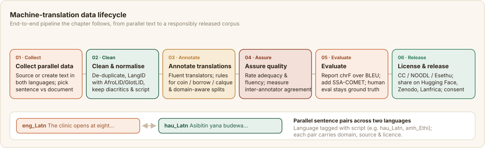

# Machine Translation

Machine translation is one of African NLP's flagship goals and one of its hardest. It needs parallel data (sentences paired across two languages), and for most African languages that data barely exists. This chapter follows the pipeline end to end: collecting parallel text, cleaning it, annotating new translations, assuring quality, evaluating, and releasing.



:::tip[Key points]

- A small amount of good, human-made parallel data beats waiting for the web to supply it.
- Pin down language, script, domain and alignment level (sentence or document) before you collect.
- Clean in stages, deduplicate before splitting, and keep diacritics and scripts intact.
- Give translators clear rules for new terms, and share a glossary and translation memory.
- Report chrF before BLEU, add a learned metric where it covers the language, and let native speakers have the final word.

:::

## What machine translation needs, and why African languages make it hard

A machine-translation system learns to map text from a source language to a target language. Modern systems are neural. The strongest are large multilingual models trained on many language pairs at once, which lets a high-resource pair lend statistical strength to a low-resource one.

The applications for African languages are immediate: access to health, government and education information, and a place in a digital world that defaults to a handful of languages.

The obstacle is data. Neural translation needs many parallel sentences, and for most African languages there are few, scattered across religious texts, the occasional news site and government documents. What exists online is often unreliable: an audit of web-crawled data found that for many low-resource languages a large share was mislabelled, low quality, or not the language at all ([Kreutzer et al., 2022](../references.md#kreutzer-2022)).

The community has answered with purpose-built data:

- **MAFAND-MT** showed that a few thousand high-quality human translations in the news domain go a long way ([Adelani et al., 2022b](../references.md#mafand-2022)).
- **NLLB** and its **FLORES-200** benchmark extended translation and evaluation to 200 languages, including many African ones ([NLLB Team, 2022](../references.md#nllb-2022)).
- Newer African-centric multilingual models keep widening the number of languages covered.

The lesson is consistent: for African translation, building a small amount of good parallel data beats waiting for the web to supply it.

## Collect parallel data

The first job is to find or create text that exists in both your source and your target language. Common sources are:

- **Religious translations.** The Bible is translated into more languages than any other text, but it is narrow in domain and its rights need checking (see [Religious and literary texts](../2_data-collection/2_data-sources.md#religious-and-literary-texts)).
- **News outlets** with editions in several languages.
- **Government and health publications.**
- **Translations the community produces itself.**

**Decide the alignment level early.** Sentence level or document level matters more than it sounds. Most translation data is sentence pairs, but real translation works over whole documents, and the AfriDoc-MT corpus found that models trained only on sentences generalise poorly to longer documents ([AfriDoc-MT, 2025](../references.md#afridocmt-2025)).

**Choose the domain on purpose.** A general-domain dataset is broadly useful but shallow. A domain-specific one serves a concrete need: AfriDoc-MT was built in health and IT, and AfriScience-MT in science and technology ([AfriScience-MT, 2026](../references.md#afriscience-2026)), each because that domain mattered to its users.

**When parallel text does not exist, translate.** Use human translation, ideally through the same participatory, native-speaker route the rest of this playbook recommends ([Nekoto et al., 2020](../references.md#nekoto-2020)).

A parallel corpus is two aligned sides plus the metadata that lets others trust it. One JSON object per pair keeps the alignment explicit. It also carries the domain, direction and provenance that a bare two-column file loses:

```json
{
  "src_lang": "eng_Latn",
  "tgt_lang": "hau_Latn",
  "src": "The clinic opens at eight in the morning.",
  "tgt": "Asibitin yana buɗewa da ƙarfe takwas na safe.",
  "domain": "health",
  "source": "project-translation",
  "translator": "native-speaker",
  "license": "CC BY 4.0"
}
```

Name each language together with its script (`hau_Latn`, `amh_Ethi`), not with a bare language code. Several African languages are written in more than one script, so a translation pair is only meaningful once both the language and the script are fixed.

## Clean and normalise the parallel text

Raw parallel data is noisy, and noise in translation data does double harm: a bad pair teaches the model a wrong mapping. Clean in stages:

1. **Strip markup.** Remove HTML and other formatting.
2. **Remove duplicates before splitting.** Drop exact and near-duplicate pairs, so the same sentence cannot leak from training into test.
3. **Drop broken pairs.** Remove pairs where one side is empty or where the two sides differ wildly in length.
4. **Check the language of both sides.** Run language identification to catch wrong-language and machine-translated segments. Use tools that cover African languages, such as AfroLID ([Adebara et al., 2022](../references.md#afrolid-2022)) or GlotLID ([Kargaran et al., 2023](../references.md#glotlid-2023)), not general detectors that misread them.
5. **Normalise consistently.** Treat punctuation, numbers and dates the same way throughout, and expand abbreviations where it helps.
6. **Handle scripts and diacritics with care.** African languages are written in Latin, Ge'ez, Ajami and other scripts, sometimes one language in more than one. Preserve diacritics; never strip them.
7. **Re-align where needed.** Re-segment and re-align sentences where the original alignment is unreliable.
8. **Filter harmful content.** Remove toxic or harmful text before it reaches annotators or the model.

## Annotate translations

When you create translations rather than mine them, the annotation design decides their quality.

**Choose the right translators.** They should be fluent in both languages and, for specialised domains, familiar with the subject. A translator who does not know the material will guess.

**Write clear instructions for the hard cases.** African translators meet these constantly:

- terms that do not yet exist in the target language: borrow, calque (translate literally, part by part) or coin a new word;
- names;
- code-switching;
- culturally specific content.

This is not hypothetical. To build AfriScience-MT, translators working with science communicators had to coin new scientific terms in six African languages because none existed ([AfriScience-MT, 2026](../references.md#afriscience-2026)).

**Capture metadata with every pair:** source, language and variety, translator, version and licence. Store the dataset in one clean, consistent format.

**Plan the split.** Plan the train, validation and test split on purpose. A naive random split can leak near-duplicate sentences or let one domain dominate. A domain-aware split gives a more honest measure of how the model will do on text it has not seen.

A translation task shows the source sentence and gives the translator a box for the target. It should also record how the translator handled hard cases, so that a coined or borrowed term is flagged for review:

**Task specification: sentence translation**

| Setting | Value |
|---|---|
| Annotator sees | The source sentence, under the instruction "Translate this sentence" |
| Annotator gives | (1) The translation in the target language, as free text; (2) how hard cases were handled: coined a new term, borrowed from another language, calque (literal loan translation), source contains code-switching |
| Choice | Translation: free text, required, one submission per item. Hard cases: one or more, optional |
| Notes | For post-editing, the translation box starts with a machine-translation draft instead of being empty |

**Post-editing.** Instead of translating from scratch, the translator can start from a machine-translation draft and correct it. This is faster than retyping. But post-editing can anchor the translator to the machine's phrasing, so it suits routine domains better than creative or culturally loaded text.

For post-editing, show the source beside an editable draft. Keep both the original machine output and the corrected translation, and record which model or draft version produced the draft. This lets you measure edit effort and anchoring later.

### Glossaries and translation memory

When several translators work on one corpus, or one translator works across many batches, the same term and the same sentence will come up again and again. Without shared records, each person resolves them differently, and the corpus ends up with three spellings of one coined word and two translations of one recurring instruction. Two shared resources prevent this.

**Keep a project glossary.** A glossary (also called a term base) lists each coined, borrowed or domain term with its approved target form, a short note on meaning or usage, and the date it was agreed.

- Fill it from the hard-case choices translators record per item (see the task specification above). When someone marks "Coined a new term" or "Borrowed from another language", a reviewer decides on the form, and the glossary records that decision once for everyone.
- Version the glossary like the dataset, and make it available to every translator while they work.
- Tell translators to follow it, or to raise a query, rather than invent a competing form.

This matters most where terminology is being created as the corpus is built, as in the AfriScience-MT work described above ([AfriScience-MT, 2026](../references.md#afriscience-2026)).

**Keep a translation memory.** A translation memory stores approved pairs of source and target segments, usually sentences. When a segment that has already been translated and approved appears again, the translator sees the earlier translation and reuses or adapts it, so repeated segments such as standard instructions, headings and boilerplate come out the same across translators and batches. Many annotation and translation tools can show glossary terms and memory matches next to the translation box. If yours cannot, a shared, searchable spreadsheet of terms and approved segments still gives most of the benefit.

**Use standard formats when you exchange material.** If you share work with professional translators or localisation teams, two open XML formats are worth knowing. TMX (Translation Memory eXchange) is the exchange format for translation memories, designed to move memory data between tools with little or no loss ([LISA, 2005](../references.md#tmx-2005)). XLIFF is the exchange format for bilingual files: each segment holds a source and an optional target, so a file with existing targets can arrive ready for post-editing ([OASIS, 2018](../references.md#xliff-2018)). Treat these as ways to work with other tools, not as requirements. A JSON record per pair, like the one earlier in this chapter, is enough for most research datasets.

**Keep structural context.** Whatever format you use, record as metadata where each segment came from (a heading, a paragraph or a table cell) and its position in the document, so the document can be rebuilt and document-level work stays possible.

:::warning[Suggestions anchor translators too]

Memory matches and glossary hits are drafts, not answers. Like a machine-translation draft (see [Treat drafts as drafts](../3_annotation-design/model-assisted-annotation.md#treat-drafts-as-drafts)), a reused suggestion can anchor the translator to its wording, and an early mistake that enters the memory spreads to every later segment that reuses it. Record in each pair's metadata whether the translation started from a suggestion, review a sample of suggestion-based segments separately, and correct the glossary or memory entry itself when you find an error. Never put test or evaluation sentences into the memory or the glossary: if a test sentence's approved translation sits in the memory, it can be reused in training pairs, and the test set quietly leaks into training.

:::

## Assure quality

Translation quality control combines automatic filtering with human judgement. Confidence and length-ratio filters can flag suspect pairs for review, but they do not replace people.

- **Rate a sample.** Have native speakers rate a sample of the translations for **adequacy** (does the translation keep the source meaning?) and **fluency** (does it read naturally?).
- **Measure agreement.** When several evaluators rate the same items, measure their inter-annotator agreement so you know how reliable the judgements are. See [Data Quality](../4_data-quality/index.md), and [Match the metric to the annotation shape](../4_data-quality/index.md#match-the-metric-to-the-annotation-shape) for ratings, rankings and free text. For rating and comparison designs, see [Human Evaluation Designs](../3_annotation-design/human-evaluation-designs.md).
- **Read the disagreements.** Disagreement among evaluators is informative. Fluency in particular is partly subjective and depends on dialect.

## Evaluate translation

Report more than one metric. Each measures something different, and the cheap ones are weakest exactly where African languages live.

| Metric | What it measures | Use for African languages |
|---|---|---|
| [BLEU](https://en.wikipedia.org/wiki/BLEU) | Matching word sequences | Unreliable for morphologically rich languages, where one root takes many surface forms. Report it, but read it with caution. |
| chrF ([Popović, 2015](../references.md#popovic-2015)) | Matching character sequences (character n-grams) | Handles rich morphology better because it gives credit for partly matching words. Report it first. |
| COMET, BERTScore and other learned metrics | Meaning, using a trained model | Closer to human judgement, but only when the model has seen the language. SSA-COMET is trained for under-resourced African languages ([SSA-COMET, 2025](../references.md#ssa-comet-2025)). |
| Human evaluation by native speakers | Adequacy and fluency as speakers judge them | The ground truth. Automatic scores are fast, approximate stand-ins between human checks. |

`sacrebleu` computes chrF and BLEU with standard, shareable settings, and COMET adds a learned score where a model covers the language:

```python
# pip install sacrebleu unbabel-comet
import sacrebleu

hypotheses = ["Asibitin yana buɗewa da ƙarfe takwas na safe."]
references = [["Asibitin yana buɗewa da ƙarfe takwas da safe."]]  # one list per reference set

chrf = sacrebleu.corpus_chrf(hypotheses, references)
bleu = sacrebleu.corpus_bleu(hypotheses, references)
print(f"chrF2: {chrf.score:.2f}")   # report this first for African languages
print(f"BLEU:  {bleu.score:.2f}")   # report alongside, read with caution

# Learned metric: only meaningful if the model covers the language.
# SSA-COMET is trained for under-resourced African languages.
from comet import download_model, load_from_checkpoint
model = load_from_checkpoint(download_model("McGill-NLP/ssa-comet-mtl"))
data = [{"src": "The clinic opens at eight in the morning.",
         "mt": hypotheses[0],
         "ref": references[0][0]}]
print(f"SSA-COMET: {model.predict(data, gpus=0).system_score:.3f}")
```

Where no metric covers a language, none of these numbers replaces a native speaker reading the output.

## License and release responsibly

A translation dataset is only useful to others if they can find it and are allowed to use it. It is only safe to release if it does not expose the people in it.

- **Choose a licence on purpose.** Use a Creative Commons licence or one of the African community licences, such as NOODL or Esethu, that keep benefit with the source community (see [Data Governance](../data-governance/index.md)).
- **Release where the community will look,** such as Hugging Face, Zenodo, or the Lanfrica catalogue (see [Hosting and Preservation](../9_dataset-lifecycle/hosting.md)).
- **Attend to the ethics.** Get consent for any human-produced translations, and avoid training on machine-translated text that will quietly degrade the next model.
- **Remember the weight of the output.** A translation system carries representational weight: the words it normalises become, for many users, the language itself.
