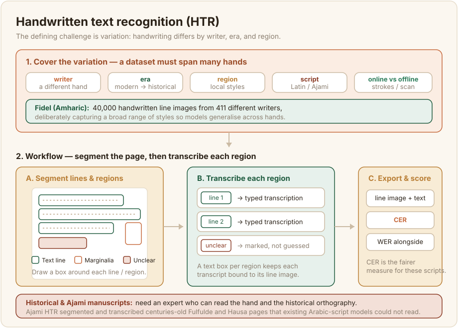

# Handwritten text recognition

*Last reviewed: 2026-07-07.*

Handwritten text recognition (HTR) reads handwriting rather than print. It is harder than OCR because no two hands are alike, and it is especially valuable in Africa, where a great deal of knowledge, from personal and administrative records to centuries of scholarly manuscripts, exists only in handwriting.

:::tip[Key points]

- HTR data is line or page images of handwriting paired with transcriptions, with the lines marked first.
- Variation between writers is the main challenge: the number of writers matters more than the number of lines.
- Settle conventions for unclear characters, abbreviations and scribal marks before transcription starts.
- Score with CER first and WER alongside, and report results across writers and periods.
- Handwritten records often carry personal data, so govern them like sensitive data.

:::

## What the data looks like

An HTR dataset pairs images of handwritten lines or pages with their transcriptions. There are two settings:

- **Offline recognition** works from a scanned or photographed image.
- **Online recognition** also captures the pen strokes as they are written. It needs a digitiser (a pen tablet or touch screen) but makes the task easier.

The defining challenge is variation: handwriting differs by writer, era and region, so a dataset has to cover many hands to generalise. Fidel did this for Amharic by collecting 40,000 handwritten line images from 411 different writers, deliberately capturing a broad range of styles ([Fidel, 2025](../references.md#fidel-2025)).

The manuscript tradition adds historical depth and difficulty. A handwritten dataset for Ajami manuscripts in Fulfulde and Hausa had to segment and transcribe old manuscript pages that existing Arabic-script models could not read ([Ajami HTR, 2025](../references.md#ajami-htr-2025)).

## Annotation and evaluation

HTR annotation is segmentation plus transcription: the lines and regions of a handwritten page must be marked before they are transcribed. Historical manuscripts often need an expert who can read both the hand and the historical orthography. Settle conventions for unclear characters, abbreviations and scribal marks before starting.

Because the page must be segmented before it is transcribed, annotators can do both in one pass: draw a box around each line, label it, and type its transcription for that box.

**Task specification: handwritten line segmentation and transcription**

| Setting | Value |
|---|---|
| Annotator sees | One page image |
| Annotator gives | A box around each line or region, one label per box, and a transcription attached to each box |
| Choice | Label: exactly one of Text line, Marginalia, Unclear. Transcription: free text per box |
| Notes | Follow the project's manuscript conventions. Use Unclear for faded or damaged text that cannot be read with confidence, rather than guessing |

Keeping each transcription attached to its own box means the export gives you every line region together with its text, ready to score with the same tooling as OCR. The Unclear label gives an expert an honest way to mark what cannot be read.

Like OCR, HTR is evaluated with **Character Error Rate (CER)** as the main metric and **Word Error Rate (WER)** alongside it. CER is again the fairer measure for these scripts.

## The 2026 modelling landscape

Handwriting recognition in 2026 sits between three model families:

- **[TrOCR](https://arxiv.org/abs/2109.10282)** (Microsoft, 2021): a vision-encoder-plus-text-decoder architecture built for text recognition, MIT-licensed, and still the workable open reference for line-level handwriting recognition. Community fine-tunes exist for other languages. Fine-tuning an existing TrOCR checkpoint on about 5,000-10,000 target-language line images is the shortest path to a usable model on a new hand.
- **[Kraken](https://kraken.re/)**: the reference open engine for historical HTR, including non-Latin scripts. Widely used by digital-humanities projects to train on decades or centuries of scanned handwriting. Its `ketos` training tool is the workable path for Ajami, Ge'ez, and other historical African-script manuscripts where TrOCR's Western-handwriting bias makes fine-tuning fragile.
- **[GOT-OCR 2.0](https://arxiv.org/abs/2409.01704)** and general MLLMs (Qwen2.5-VL, InternVL 3): capable of handwriting recognition as one of many tasks, noisier per-character than dedicated HTR engines but strong when the task requires joint reading + structured extraction (e.g., transcribing a manuscript and identifying scribal marks or marginalia in the same pass).

**Editorial opinion: where to start.** These are the editors' suggested starting points, not measured results:

| Material | Suggested first path |
|---|---|
| Contemporary Latin-script handwriting (school records, health surveys, field notes) | Fine-tune TrOCR on 5,000-10,000 target-domain line images, compare against a Kraken-trained baseline for the same script, and report CER with and without diacritic normalisation. |
| Historical Ge'ez / Amharic manuscripts | Train Kraken on Ge'ez handwriting data such as Fidel's handwritten lines. |
| Ajami manuscripts (Fulfulde, Hausa, Wolof) | Train Kraken on a training set from the same manuscript tradition; general Arabic-script HTR models are not adequate. |

**Online HTR** (pen-stroke capture) is less common in African projects because the digitising hardware is expensive. Where it is available, it is usually more accurate than offline recognition of the same script, because stroke order and timing are extra evidence. The cost is the hardware and the need to capture the writing live.

## What it will actually cost you

HTR costs more than OCR at every scale, because handwriting variation means more transcription time per record and more training iterations. The figures below are rough, order-of-magnitude planning estimates from the editors, not measured benchmarks:

| Activity | Scale | Rough effort |
|---|---|---|
| Fine-tune TrOCR or Kraken on an existing corpus (Fidel handwritten, Ajami HTR) | Existing corpus | 2-4 person-weeks of engineering; 20-80 GPU-hours across candidate models |
| Collect a new contemporary-handwriting corpus | 5,000-10,000 line images from 50-200 writers | 6-12 months elapsed; 4-10 person-months |
| Build a manuscript-tradition HTR corpus (Ge'ez, Ajami or similar) | 5,000-20,000 line images | 2-5 years elapsed; 10-40 person-months |
| Build an evaluation-only HTR set | 500-1,500 line images | 3-6 months elapsed; 2-5 person-months |
| Human evaluation of HTR output | 200 items | 2-4 person-weeks per evaluator |

What slows each one down:

- **New handwriting corpora:** recruiting writers with varied hands. A corpus from 100 writers behaves very differently from one from 10, even at the same line count.
- **Manuscript corpora:** finding experts who can read the historical hand, more than the transcription work itself.
- **Human evaluation:** uncertain characters, marginalia and scribal marks all need judgement.

## Known limitations to watch for

- **Writer variation dominates.** A model trained on 5,000 lines from 10 writers is likely to do much worse on an 11th writer. Corpus size in *writers* matters more than corpus size in *lines*. Report cross-writer CER, not just headline CER.
- **Historical orthography drift.** A model trained on 21st-century handwriting tends to misread 20th-century marginalia, and one trained on 20th-century material tends to misread 19th-century manuscripts. Split evaluation by period.
- **Ligatures and contextual shapes.** Ajami, like other Arabic-derived scripts, has contextual letter forms: the same letter changes shape depending on its neighbours. Ge'ez has hundreds of syllable characters built from shared base shapes with small vowel marks ([Belay, 2021](../references.md#belay-2021)), and handwriting adds ligatures. Character inventories and tokenisation that assume one fixed shape per character can fail silently on these scripts.
- **Marginalia are a separate task.** Manuscript marginalia, footnotes, and interlinear glosses often use a different hand, script size, and even language from the main text. Treat them as a separate labelling and evaluation surface.
- **Damaged or faded material.** A model's CER on faded, water-damaged or torn material can be several times its CER on clean material, and the failure is often a confident wrong reading, not honest uncertainty. Use the Unclear label liberally in ground truth, and do not train on uncertain characters.
- **Cursive vs. print handwriting.** Latin-script HTR corpora often mix print handwriting (block letters written by hand) and cursive; models trained on one perform poorly on the other. Segment your corpus.
- **Consent and provenance for personal handwritten material.** School records, medical charts, personal correspondence: all carry personal information in the handwriting itself. Governance for HTR corpora is closer to health-data governance than to book-scan governance.

## Further reading

- Fidel ([Fidel, 2025](../references.md#fidel-2025)): the reference Amharic corpus, with 40,000 handwritten line images from 411 writers; required reading for any Ge'ez-family HTR project.
- Ajami HTR ([Ajami HTR, 2025](../references.md#ajami-htr-2025)): the reference Ajami-manuscript HTR corpus for Fulfulde and Hausa, and the methodological reference for historical African-script manuscript HTR.
- [TrOCR paper (Li et al., 2021)](https://arxiv.org/abs/2109.10282): the workable open baseline architecture for line-level HTR; fine-tuning recipes are the reference for most contemporary HTR projects.

Additional references

- [Kraken (Kiessling, 2019)](https://kraken.re/): the reference open engine for historical and non-Latin script HTR; `ketos` training tool is the workable path for Ajami and Ge'ez manuscripts.
- [GOT-OCR 2.0 (Wei et al., 2024)](https://arxiv.org/abs/2409.01704): the MLLM approach useful when the HTR task requires joint reading + structured extraction.
- [IAM Handwriting Database](https://fki.tic.heia-fr.ch/databases/iam-handwriting-database): the standard English handwriting benchmark, on which TrOCR's handwritten models were fine-tuned and evaluated; useful for calibration.

