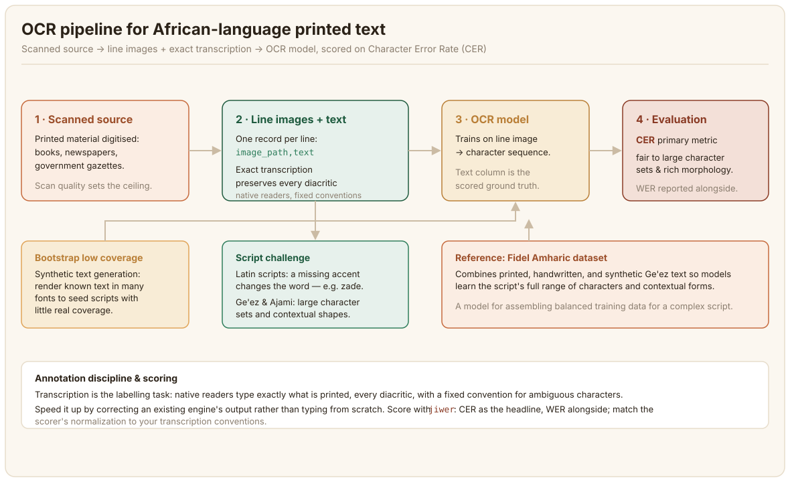

# OCR

*Last reviewed: 2026-07-07.*

Optical character recognition (OCR) converts images of printed text into machine-readable characters. For African languages it is the cheapest way to turn the large stock of printed material, books, newspapers, and government gazettes, into usable text data, which makes it a multiplier for every text task downstream.



## What the data looks like

An OCR dataset pairs images of text, usually at the line or page level, with their exact transcriptions. The images come from scanning printed sources, and the quality of the scan sets the ceiling on the result. The hard part for African languages is the script. Latin-based African languages need every diacritic transcribed faithfully, since a missing accent changes the word, while syllabic and Arabic-derived scripts like Ge'ez and Ajami have large character sets and contextual shapes that general OCR engines never learned. The Fidel dataset addressed this for Amharic by collecting printed, handwritten, and synthetic text together so models could learn the script's full range ([Fidel, 2025](../references.md#fidel-2025)). Synthetic text generation, rendering known text in many fonts, is a useful way to bootstrap data for a script with little real coverage.

The data is usually organised as line images paired with their exact transcription, one record per line:

```text
image_path,text
lines/gazette_0001.png,Hukumar zaɓe ta sanar da sakamakon zaɓe.
lines/gazette_0002.png,An gudanar da zaɓen cikin lumana.
```

The transcription must preserve every diacritic and special character exactly as printed, since for OCR the text column is the ground truth the model is scored against, and a dropped accent there teaches and then rewards the wrong spelling.

### Scene text

Contributors can photograph signs, posters, shopfronts and public notices that contain local-language text. Record the languages and scripts present and transcribe exactly what is visible, preserving diacritics and mixed-script text. Where the task needs locations, annotate a box or polygon for each line and keep its reading order.

Scene photographs bring perspective, uneven lighting, stylised fonts and mixed scripts that clean scans do not. Include these conditions in the pilot and evaluation rather than treating scan performance as a substitute. Phone photos often store their rotation as metadata, so apply it to the pixels before annotation ([Coordinates and image orientation](../image-data/object-detection.md#coordinates-and-image-orientation)). Before release, blur faces and number plates and coarsen or drop location metadata ([Visual privacy](../image-data/visual-privacy.md)). [Field image capture](../agri-advisory/field-image-capture.md#quality-control) shows the face-blurring and location steps in a real project.

## Annotation and evaluation

For OCR the annotation is transcription, the same discipline as in [speech](../asr/index.md): native readers, exact diacritics, and a fixed convention for ambiguous characters. The work can be sped up by correcting an existing OCR engine's output rather than typing from scratch, as long as the corrections are careful. OCR is evaluated by error rate against the reference, with Character Error Rate (CER) the primary measure because it is fair to the large character sets and rich morphology of African scripts, and Word Error Rate (WER) reported alongside it.

The transcription config shows a line image and a text box, with the guideline to type exactly what is printed:

```xml
<View>
  <Image name="page" value="$image"/>
  <TextArea name="transcript" toName="page" rows="3"
            editable="true" required="true"
            placeholder="Transcribe the text exactly, including every diacritic"/>
</View>
```

Scoring is identical to the ASR case: feed the reference and predicted transcripts to `jiwer` and read CER as the headline, WER alongside. The worked snippet and the caution about matching the scorer's normalization to your transcription conventions are on the [ASR](../asr/index.md) page and apply here unchanged.

The OCR annotation interface should support zoom, region ordering, precise boundary editing and transcription that preserves the target script and diacritics. Exports should retain page and region identifiers, coordinates, reading order, transcript and annotator.

## The 2026 modelling landscape

The workable open-model OCR references in mid-2026 fall into three groups:

- **General-purpose modern OCR (Latin script + selected non-Latin).** **[Surya](https://github.com/VikParuchuri/surya)** (2024-2026) is a strong current open OCR release: a document OCR and layout model of about 690M parameters that its README says covers 90+ languages and outputs text, layout regions and reading order. The code is Apache-2.0, but the model weights carry a modified OpenRAIL-M licence that restricts larger commercial users, so check the terms before deployment. **[docTR](https://github.com/mindee/doctr)** (Mindee, 2021-2026) is a two-stage detection + recognition library with pluggable architectures, Apache-2.0 licensed, and a workable reference for pipelined OCR where the detection and recognition stages need to be swapped independently. **[Kraken](https://kraken.re/)** is an Apache-2.0 text recognition system built for historical and non-Latin script material, with trainable layout analysis, reading order and recognition and support for right-to-left scripts; digital-humanities projects use it widely.
- **General-purpose multimodal LLMs applied as OCR engines.** **GOT-OCR 2.0** is a purpose-built 580M-parameter end-to-end OCR model that handles plain text, formulas, tables, charts and multi-page input, with plain or formatted output ([Wei et al., 2024](../references.md#wei-2024-got)). **[Qwen2.5-VL](https://qwenlm.github.io/blog/qwen2.5-vl/)** and **[InternVL 3](https://github.com/OpenGVLab/InternVL)** handle OCR as one of many multimodal tasks. In practice they tend to be noisier per character than dedicated OCR engines, but they can follow complex extraction instructions ("read only the header row of every table") that dedicated engines cannot.
- **Legacy engines still worth measuring against.** **[Tesseract 5](https://github.com/tesseract-ocr/tesseract)** remains the honest floor for African-language OCR: it is deployable on-device, requires no GPU, and its [published traineddata](https://tesseract-ocr.github.io/tessdoc/Data-Files-in-different-versions.html) includes Afrikaans, Amharic, Swahili, Tigrinya and Yorùbá, plus an Ethiopic script model. There is no Hausa model, so Hausa needs fine-tuning or a Latin-script model. **[EasyOCR](https://www.jaided.ai/easyocr/)** covers 80+ languages with a lower-effort Python API than Tesseract, but apart from Arabic its only African languages are Afrikaans and Swahili.

**Editorial opinion.** For a new African-language OCR project on **printed Latin-script material with modest diacritic complexity**, the shortest defensible path is: measure Surya and docTR on 200-500 line images from your target domain, and only fine-tune (typically Surya's recognition head) if the out-of-box CER exceeds 5%. For **Ge'ez / Amharic printed text**, start with **Fidel-trained** Kraken or Surya fine-tunes. For **Ajami / Arabic-script African languages**, dedicated Ajami-specific fine-tuning is required: no general model reliably handles the script. For **historical or handwritten material**, see the [Handwritten text recognition](./handwritten.md) page.

**Closed-API baselines.** **Google Cloud Vision**, **Azure Document Intelligence**, and **Amazon Textract** all provide OCR APIs with varying African-language coverage. They can be workable ceilings for Latin-script African languages on clean printed text, but check each provider's supported-language list: coverage of Ge'ez, Ajami and other non-Latin scripts is limited or absent, and general-purpose OCR tools are known to degrade on data-scarce languages ([Rijhwani et al., 2020](../references.md#rijhwani-2020)). Use them as a research reference, not a deployment surface, unless the language is validated and the budget permits it.

## What it will actually cost you

OCR data cost is dominated by transcription throughput, not by images. Rough order-of-magnitude:

- **Evaluating open OCR engines (Surya, docTR, Tesseract 5, GOT-OCR 2.0) on 500 target-domain line images.** One to two person-weeks; one to five GPU-hours for inference across engines; two person-weeks for the reference transcription itself.
- **Fine-tuning Surya or Kraken on a new African language** with 5,000-10,000 line images. Two to four person-weeks of engineering; three to eight person-months of transcription (throughput ~500-1,000 lines per transcriber per week for a covered Latin script; 100-300 for Ge'ez / Ajami).
- **Building a Fidel-scale corpus for a new script** (50,000+ line images across printed, handwritten, and synthetic). Eighteen months to three years elapsed; twelve to thirty person-months. Not a project to underestimate.
- **A defensible evaluation-only OCR set** (500-2,000 line images across the target domain). Two to four months; one to three person-months.
- **Synthetic OCR data generation** (rendering known text in many fonts). One to two person-weeks of engineering to set up the pipeline; then automated. Useful for bootstrapping, but cannot fully replace real scans, especially for handwriting-adjacent styles or degraded print.

## Known limitations to watch for

- **Diacritics are load-bearing on Latin-script African languages.** An engine that does well on English can lose much of its accuracy on Yorùbá because the tone marks fall off or are misread. Report CER *with* and *without* diacritic normalisation; the two numbers tell different truths.
- **Ge'ez / Fidel has a large character set.** The Amharic script has about 317 characters derived from 34 consonants, and the small modifications that mark vowels give many characters very similar shapes ([Belay, 2021](../references.md#belay-2021)). This stresses general OCR engines built around small Latin alphabets, so start from models trained on Ge'ez-script data such as Fidel ([Fidel, 2025](../references.md#fidel-2025)).
- **Ajami is not standard Arabic.** Ajami writing for Hausa and Fulfulde adds letters and conventions that Modern Standard Arabic models were not trained on, and dedicated Ajami data has only recently appeared ([Ajami HTR, 2025](../references.md#ajami-htr-2025)). Do not assume Arabic-OCR reuse works; measure it.
- **Scan quality dominates model choice.** A clean, high-resolution scan of a government gazette and a phone photo of a photocopied newspaper can differ by an order of magnitude in CER on the same engine. Preprocessing (deskew, binarisation, resolution normalisation) often matters more than model choice on poor scans, so measure on scans of the quality you will actually have.
- **Reading order is a task in itself.** Multi-column newspapers, tabular gazettes, and figures with embedded text all need reading order recovered separately from character recognition, and dedicated reading-order models improve the line ordering of both open-source and commercial OCR engines ([Wang et al., 2021](../references.md#wang-2021-layoutreader)). Surya and Kraken output reading order; with other engines, check what their layout step does before relying on it.
- **Historical spellings and orthography drift complicate evaluation.** A gazette from 1965 uses different orthographic conventions from a 2020 gazette in the same language; treating them as the same evaluation set produces misleading numbers. Split by historical period.
- **Copyright of scanned print material.** Do not assume any category of print is free to use: government publications are copyrighted in some jurisdictions, and open-licence and community-consented collections still carry terms. Commercial newspapers, books, and periodicals require licence clearance; the scan is a copy, and OCR does not launder the copyright. See [Licensing](../6_documentation/licensing.md).

## Further reading

- Fidel ([Fidel, 2025](../references.md#fidel-2025)): the reference Amharic OCR corpus covering printed, handwritten, and synthetic text; required reading for any Ge'ez-family OCR project.
- [Surya (Paruchuri, 2024-2026)](https://github.com/VikParuchuri/surya): a strong current open OCR release; its README reports per-language benchmark results, so check your language before relying on it.
- GOT-OCR 2.0 ([Wei et al., 2024](../references.md#wei-2024-got)): the end-to-end OCR model approach; useful when the task requires structured extraction (tables, formulas) beyond plain text.
- OCR4MT ([Ignat et al., 2022](../references.md#ignat-2022)): a benchmark of real and synthetic OCR data for 60 low-resource languages, showing that OCR'd monolingual text helps machine translation through back-translation and how much OCR error that use can tolerate.
- OCR post-correction ([Rijhwani et al., 2020](../references.md#rijhwani-2020)): shows that general OCR tools are not robust for data-scarce languages and that a post-correction model cuts recognition errors by about a third.

<details>
<summary>Additional references</summary>

- [docTR (Mindee, 2021)](https://github.com/mindee/doctr): the pipelined detection-plus-recognition open OCR framework, useful when the two stages need to be swapped independently.
- [Kraken (Kiessling, 2019)](https://kraken.re/): the reference open OCR engine for historical and non-Latin script material.
- [Tesseract 5 (2021)](https://github.com/tesseract-ocr/tesseract): the on-device deployable OCR floor; useful for edge deployments with no GPU.
- [Qwen2.5-VL blog (Alibaba, 2025)](https://qwenlm.github.io/blog/qwen2.5-vl/): the MLLM lineage's OCR capability; useful when structured extraction alongside plain OCR is needed.

</details>
