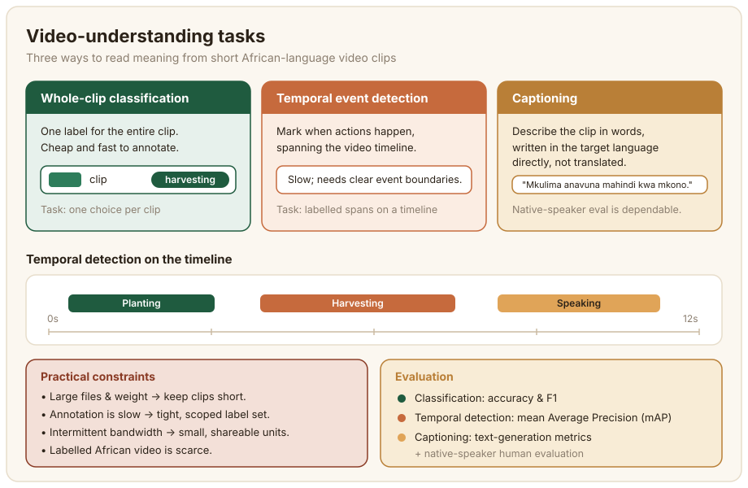

# Video

*Last reviewed: 2026-07-07.*

General video understanding covers the tasks that read meaning from ordinary moving images: classifying what a clip shows, detecting actions or events within it, and captioning it in words. For African contexts the uses are practical, from analysing agricultural or health video to making the continent's broadcast and community video searchable.



:::tip[Key points]

- Keep clips short and the label set small: video is heavy to store, stream and annotate.
- Annotate a normalised, constant-frame-rate copy, and tie every timestamp to that exact file.
- Write captions directly in the target language, not translated from English.
- Split train and test by whole video, never by frame.
- Models trained on Western benchmarks transfer poorly to African activities; build target-domain data.

:::

## What the data looks like

Video data is clips paired with labels. A label can be:

- **a single class** for the whole clip;
- **time-stamped events** within the clip; or
- **a caption** describing the clip in words.

Unlabelled African video is plentiful: broadcast, social and community video is everywhere. Labelled African video is scarce.

Video is also heavy. Large files, slow annotation and intermittent bandwidth for distributed teams shape every decision. Most projects therefore work with short clips and a tightly scoped label set rather than long-form video.

A whole-clip record is one clip with its label or caption:

```json
{
  "video": "clips/farm_0042.mp4",
  "duration": 12.0,
  "label": "harvesting",
  "caption": "A farmer harvests maize by hand in a small field.",
  "language": "swa",
  "source": "agricultural extension video"
}
```

Write captions directly in the target language rather than translating them from English. The descriptions then carry how the language actually describes a scene.

## Preparing video for annotation

Video arrives from phones, browsers, broadcast archives and drones, each with its own frame rate and encoding. Annotation timestamps are only as reliable as the file they were made on, so prepare every clip before annotators see it. The general steps for audio and video (browser-friendly formats, streamable MP4, range requests, size limits) are in [Preparing media for annotation](../2_data-collection/7_data-cleaning-preprocessing.md#preparing-media-for-annotation); the points below are the ones specific to video timing.

- **Record how the annotation copy was made.** Annotate a normalised copy, never the master (see the general steps linked above), and record the exact conversion command and the copy's frame rate, because every timestamp in the annotations refers to the copy, not the master.
- **Convert to a constant frame rate.** Phone video is often recorded at a variable frame rate: iPhones treat the chosen rate as a target, not an exact rate ([Tépper, 2017](../references.md#tepper-2017)). Do not assume other phones or screen recordings differ. A variable-rate file makes frame counts and frame stepping unreliable, so convert it to a constant rate close to the recording's own, then check that the copy's duration matches the master and that sound and picture are still in sync.
- **Encode for the work.** For frame-by-frame work such as glossing, encode with a keyframe about once a second and no B-frames, as the MPI guide for ELAN recommends ([MPI, 2024](../references.md#mpi-video-guidelines)); see also [Recording](./sign-language.md#recording). Trim the copy so its audio and video streams end together; a longer audio track stretches the file's duration past the last video frame, so the timeline shows time with no picture and duration-based frame counts are off.
- **Probe every file, and do not trust the container.** Read each copy's measured frame rate, frame count and duration with a tool such as `ffprobe`, and store them in the manifest. Container metadata can be missing or wrong. WebM files recorded in Chrome lack a seek index (Cues) in every case, and lack a duration when the recording is made in chunks (with a timeslice or `requestData()` calls), which is recommended for long recordings; Chrome 140 and later write a duration only for unchunked recordings ([Naicu, 2026](../references.md#naicu-2026)). For such files, measure by decoding the whole file rather than reading the header.
- **Store times in seconds, tied to one file.** Store each event's start and end in seconds, with the frame rate (or audio sample rate) of the file they were marked on and a hash of that exact file. If a clip is later trimmed or re-encoded, re-map every timestamp, then spot-check a sample of events against the released media to confirm they still line up.

A conversion and probe for frame-accurate annotation:

```bash
# Normalised copy: constant 30 fps, H.264 with a keyframe every 30 frames and no B-frames,
# AAC audio, stop at the end of the shorter stream, index at the front for streaming.
# Set -r and -g to the source's nominal rate (one keyframe per second),
# e.g. -r 50 -g 50 for 50 fps sign-language video.
ffmpeg -i master.mov -c:v libx264 -pix_fmt yuv420p -r 30 -fps_mode cfr -g 30 -bf 0 \
  -c:a aac -b:a 128k -shortest -movflags +faststart clip_annot.mp4

# Count decoded frames; the duration and rate fields come from the header
# and may be N/A for browser WebM.
ffprobe -v error -select_streams v:0 -count_frames \
  -show_entries stream=avg_frame_rate,nb_read_frames,duration -of json clip_annot.mp4

# Measure duration by decoding (works when the header has none):
# the last time= value printed is the decoded length of the video stream.
ffmpeg -i master.webm -map 0:v:0 -f null -
```

With `-fps_mode cfr`, FFmpeg duplicates and drops frames to reach exactly the requested constant rate ([FFmpeg Developers, n.d.-a](../references.md#ffmpeg-cli)); the option exists from FFmpeg 5.1, and older versions use `-vsync cfr`. Log the command and the FFmpeg version in the [transformation log](../2_data-collection/8_data-provenance-traceability.md#a-transformation-log-that-travels-with-the-data).

For recordings longer than a few minutes (cutting them into chunks that trace back to the source, choosing a frame-sampling rate, shot boundaries and sync checks), see [Long video](./long-video.md).

## Annotation and evaluation

Video annotation is labelling across time. A whole-clip label is cheap. Marking when actions happen, or writing captions, is slow, and needs clear rules on:

- where an event starts and ends; and
- how much detail a caption should capture.

Use a tool built for timeline annotation, keep clips short (see [Long video](./long-video.md) for cutting long recordings into traceable chunks), and measure agreement on a shared set of clips.

### Task specifications

For marking when an action happens, the annotator drags each label across the stretch of the timeline where that action occurs:

**Task specification: temporal action labelling**

| Setting | Value |
|---|---|
| Annotator sees | The video clip with a timeline |
| Annotator gives | Time spans (start and end) on the timeline, each with one action label: Planting, Harvesting, Speaking |
| Choice | One label per span; spans may overlap when actions co-occur; optional (a clip may contain none) |
| Notes | Agree boundary rules before annotation starts (see [Known limitations](#known-limitations-to-watch-for)) |

For a single label per clip, use one choice for the whole clip instead of spans:

**Task specification: clip classification**

| Setting | Value |
|---|---|
| Annotator sees | The video clip |
| Annotator gives | One class for the whole clip, from the project's label set |
| Choice | Exactly one; required |

### What the annotation tool should support

- Frame-accurate seeking.
- Playback-speed control.
- Clear event boundaries on a timeline.
- A fixed list of event labels, so annotators cannot type free variants.

Exports should keep the video identifier, frame rate, start and end times (or frames), labels and annotator.

### Evaluation metrics

| Task | Metric |
|---|---|
| Clip classification | Accuracy and [F1](https://en.wikipedia.org/wiki/F-score) |
| Temporal action detection | Mean average precision (mAP) at several temporal IoU (intersection over union of time spans) thresholds |
| Captioning | The text-generation metrics in the [Text Generation](../text-generation/index.md) chapter |

For captioning, as with all text generation, human evaluation by native speakers is the dependable measure.

### Tracking objects across frames

For multi-object tracking, annotators draw boxes on keyframes and the annotation tool interpolates the frames in between. A reviewer checks interpolated frames at a fixed interval, including frames where objects enter, leave or overlap. Keep one track ID from entry to exit, and write rules for occlusion, re-entry, frame-edge truncation and minimum object size. A new detection is not automatically a new identity. If a tracking model propagates the boxes or masks for you, review it as described in [Auto-tracking in video](../3_annotation-design/model-assisted-annotation.md#auto-tracking-in-video). Converting keyframe tracks to per-frame MOT rows is covered in [Formats and merging](../image-data/formats-and-merging.md#video-tracks-mot-and-keyframe-tracks).

Evaluate identity as well as detection. IDF1 measures the agreement between ground-truth and computed identities after a global one-to-one assignment ([Ristani et al., 2016](../references.md#ristani-2016)). HOTA balances detection, association and localisation and provides diagnostic sub-metrics ([Luiten et al., 2020](../references.md#luiten-2020)). Report these alongside detection mAP rather than treating mAP alone as evidence that identities were preserved.

## The 2026 modelling landscape

Video understanding in 2026 splits three ways:

- short-clip classification, led by dedicated video backbones;
- long-form captioning and reasoning, led by multimodal large language models (MLLMs); and
- temporal detection, which uses a mix of both.

| Task | Open models to start from |
|---|---|
| Short-clip classification and action detection | **[VideoMAE v2](https://arxiv.org/abs/2303.16727)** (2023), **[TimeSformer](https://arxiv.org/abs/2102.05095)** (Facebook AI, 2021), **[SlowFast](https://github.com/facebookresearch/SlowFast)** (Facebook AI, 2019), **[X-CLIP](https://arxiv.org/abs/2208.02816)** (2022) |
| Long-form video reasoning and captioning | **[Qwen2.5-VL](https://qwenlm.github.io/blog/qwen2.5-vl/)** and **[InternVL 3](https://github.com/OpenGVLab/InternVL)**, general MLLMs that accept multi-minute video; purpose-built video-LLMs **[LLaVA-Video](https://arxiv.org/abs/2410.02713)** and **[VideoLLaMA 3](https://github.com/DAMO-NLP-SG/VideoLLaMA3)** |
| Temporal action detection | **[ActionFormer](https://arxiv.org/abs/2202.07925)** (2022) and **[TriDet](https://arxiv.org/abs/2303.07347)** (2023), for finding the start and end of actions in continuous video |
| Open-vocabulary retrieval and search | **[VideoCLIP](https://arxiv.org/abs/2109.14084)** and **[InternVideo 2](https://arxiv.org/abs/2403.15377)**, joint video-text embeddings that make a collection searchable by a plain-language query |

Retrieval is often the practical choice for African-language video archives: it needs no fixed label set, only a text description to search with.

**Editorial opinion.** For a new African-context video project, the shortest defensible path is:

- **Classification and action detection:** fine-tune VideoMAE v2 or SlowFast on your own target-vocabulary clips. A pilot of a few thousand clips is a common starting scale; check it on your task.
- **Captioning:** prompt Qwen2.5-VL, or fine-tune it with LoRA (a low-cost fine-tuning method), on captions written in the target language (see the [captioning page](../image-text/captioning.md)). Skip end-to-end video captioning training: the data it needs is out of reach for most African-language projects.
- **Retrieval:** use InternVideo 2 embeddings with a plain-language query.

## What it will actually cost you

Video corpora are the heaviest modality in the playbook for both storage and annotation. The figures below are rough planning estimates, not measured benchmarks; run a small pilot to calibrate them for your team.

| Activity | Elapsed time | Effort |
|---|---|---|
| Fine-tune VideoMAE v2 or SlowFast on an existing classification corpus | — | One to two person-weeks; ten to fifty GPU-hours |
| Build a new short-clip classification corpus (1,000 to 5,000 clips, 10 to 30 seconds each) | Three to six months | Three to seven person-months |
| Add temporal event annotation (start and end times) to a corpus | Two to four months more | Roughly doubles to triples annotation effort per clip, depending on how many events each clip has |
| Build a captioning corpus natively in the target language (500 to 2,000 clips, 3 to 5 captions each) | Six to twelve months | Five to twelve person-months |
| Build an evaluation-only set (200 to 500 clips) | Two to four months | Two to four person-months |
| Human evaluation of video-model output | — | Two to three person-weeks per evaluator per 200 items |

What drives these costs:

- **New corpus:** sourcing clips, getting consent from identifiable people, and storage.
- **Native captioning:** it is slower than translation.
- **Human evaluation:** the evaluator must watch every clip from start to end.

**Storage and bandwidth.** File size is roughly bitrate × duration. A 5,000-clip corpus averaging 15 seconds is about 21 hours of video. Encoded as 720p H.264 at 2 to 5 Mbit/s, that is roughly 20 to 50 GB; keeping phone or broadcast masters at their original bitrate can multiply this several times. Distributed teams with intermittent bandwidth cannot download the whole corpus, so plan a streaming annotation workflow from the start.

## Known limitations to watch for

- **Western action benchmarks transfer poorly.** A model trained on Kinetics-700 recognises classes such as skiing, but activities like cassava processing, palm-wine tapping or shelling maize by hand are unlikely to be well covered. Transfer to African activities can be much weaker than benchmark scores suggest.
- **Storage and bandwidth constrain corpus size more than annotation cost.** A team that can afford to annotate 10,000 clips may not be able to store and stream them. Design for constrained infrastructure.
- **Frame-rate and resolution normalisation is load-bearing.** Broadcast video, phone-camera video, and drone video have different frame rates, aspect ratios, and resolutions. A model trained on a mixed corpus without normalisation learns to distinguish by source, not by content.
- **Consent is heavier for video than for photos.** A photo shows an identifiable person at one moment; a video shows the same person over time, revealing more about behaviour, movement, and context. Consent frameworks must be video-specific.
- **Face-visibility trade-off.** Blurring faces during preprocessing degrades models that need the face, such as those for signing, gesture, emotion or speaking-person tasks; for object and scene tasks the cost can be small. Blurring for release is often required. Decide per task, as described in [Redact for training, or only for release?](../image-data/visual-privacy.md#redact-for-training-or-only-for-release)
- **Copyright of broadcast and social media video.** Community-produced and consented material is safe; commercial broadcast, YouTube, and other social platforms have terms of service that constrain redistribution and often training use. Read the terms before scraping.
- **Temporal detection boundary annotation is subjective.** Where does "harvesting" begin and end? Two annotators produce systematically different boundaries. Report boundary agreement (temporal IoU at multiple thresholds), not just detection F1.
- **Long-form video reasoning is hard.** Models that perform well on short clips can be much less reliable on videos several minutes long. Report the distribution of video lengths in every evaluation, and results by length band; a single average hides where the model breaks.

For the normalisation steps behind the frame-rate point above, see [Preparing video for annotation](#preparing-video-for-annotation). Clips that contributors record themselves also need checks before annotation: that the duration can be read, that there are no black or frozen stretches, and that the measured frame rate matches the declared one. [Check recorded clips first](./sign-language.md#check-recorded-clips-first) on the sign-language page sets these out, and most of them apply to any recorded video.

Frames from one video are near-copies of each other, so split by whole video, never by frame; see [Split video by video, not by frame](../image-data/splits-and-duplicates.md#split-video-by-video-not-by-frame).

## Further reading

- [VideoMAE v2 (Wang et al., 2023)](https://arxiv.org/abs/2303.16727): an open video backbone and a common starting point for fine-tuning short-clip classification and action detection.
- [Qwen2.5-VL blog (Qwen team, Alibaba, 2025)](https://qwenlm.github.io/blog/qwen2.5-vl/): a strong open MLLM for long-form video reasoning and captioning.
- [InternVideo 2 (Wang et al., 2024)](https://arxiv.org/abs/2403.15377): a joint video-text embedding model, useful for open-vocabulary video retrieval.

<details>
<summary>Additional references</summary>

- [SlowFast (Feichtenhofer et al., 2019)](https://github.com/facebookresearch/SlowFast): a two-pathway video backbone (a slow, detailed pathway and a fast, motion pathway).
- [TimeSformer (Bertasius et al., 2021)](https://arxiv.org/abs/2102.05095): a transformer video backbone; a useful comparison to VideoMAE.
- [LLaVA-Video (Zhang et al., 2024)](https://arxiv.org/abs/2410.02713): a purpose-built video-LLM, competitive on video question-answering benchmarks.
- [ActionFormer (Zhang et al., 2022)](https://arxiv.org/abs/2202.07925): an open baseline for temporal action detection.
- [Kinetics-700](https://github.com/cvdfoundation/kinetics-dataset): a widely used action-classification benchmark; useful for calibration.

</details>
