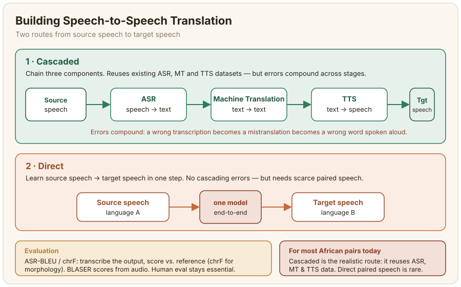

# Speech-to-Speech Translation

Speech-to-speech translation (S2ST) takes speech in one language and produces speech in another, the spoken equivalent of a human interpreter. For African languages it is the most ambitious speech task and the least resourced, because it sits on top of three hard tasks at once. This page is the practical guide to how to assemble a working system from the pieces that exist, how to evaluate it honestly, and what has to be true before deployment.

S2ST combines three tasks: automatic speech recognition (ASR), machine translation (MT) and text-to-speech (TTS). Before building data for any of them, check what already exists with [Before You Start](../before-you-start/index.md). The [ASR](../asr/index.md) and [Text-to-Speech](../text-to-speech/index.md) chapters cover those tasks in depth. This page shows how the three fit together and the decisions that are specific to speech in, speech out.

:::tip[Key points]

- For most African language pairs, a cascade (ASR, then MT, then TTS) is the realistic starting point.
- Tone and code-switching must be handled at every stage, not only in the final output.
- Record whether target speech is human or synthesised, and get voice consent for both sides of the pair.
- Report per-stage scores, ASR-chrF, BLASER and human evaluation together; no single metric is enough.
- Design for latency, cost and consent at deployment scale before choosing cascade or direct.

:::



## Cascaded and direct, and what each needs

There are two ways to build S2ST. A **cascaded** system chains three components (ASR to transcribe the source speech, machine translation to translate the text, TTS to speak the result), while a **direct** system learns to map source speech to target speech in one step. For African languages the cascaded route is almost always the realistic one today, because it can reuse the ASR, MT, and TTS datasets covered elsewhere in this section rather than requiring scarce end-to-end speech-translation pairs.

The cost of cascading is that errors compound: a mistake in transcription becomes a mistranslation becomes a wrong word spoken aloud. Direct systems avoid that but need paired source-and-target speech that, for most African language pairs, no one has collected.

### Resources that changed the picture

The landscape has shifted since 2023. Two resources matter most:

| Resource | What it is | What it means for African languages |
|---|---|---|
| **SeamlessM4T** ([Seamless Communication et al., 2023](../references.md#seamless-2023)) | A foundation model for speech-to-speech, speech-to-text and text-to-text translation in up to about 100 languages. | Coverage is lopsided. Many African languages (among them Amharic, Igbo, Luganda, Shona, Somali, Yorùbá and Zulu) are supported as *speech input*. Among sub-Saharan languages, only Swahili is supported as *speech output*. Some major languages, such as Hausa, are absent altogether. |
| **CVSS** ([Jia et al., 2022](../references.md#cvss-2022)) | A large parallel speech-to-speech corpus from 21 languages into English, built on Common Voice and the CoVoST 2 speech-translation corpus. The English target side is synthesised by TTS: CVSS-C uses one canonical voice, CVSS-T transfers each source speaker's voice. | It contains no sub-Saharan African source language, so its value here is as a recipe, not as data. |

Check the model card for your exact language pair before planning around any model.

Direct S2ST is no longer only a research topic: the models exist and can be fine-tuned for language pairs they do not cover natively. Cascaded remains the default for most African pairs. Direct is worth measuring where a model's coverage is close to your pair and your team can afford human evaluation to compare the two.

## What African-language S2ST actually varies on

Two axes matter more than the specific model choice.

- **Tone preservation across the language boundary.**
  - *Tonal target, non-tonal source* (for example English, French or Standard Arabic into Yorùbá, Igbo or most Bantu languages): the target's tone is not in the source audio at all. It must come from the translation and TTS stages. A pipeline that treats target-side tone as "just another diacritic to preserve" will produce tone-flat synthesised speech.
  - *Tonal source, non-tonal target:* the ASR must transcribe tone faithfully, or the translation loses the word distinctions that tone carried.
- **Code-switching on either side.** Real African-language conversation mixes in English, French, Arabic or a regional lingua franca.
  - A monolingual source ASR fails on code-switched input.
  - An ASR that does handle code-switching passes on text in more than one language, and MT models trained only on monolingual text often fail on it.
  - Design the cascade to handle code-switching end to end, or budget for an explicit code-switching step at each stage.

## Building the data

If you collect S2ST data directly, the unit is aligned speech across two languages: the same utterance spoken in the source and in the target, with a transcript on each side for training and evaluation. This is expensive, so most projects start cascaded and compose existing resources: an ASR corpus for the source language, a parallel text corpus for the pair (see [Machine Translation](../machine-translation/index.md)), and a TTS corpus for the target.

Choose the source and target collection tasks deliberately. Read prompts, prompted answers, listen-and-repeat, translation-to-speech and image descriptions produce different speech and transcription costs; the comparison is in [ASR · Choose an elicitation style](../asr/index.md#choose-an-elicitation-style). Keep the elicitation style and prompt ID on both sides of an aligned record.

Where you do collect end-to-end data, treat consent and voice rights as you would for TTS, since the target side is synthesised or re-spoken speech. Voice-consent conversations must cover both sides of the pair explicitly. A speaker whose source-language voice is recorded may not have consented to their voice being used to produce target-language output.

### Two routes to a direct-S2ST corpus

**Route 1: synthesise the target side (the CVSS recipe).**

1. Start from a speech-to-text translation corpus: source-language speech with its transcript and a target-language translation.
2. Synthesise the target side with a TTS model.
3. Have native listeners check a sample.
4. Release the aligned set: source speech, source transcript, target text, target speech.

African speech-translation corpora of this shape exist. BIG-C, for example, pairs more than 180 hours of conversational Bemba speech with transcripts and English translations ([Sikasote et al., 2023a](../references.md#bigc-2023)). A text-only parallel corpus such as MAFAND-MT ([Adelani et al., 2022b](../references.md#mafand-2022)) is not enough on its own, because it has no source speech: you would have to record the source side (read speech) as well as synthesise the target.

The result is not "real" end-to-end data, because the target speech is synthesised. It can still give a direct S2ST model enough data to fine-tune on, so that you can compare it fairly with a cascade.

**Route 2: record real target speech.** A genuinely end-to-end corpus uses human target speech, not TTS. Professional interpreters record the target side in a controlled setting, aligned utterance by utterance to the source recording. This is expensive: budget for something closer to a TTS-scale corpus than an ASR-scale one. It must also meet the voice-consent requirements for both source and target speakers.

### What a record looks like

Whichever route you take, keep each utterance as one record that links both sides, and record where the target speech came from, so synthesised and human target audio are never silently mixed in training or evaluation:

```json
{"id": "en-ha_000123",
 "source_lang": "eng", "source_audio": "audio/src/en-ha_000123.wav",
 "source_text": "The hospital opens at eight in the morning.",
 "target_lang": "hau", "target_audio": "audio/tgt/en-ha_000123.wav",
 "target_text": "Asibitin yana buɗewa da ƙarfe takwas na safe.",
 "target_audio_origin": "tts",
 "source_speaker": "spk_017", "target_speaker": "voice_ha_01",
 "consent_ids": ["c_017", "c_ha_01"], "domain": "health"}
```

Keep the target text in its full standard orthography (Hausa hooked letters, tone diacritics for tonal targets): it is the reference for evaluation and, in a cascade, the input to TTS. For evaluation across many African pairs, FLEURS is a useful starting point: it is n-way parallel read speech in 102 languages, including many African ones, so the same sentence is available as audio in both languages of a pair ([Conneau et al., 2022](../references.md#fleurs-2022)). Its sentences are short Wikipedia-style text, so add in-domain test data before trusting it for a deployment.

### Quality assurance

- **Alignment check.** Have a bilingual reviewer confirm on a sample that each target recording says what its source says, no more and no less; misaligned pairs are the commonest silent defect in parallel speech data.
- **Listen to synthesised targets.** Native listeners should check a sample of TTS-generated target audio for mispronunciations, wrong tone, and number or name errors before the set is used for training.
- **Track provenance.** Keep the `target_audio_origin` field honest, and never evaluate a system on synthesised target speech from the same TTS voice it was trained on.
- **Split by speaker.** Make sure no source speaker or target voice appears in both training and test sets, as in [ASR](../asr/index.md).

## Evaluation

S2ST is usually evaluated by transcribing the spoken output and scoring that text against a reference translation, an approach often called ASR-BLEU, with chrF preferred over BLEU for the same morphology reasons as in text translation. Newer speech-aware metrics such as BLASER ([Chen et al., 2023](../references.md#blaser-2023)) score the translation directly from the audio, sidestepping the ASR-in-the-metric problem. None of these captures whether the output sounds natural and says the right thing, so human evaluation by people fluent in both languages remains essential.

The ASR-based approach is two steps: transcribe the spoken output with an ASR model for the target language, then score that text against the reference translation:

```python
# pip install sacrebleu  (plus an ASR model for the target language)
import sacrebleu

# Step 1: run ASR on the synthesized target-language audio to get text.
#   hypotheses = [asr_model.transcribe(path) for path in generated_audio]
hypotheses = ["asibitin yana buɗewa da ƙarfe takwas na safe"]
references = [["asibitin yana buɗewa da ƙarfe takwas da safe"]]

# Step 2: score the transcribed output against the reference translation.
chrf = sacrebleu.corpus_chrf(hypotheses, references)
print(f"ASR-chrF: {chrf.score:.2f}")
```

One caution specific to this cascade: the score now blends two error sources, the translation and the ASR model used to read it back, so a poor number can mean a bad translation or simply a weak target-language recognizer. For most African target languages the ASR step is itself under-resourced, so interpret ASR-BLEU as a loose proxy and lean harder on the human evaluation than you would for text translation.

### A metric bundle for release

For a defensible release, report all three:

| Measure | What it does | Limits |
|---|---|---|
| **ASR-chrF** (as above) | The classic proxy; useful for tracking training progress. | Mixes translation errors with errors of the ASR used to score. |
| **BLASER** | Scores the audio directly, so no ASR sits inside the metric. | Still not a substitute for human evaluation. |
| **Human evaluation** | Bilingual listeners rate each clip from 1 to 5 on **adequacy** (does the target speech convey the source meaning?), **fluency** (does it sound natural?) and **acoustic quality** (is the voice clear and pleasant?). | Costs listening time; see the tips below. |

For human evaluation, use at least two evaluators per clip and adjudicate disagreements. Time a small pilot batch first to estimate the listening budget, since clip length and the number of systems compared drive the cost.

**Evaluate the cascade honestly.** In a cascaded system, aggregate ASR-chrF is not enough. Report the per-stage error: ASR CER on the source recognition, chrF on the intermediate translation (against a reference text translation), then ASR-chrF end-to-end. This isolates where errors compound and lets you invest fixing effort at the right stage.

**Code-switched evaluation.** Real African user input code-switches. Split evaluation into monolingual-source and code-switched-source subsets and report separately. A model whose monolingual ASR-chrF is acceptable and whose code-switched ASR-chrF is catastrophic will silently under-serve most real users.

## Deployment realities

- **Latency budget.** Live conversation needs each translated utterance to arrive quickly, and cascaded systems add up the delay of three model calls plus network round-trips. Direct S2ST, with a single model call, is often faster when its quality is acceptable. Decide the use case first (live interpretation, or batch translation of recorded content?), set a latency target, then choose cascade or direct.
- **Compute cost per interaction.** A cascade makes three model calls per input where a direct system makes one. Each stage is often smaller than a single large direct model, so the cost gap depends on the models chosen: measure cost per interaction rather than assuming it. For at-scale deployment (a customer-service bot handling thousands of calls per day), the difference matters.
- **Cascade failure isolation is a feature.** When a cascaded system produces bad output, you can inspect each stage's intermediate result and pinpoint which stage failed. Direct systems are more opaque: a wrong output is a wrong output with no clear diagnosis. For production deployment with SLAs and error triage, the cascade's diagnostic transparency is often worth the quality tradeoff.
- **Voice-cloning risk on the target side.** Direct S2ST or TTS-based cascade targets can be trained to produce a specific voice; the same voice-cloning consent conversation from [TTS · Voice consent](../text-to-speech/index.md#distinctive-annotation-and-consent) applies here. The consent conversation must cover the voice used to produce target-language output, distinct from the voice of the source speaker.
- **Streaming vs full-utterance.** Cascaded systems typically need the full source utterance before starting; direct systems can be streaming-capable if the model supports it. Simultaneous interpretation is a research problem, not yet a solved production capability for African language pairs.

## What breaks: common failure modes

- **Error compounding in cascade collapse.** ASR miss-transcribes a critical word, MT translates the mistake fluently, TTS speaks it convincingly. The user hears a natural-sounding wrong answer. Fix: per-stage error tracking with human eval at the intermediate MT stage, so ASR errors surface before they propagate.
- **Tone-flat target speech.** Target language is tonal, tone information gets stripped somewhere in the pipeline (source ASR doesn't preserve it, MT normalises it away, TTS lacks tone marks in prompts). Result: right words, wrong meaning. Fix: audit tone preservation at every stage, not just the final output.
- **Code-switching collapse.** Source is code-switched, monolingual source ASR fails, cascade cannot recover. Fix: source ASR must be code-switching-aware, or code-switching in the source needs explicit pre-processing (split into monolingual segments, translate separately, re-assemble).
- **Voice mismatch.** Direct S2ST or voice-cloned cascade target changes the perceived speaker identity in ways that confuse listeners (e.g., a male source speaker's translation is produced in a female voice). Fix: match target voice deliberately or normalise to a single canonical target voice per language.
- **Speaker consent gap on the target side.** A voice used to record target-language TTS training data (or to clone in a direct S2ST) has not consented to the specific S2ST use case. Fix: the consent conversation must cover S2ST use cases explicitly; retroactive extension is not consent.
- **Aggregate metrics hiding per-domain collapse.** Overall ASR-chrF looks acceptable; per-domain breakdown reveals catastrophic failure on informal-register speech or on domain-specific vocabulary. Fix: per-domain evaluation is not optional; if the deployment target is customer service, evaluate on customer-service audio, not on news.
- **Cost surprise at scale.** A cascade that works in a demo blows up the cloud-compute bill when deployed to thousands of concurrent users. Fix: cost model the cascade at deployment scale during scoping; if the numbers don't work, consider a direct-model path or a lighter cascade.
