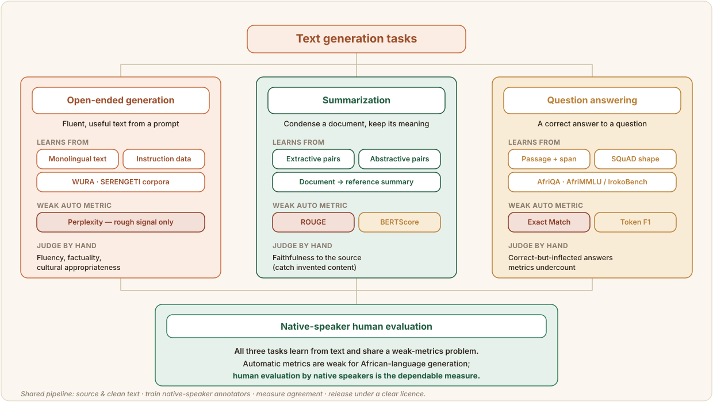

# Text Generation

Text generation covers the tasks where a model produces language rather than just labelling it: writing open-ended text, summarising a longer document, and answering questions. These are the tasks closest to what people picture when they think of modern language models.

They are also where African languages fall furthest behind. Generation needs both large amounts of clean text to learn from and careful human data to steer and check the model. Benchmarks that test large language models across the continent, such as AfroBench, find a persistent gap between English and African languages on exactly these tasks ([Ojo et al., 2025](../references.md#afrobench)).

:::tip[Key points]

- Generation tasks reuse the playbook's shared pipeline; each page covers only what is distinctive.
- Check existing resources (XL-Sum, AfriQA, IrokoBench) before building new data.
- Prefer text written natively over machine-translated text, and record which is which.
- Automatic metrics are weak for African languages; native-speaker human evaluation is the dependable measure.

:::

This chapter covers three established generation tasks, plus a related page on dialogue annotation:

- **[Open-ended generation](./generation.md)**: producing fluent, useful text from a prompt.
- **[Summarization](./summarization.md)**: condensing a document while keeping its meaning.
- **[Question answering](./question-answering.md)**: returning a correct answer to a question, from a passage or from the model's own knowledge.
- **[Dialogue](./dialogue.md)**: annotating ordered conversations, target turns and responses with their context preserved.

The diagram illustrates the three established generation tasks. Dialogue is an additional related page focused on conversation structure and context.

## What the three tasks share

The pages that follow differ mainly in what the data looks like and how it is scored. The rest of the pipeline is shared, and earlier chapters of this playbook already cover it:

1. **Source and clean the text** with care for African scripts and web noise (see [Data Collection](../2_data-collection/1_data-modalities.md) and [Data Quality](../4_data-quality/index.md)).
2. **Design the annotation task** and train native-speaker annotators (see [Annotation Design](../3_annotation-design/annotation-task-design.md)).
3. **Assure quality** and measure agreement.
4. **Release** under a clear, community-respecting licence (see [Data Governance](../data-governance/index.md)).

Each task page concentrates on what is distinctive to it: its definition, its data sources and its evaluation. One theme runs through all of them: automatic metrics are weak for African-language generation, and native-speaker human evaluation is the dependable measure.

## Before you build

Check what already exists before creating new data; [Before You Start](../before-you-start/index.md) explains how to search across the many names and codes African languages are filed under. The shared groundwork for all text tasks is summarised in the [Text overview](../sections/text.md). For generation, three public resources are the usual starting points, and each task page discusses them in more detail:

| Task | Starting resource | What it offers |
| --- | --- | --- |
| Summarization | XL-Sum ([Hasan et al., 2021](../references.md#xlsum-2021)) | BBC articles paired with professionally written summaries, covering several African languages. |
| Question answering | AfriQA ([Ogundepo et al., 2023](../references.md#afriqa-2023)) | 12,000+ cross-lingual open-retrieval questions across ten African languages. |
| Knowledge QA and LLM evaluation | IrokoBench ([Adelani et al., 2024](../references.md#irokobench-2024)) | Human-translated knowledge (AfriMMLU), reasoning, and inference tests for seventeen languages. |

Open-ended generation has no single equivalent benchmark; most projects assemble monolingual text and write their own instruction data, as the [Open-ended generation](./generation.md) page describes.

## Common failure modes

The same mistakes recur across all three tasks, and most of them inflate scores rather than lower them, which is why they go unnoticed:

- **Machine-translated data passed off as native text.** Translated prompts, summaries, or questions read as stilted "translationese" and carry the translation system's errors into both training and evaluation. Audits of web-crawled corpora found this problem widespread in low-resource languages ([Kreutzer et al., 2022](../references.md#kreutzer-2022)). Record in the metadata whether each item was written natively or translated, and keep the two apart in evaluation.
- **Test data the model has already seen.** Benchmarks built from public web sources such as news sites may already sit in a large model's pretraining data, which makes results look better than they are. Where you can, hold back a test set written fresh for the project and never published online in plain text.
- **Grading a model with itself.** Generating training or evaluation data with a language model, then judging outputs with the same or a related model, rewards that model's habits rather than real quality. Native-speaker review breaks the loop.
- **One reference, one overlap metric.** A single reference answer or summary scored only with word-overlap metrics penalises correct outputs that use a different inflection or phrasing, a serious problem in morphologically rich languages. Collect more than one reference where you can and pair automatic scores with human judgement.
