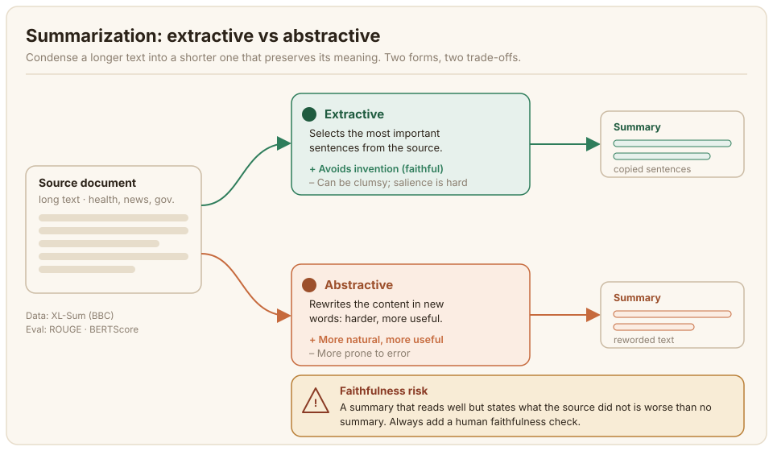

# Summarization

Summarization condenses a longer text into a shorter one that preserves its meaning. It comes in two forms:

- **Extractive summarization** selects the most important sentences from the source.
- **Abstractive summarization** rewrites the content in new words. This is harder and more useful, but also more prone to error.

For African languages, summarization is valuable because it makes long documents in health, news and government quick to read. It is difficult for the same reasons as all generation: scarce training data, and morphologically rich languages that defeat simple methods.

:::tip[Key points]

- XL-Sum is the main multilingual starting point; beyond it, most projects write their own reference summaries.
- Agree a written guideline first: fixed length, only what the source says, natural register, main point first.
- Faithfulness is the central risk; check it by hand on a sample.
- Use ROUGE only as a rough signal, with a tokenizer that keeps your script's characters, and check that any BERTScore model covers your language.

:::



## What the data looks like

Summarization needs documents paired with reference summaries. The most widely used multilingual resource is XL-Sum, built from BBC articles and their professionally written summaries, which covers a number of African languages including Amharic, Hausa, Igbo, Kirundi, Oromo, Nigerian Pidgin, Somali, Swahili, Tigrinya, and Yorùbá ([Hasan et al., 2021](../references.md#xlsum-2021)). Beyond it, summarization data for African languages is sparse, so most projects create their own by pairing source documents with summaries written by native speakers. The same care applies as in machine translation: prefer document-level material from a domain that matters, and watch for source documents that are themselves machine-translated.

A summarization record pairs the source document with one or more reference summaries. Keeping it as JSON, one object per line, keeps long documents and their summaries together with provenance. The record below is an illustrative example in the XL-Sum style, not an actual XL-Sum entry; the `license` field shows the licence XL-Sum itself is released under, which is non-commercial, so check it before building on that data:

```json
{
  "document": "Gwamnatin tarayya ta sanar da sabon shirin samar da ruwan sha a yankunan karkara...",
  "summary": "Gwamnati ta kaddamar da shirin ruwan sha na karkara.",
  "language": "hau_Latn",
  "source": "illustrative, XL-Sum style (BBC Hausa)",
  "license": "CC BY-NC-SA 4.0"
}
```

Recording more than one reference summary where you can afford it is worth the cost: a single reference unfairly penalizes a correct summary that happens to phrase things differently, a problem made worse by the morphological richness discussed below.

## Writing reference summaries

When you create your own data, the reference summaries are the annotation, and their quality caps everything downstream. A short written guideline, agreed before annotation starts, prevents most problems:

- **Fix the target length and form.** Decide whether a summary is one sentence, a fixed number of sentences, or a word budget, and whether it may copy phrases from the source. Inconsistent lengths make both training and ROUGE scores noisy.
- **Only what the source says.** Annotators must not add background knowledge, opinions, or facts from outside the document, even true ones. A reference that contains outside information teaches a model to hallucinate.
- **Write in the natural register of the language.** Summaries should read as a fluent speaker would write them, in the standard orthography the project has chosen (diacritics, tone marks, word separation), not as a translation of an English summary.
- **Cover the main point first.** The core event or claim of the document should appear in every summary; secondary details are optional.

For quality assurance, have a second native speaker review a sample of summaries against their source documents, checking two things separately: is every statement supported by the document (faithfulness), and is the main point present (coverage)? Track the rejection rate per annotator, and where you collect two summaries for the same document, use them as the multiple references recommended above rather than discarding one.

## Distinctive challenges

The central risk in summarization is faithfulness. An abstractive summary that reads well but states something the source did not is worse than no summary at all. Human evaluation of neural summarizers has found that all of them produce a substantial share of content not supported by the source document ([Maynez et al., 2020](../references.md#maynez-2020)), and that risk is higher in low-resource languages where the model's grip on meaning is weaker. Extractive methods avoid invention but can be clumsy in morphologically rich languages where sentence boundaries and salience are harder to detect. Whichever form you target, a human check for whether the summary is faithful to the source is essential.

## Evaluation

The standard automatic metric, [ROUGE](https://pypi.org/project/rouge-score/), measures the overlap of words and short sequences between the generated summary and a reference. It is convenient but unreliable for African languages, because morphological richness means a correct summary can use different surface forms and still be marked wrong, the same weakness that affects BLEU in translation. Embedding-based metrics such as [BERTScore](https://github.com/Tiiiger/bert_score) capture meaning better, and a dedicated faithfulness or factuality check, whether automatic or human, catches the inventions that overlap metrics miss. As everywhere in generation, native-speaker human evaluation remains the ground truth.

In practice you compute both, read ROUGE as a rough signal, and lean on BERTScore with a multilingual model that has seen the target language. Watch for two traps in the defaults:

- **ROUGE's built-in tokenizer drops non-ASCII letters.** The `rouge-score` package keeps only the characters a-z and 0-9 and turns everything else into spaces. Letters such as Hausa ɗ, ƙ and ɓ, Yorùbá tone-marked vowels, and every character of Ge'ez script (Amharic, Tigrinya) are silently dropped. Pass your own tokenizer instead.
- **Multilingual BERT does not cover every language.** `bert-base-multilingual-cased` was not trained on Hausa, Amharic or Igbo. Pick a model whose pretraining languages include yours, such as XLM-RoBERTa, which covers Hausa.

```python
# pip install rouge-score bert-score
from rouge_score import rouge_scorer
from bert_score import score as bert_score


class WhitespaceTokenizer:
    """Lowercase and split on whitespace, keeping non-ASCII letters intact.
    The default rouge-score tokenizer deletes every character outside a-z0-9."""

    def tokenize(self, text):
        return text.lower().split()


predictions = ["Gwamnati ta kaddamar da shirin ruwan sha na karkara."]
references = ["An kaddamar da sabon shirin ruwan sha a karkara."]

# ROUGE: surface overlap. Treat as a weak internal signal only.
scorer = rouge_scorer.RougeScorer(["rouge1", "rougeL"], use_stemmer=False,
                                  tokenizer=WhitespaceTokenizer())
for pred, ref in zip(predictions, references):
    r = scorer.score(ref, pred)
    print(f"ROUGE-1 F: {r['rouge1'].fmeasure:.3f}  ROUGE-L F: {r['rougeL'].fmeasure:.3f}")

# BERTScore: meaning overlap. Use a multilingual model that covers the language.
P, R, F1 = bert_score(predictions, references, lang="ha",
                      model_type="xlm-roberta-large")
print(f"BERTScore F1: {F1.mean().item():.3f}")
```

Three further cautions apply to African languages:

- **No stemmer.** The code above uses no stemmer, because the stemmers shipped with these tools target English and mangle agglutinative or richly inflected words. The simple whitespace tokenizer also leaves punctuation attached to words, so normalise punctuation the same way for predictions and references.
- **Check model coverage.** BERTScore is only as good as its underlying model. If the language is absent from the multilingual model, the score is meaningless, so verify coverage before trusting it, and fall back to human evaluation when no model covers the language.
- **Report your settings.** State the metric implementation, tokenizer and model used, since scores computed with different settings are not comparable.

## What breaks: common failure modes

- **Hallucinated facts.** Fluent summaries that add names, numbers or events not in the source. Catch them with a human faithfulness check on a sample of outputs, not with ROUGE.
- **Lead copying.** In news data the first sentence often already summarises the article, so a model that copies it scores well without summarising anything. Compare against a "first sentence" baseline before claiming progress.
- **Script and orthography loss.** Diacritics, tone marks or non-Latin characters stripped during cleaning or tokenisation, which corrupts both training data and metric scores. Check a few records end to end.
- **Answering in the wrong language.** Multilingual models asked to summarise an African-language document may reply in English or in a related high-resource language. Check the output language automatically before scoring.
- **Data leakage.** News articles are widely republished, so the same story can appear in both training and test splits. Deduplicate across splits by document content, not only by URL.
