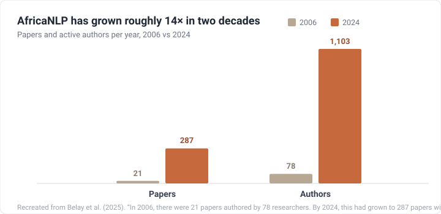

# Yadda ake Rubuta Babi {#how-to-write-a-chapter}

Sashen [Yadda ake Bada Gudummuwa](./how-to-contribute) ya ƙunshi ƙa'idojin bada gudummuwa, wato yin gyara a shafin, raba aiki (forking), da buɗe buƙatar haɗa aiki (pull request). A cikin wannan Sashen, za mu tattauna kan rubutun kansa, yadda ake tsara shafi, ƙara sassa da ƙananan sassa, da kuma amfani da akwatunan kira masu launi (admonitions) waɗanda ke sa shafi ya kasance mai sauƙin karantawa.

Kuna iya rubutu ta **hanyoyi biyu**, amma akwai ƙarin zaɓuɓɓuka (duba sashen [Yadda ake Bada Gudummuwa](./how-to-contribute)):

- **Markdown**: Wannan shi ne ainihin tsarin rubutun AfriPlaybook. Abin da kuka rubuta shi ne zai fita, amma ta hanyar amfani da tsarin rubutun markdown (markdown syntax). Idan ba ku saba da markdown ba, ba shi da wahala, mun bayar da abubuwan farko a ƙasa, amma kuma kuna iya farawa [a nan](https://www.markdownguide.org/getting-started/). Wannan shi ne zaɓi mafi kyau idan kun ƙware wajen gyara fayilolin rubutu ko amfani da manhajar gyara rubutu ta intanet.
- **Microsoft Word**: Wannan sananniyar manhajar gyara rubutu ce da za ku iya amfani da ita wajen tsara babinku, sannan muna da mai kula na cikin gida wanda zai canza shi zuwa Markdown. Ya fi dacewa ga dogayen babi ko masu bada gudummuwa waɗanda ba sa aiki da Markdown.

Dukkansu suna samar da shafi ɗaya da aka wallafa. An rubuta ƙa'idojin da ke ƙasa ta yadda tsarin Word da tsarin Markdown za su bayar da sakamako iri ɗaya.

:::tip[Babbar ƙa'ida]
**Take ɗaya, sannan sassa.** Kowane shafi yana da take ɗaya tak: kan magana guda ɗaya na `#` a layin farko bayan bayanan farko (front matter) (`# Speaker Diarization`). Filin `title:` a cikin bayanan farko ba dole ba ne; idan kun ƙara shi, ku sa ya yi daidai da kan maganar `#` sak. Kada ku taɓa rubuta lambar babi; jerin shafukan gefe (sidebar) ne ke nuna gurbin shafin a cikin AfriPlaybook. Duk abin da ya biyo bayan take sashe ne, wanda ke farawa daga `##`. A Word, take yana amfani da tsarin **Title**, sassa kuma suna farawa daga **Heading 1**.
:::

---

## Rubutu a Markdown {#writing-in-markdown}

### Sassa da ƙananan sassa {#sections-and-subsections}

Kan magana (headings) ne ke gina tsarin shafin da kuma jerin abubuwan da ke ciki a ɓangaren dama. Taken shafi ne kaɗai ke amfani da `#`; kowane sashe yana farawa daga mataki ɗaya ƙasa:

```markdown
# Page Title            ← the title, once (same as `title:` if the front matter has one)

## A section            ← top-level section (shows in the right-hand menu)

### A subsection        ← nested under the section above

#### A sub-subsection   ← use sparingly; deep nesting is hard to read
```

Ƙa'idojin da ke sa shafuka su kasance a tsare:

- **Ku yi amfani da `#` guda ɗaya sau ɗaya kawai**, don take. Kada ku sa masa lamba (`# 3. Data Quality`); jerin shafukan gefe ne ke nuna tsarin jeri, kuma lambobi suna lalacewa idan an matsar da babi.

- **Kada ku tsallake matakai.** Bayan `##` sai a sa `###`, ba `####` ba.
- **Ku sa kan magana ya zama gajere.** Suna komawa jerin abubuwan zaɓi ne; cikakkiyar jimla tana ɓata tsarin shafin.
- **Tunanin abu ɗaya a kowane sashe.** Idan sashe ya wuce tsawon shafin allo ɗaya ko biyu, ku raba shi.

### Kawo majiyoyi {#citing-sources}

Ku kawo majiya a cikin rubutu ta hanyar sa sunan marubuci da shekara a cikin baka, tare da mahaɗi zuwa shigarwar aikin a shafin [Manazarta (References)](../references.md): `([Adelani et al., 2022a](../references.md#adelani-2022))`. Ku yi amfani da sunan iyali (surname) na marubuci na farko, `et al.` idan marubutan sun kai uku ko fiye, da kuma waƙafi kafin shekara. Idan marubuta biyu ne, ku ambaci dukkansu (`Fort & Sagot, 2010`). Idan aikin bai riga ya kasance a shafin Manazarta ba, ku ƙara shigarwarsa a can a cikin buƙatar haɗa aiki (pull request) ɗin dai.

### Akwatunan kira (Admonitions): akwatunan kira masu launi {#admonitions-the-colored-callout-boxes}

Akwatunan kira (admonitions) su ne akwatunan da ke jawo hankalin mai karatu zuwa ga wani abu mai muhimmanci (kamar koren akwatin "babbar ƙa'ida" da ke sama). Ku sa rubutun a tsakanin shingayen `:::`:

```markdown
:::note
Neutral aside or extra context. Gray.
:::

:::tip
Best practice, or what worked on a real project. Green.
:::

:::info
Something the reader needs to know first: a prerequisite or definition. Blue.
:::

:::warning
A common mistake or gotcha. Yellow.
:::

:::danger
Something irreversible or unsafe: data loss, consent, security. Red.
:::
```

Ku ba akwatin naku kan magana ta hanyar sa shi a cikin maƙalafai masu kusurwa (square brackets):

```markdown
:::tip[Contribute]
You don't need to write a whole chapter to help.
:::
```

**Ƙa'idoji:**

- Ku bar **layi fanko kafin da kuma bayan** kowane shingen `:::` da kuma kewayen abin da ke ciki.
- Kuna iya sa rubutun Markdown na yau da kullum a ciki: **rubutu mai kauri (bold)**, mahaɗai (links), jeri, lambar kwamfuta (code).
- Ku yi amfani da su a taƙaice: **kada su wuce guda ɗaya a kowane sashe**, idan ba haka ba shafin zai koma kamar takardar gargaɗi.

### Yaushe ya kamata a yi amfani da wane akwati {#when-to-use-which-box}

| Akwati | Abin da za a yi amfani da shi a kai |
|------|-----------|
| `tip` | Aikin da aka ba da shawarar yi, "abin da ya yi aiki a ainihin aiki" |
| `note` | Ƙarin bayani, bayanin da ba dole ba ne |
| `info` | Abubuwan da ake buƙata kafin farawa, ma'anoni, bayanan juzu'i |
| `warning` | Kura-kuran da aka saba yi, abubuwan lura |
| `danger` | Asarar bayanai, matakan da ba za a iya juyawa ba, amincewa, tsaro |

### Wasu abubuwan da ke sa shafi ya fi kyau {#other-things-that-make-a-page-nicer}

- **Guntun lambar kwamfuta (Code blocks)**: koyaushe ku saita yaren (kamar **python**, **java**) domin a nuna shi daban, sannan ku ƙara take idan zai taimaka:

  ````markdown
  ```python title="train.py"
  print("hello")
  ```
  ````

Wannan yana da muhimmanci musamman ga babukan da ke magana kan ɓangarorin fasaha kamar tsaftace bayanai (data cleaning), nuna bayanai a hoto (visualization) da sauransu.
- **Hotuna**: ku sa su a cikin babban fayil ɗin **`images/`** na babin kuma koyaushe ku rubuta madadin rubutu (alt text) da ke bayyana hoton:

  ```markdown
  
  ```

- **Mahaɗai (Links)**: ku haɗa zuwa wasu shafukan tare da hanyar da ke da alaƙa (relative path) domin tsarin ginin ya iya duba su: `[Core principles](./core-principles)`.
- **Bayani mai naɗuwa (Collapsible detail)**: ku ɓoye dogon bayani, wanda ba dole ba ne:

  ```markdown
  <details>
    <summary>Full configuration example</summary>

    ...content...

  </details>
  ```

- **Jadawali (Tables)**: ku sa su zama matsiyata (narrow). Yawancin masu bada gudummuwa suna karatu ne a kan waya, kuma faffadan jadawali yana ɓata tsarin shafin.
- **Kada a yi amfani da dogon layi (em-dashes)**: kada ku yi amfani da dogon layi. Maimakon haka, ku yi amfani da alamar digo biyu (colon), waƙafi (comma), baka (parentheses) ko sabuwar jimla.

---

## Rubutu a Microsoft Word {#writing-in-microsoft-word}

Kuna iya tsara rubutunku a **Word** sannan ku bar mai kula ya canza shi. Domin yin canjin cikin tsari, ku yi amfani da **tsarin da ke cikin Word (built-in styles)** (maɓallan Heading 1 / Heading 2), ba rubutu mai kauri da kuka yi da kanku ko manyan haruffa ba. Manhajar canza tsarin tana fahimtar ainihin tsarin ne kawai.

### Kan magana yana sauka mataki ɗaya ƙasa {#headings-map-one-level-down}

Taken shafi yana amfani da tsarin **Title** na Word, don haka **Heading 1 na Word yana komawa sashe ne, ba take ba.** Ku yi amfani da wannan tsarin:

| A Word, yi amfani da… | Yana komawa a AfriPlaybook | Daidai da Markdown |
|------|------|------|
| **Title** (sau ɗaya, a sama) | Taken shafi | `# Title` |
| **Heading 1** | Babban sashe | `##` |
| **Heading 2** | Ƙaramin sashe | `###` |
| **Heading 3** | Ƙaramin-ƙaramin sashe | `####` |
| Rubutu na yau da kullum / Body text | Sakin layi | rubutu zalla |
| Jeri mai ɗigo / mai lamba | Jeri | `-` / `1.` |

Don haka: ku sa take sau ɗaya a saman fayil ɗin da tsarin **Title**, ba tare da lambar babi ba, sannan ku fara sashenku na farko na **Heading 1**.

### Akwatunan kira (Admonitions) a Word {#admonitions-in-word}

Word ba shi da tsarin akwatin kira a cikinsa, don haka ku yi amfani da tsarin da ke ƙasa. Hanya mafi sauƙi, kuma mafi inganci ita ce **rubuta shingayen `:::` a matsayin rubutu zalla**, kowannensu a layinsa, a cikin sakin layi na yau da kullum (Body), *ba* a tsara shi azaman kan magana ba:
```

 :::tip[Contribute]

 You don't need to write a whole chapter to help.

 :::

```

Idan an canza tsarin takardar, waɗannan layukan za su kasance yadda suke kuma AfriPlaybook zai nuna su a matsayin ainihin akwati mai launi. Ku bar sakin layi fanko kafin da kuma bayan shingayen, daidai yadda yake a Markdown.

### Wasu ƙarin shawarwari na Word {#a-few-more-word-tips}

- **Hotuna**: ku liƙa su a cikin rubutun a inda suka dace, sannan ku rubuta bayanin layi ɗaya a ƙarƙashin kowannensu domin ya zama madadin rubutu (alt text).
- **Mahaɗai (Links)**: ku yi amfani da ainihin mahaɗan Word (Insert → Link), ba kawai liƙa adireshin yanar gizo (URL) ba, domin su canzu yadda ya kamata.
- **Kada ku ƙirƙiri tsari na bogi**: ku guji sa lamba da kanku, akwatunan da aka zana da hannu, ko ƙarin layuka fanko don bayar da sarari. Ku bar tsarin (styles) su yi aikin; za a yi muku tsarin shafin a kan rukunin yanar gizon.

---

## Duba kafin ku aiko {#preview-before-you-submit}

Ko wane tsari kuka yi rubutu a ciki, ku duba yadda yake kafin ku buɗe buƙatar haɗa aiki (pull request). Dubawa mafi inganci ita ce ainihin rukunin yanar gizon kansa:

```bash
npm start        # opens a live preview at http://localhost:3000
```

Shafin dubawar yana sabunta kansa yayin da kuke gyara, don haka akwatunan kira, kan magana, da hotuna suna bayyana daidai yadda za su kasance da zarar an wallafa su. Ku karanta shafin a kan ƙaramin allo ma, tunda yawancin masu karatu suna amfani da waya ne.

Don samun cikakkun ƙa'idojin tsari, duba [CONTRIBUTING.md](https://github.com/warakacommunity/playbook/blob/main/CONTRIBUTING.md).
