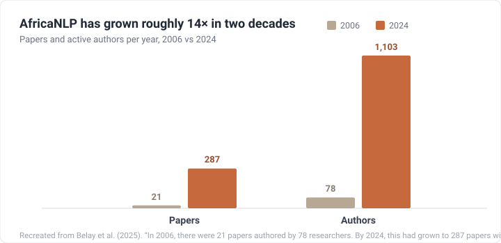

# Jinsi ya Kuandika Sura {#how-to-write-a-chapter}

Sehemu ya [Jinsi ya Kuchangia](./how-to-contribute) inashughulikia mahitaji ya kufanya michango, yaani kuhariri kwenye tovuti, kugawanya (forking), na kufungua ombi la kuvuta (pull request). Katika Sehemu hii, tunaangazia uandishi wenyewe, jinsi ya kupangilia ukurasa, kuongeza sehemu na vijisehemu, na kutumia visanduku vya wito vyenye rangi (admonitions) vinavyofanya ukurasa uwe rahisi kusomeka.

Unaweza kuandika kwa **njia mbili**, lakini kuna chaguzi zaidi (tazama sehemu ya [Jinsi ya Kuchangia](./how-to-contribute)):

- **Markdown**: Huu ni muundo asilia wa kitabu hiki cha mwongozo (playbook). Unachochapa ndicho kinachochapishwa, lakini kwa kutumia sintaksia ya markdown. Ikiwa wewe ni mgeni kwa markdown, si jambo gumu, tumetoa misingi hapa chini, lakini pia unaweza kuanza [hapa](https://www.markdownguide.org/getting-started/). Hili ndilo chaguo bora ikiwa unajisikia huru kuhariri faili za maandishi au kutumia kihariri cha mtandaoni.
- **Microsoft Word**: Hiki ni kihariri unachokizoea kwa ajili ya kuandaa rasimu ya sura yako, kisha tuna mtunzaji (maintainer) wa ndani anayeibadilisha kuwa Markdown. Ni bora kwa sura ndefu au wachangiaji ambao hawafanyi kazi na Markdown.

Zote mbili hutoa ukurasa uleule uliochapishwa. Sheria zilizo hapa chini zimeandikwa ili rasimu ya Word na rasimu ya Markdown zitoe matokeo yanayofanana.

:::tip[Kanuni ya dhahabu]
**Kichwa kimoja, kisha sehemu.** Kila ukurasa una kichwa kimoja tu: kichwa kimoja cha `#` kwenye mstari wa kwanza baada ya maelezo ya awali (front matter) (`# Speaker Diarization`). Sehemu ya `title:` katika maelezo ya awali ni ya hiari; ukiiongeza, ifanye ifanane kabisa na kichwa cha `#`. Kamwe usichape nambari ya sura; mwambaa wa kando (sidebar) unaonyesha nafasi ya ukurasa katika kitabu cha mwongozo. Kila kitu kinachofuata baada ya kichwa ni sehemu, kuanzia `##`. Katika Word, kichwa kinatumia mtindo wa **Title** na sehemu zinaanzia **Heading 1**.
:::

---

## Kuandika katika Markdown {#writing-in-markdown}

### Sehemu na vijisehemu {#sections-and-subsections}

Vichwa vinajenga muundo wa ukurasa na yaliyomo upande wa kulia. Kichwa cha ukurasa ndicho pekee kinachotumia `#`; kila sehemu inaanza ngazi moja chini:

```markdown
# Page Title            ← the title, once (same as `title:` if the front matter has one)

## A section            ← top-level section (shows in the right-hand menu)

### A subsection        ← nested under the section above

#### A sub-subsection   ← use sparingly; deep nesting is hard to read
```

Sheria zinazofanya kurasa ziwe safi:

- **Tumia `#` moja mara moja tu**, kwa ajili ya kichwa. Usikipe nambari (`# 3. Data Quality`); mwambaa wa kando unaonyesha mpangilio, na nambari huharibika sura zinapohamishwa.

- **Usiruke ngazi.** `##` inafuatiwa na `###`, si `####`.
- **Weka vichwa viwe vifupi.** Vinakuwa vipengee vya menyu; sentensi kamili inaharibu mpangilio.
- **Wazo moja kwa kila sehemu.** Ikiwa sehemu inazidi skrini moja au mbili, igawanye.

### Kunukuu vyanzo {#citing-sources}

Nukuu ndani ya maandishi kwa kuweka jina la mwandishi na mwaka ndani ya mabano, pamoja na kiungo kwenye ingizo la kazi hiyo katika ukurasa wa [Marejeleo (References)](../references.md): `([Adelani et al., 2022a](../references.md#adelani-2022))`. Tumia jina la ukoo (surname) la mwandishi wa kwanza, `et al.` kwa waandishi watatu au zaidi, na mkato kabla ya mwaka. Kwa waandishi wawili, wataje wote wawili (`Fort & Sagot, 2010`). Ikiwa kazi hiyo bado haipo kwenye ukurasa wa Marejeleo, ongeza ingizo lake hapo katika ombi lilelile la kuvuta (pull request).

### Visanduku vya wito (Admonitions): visanduku vya wito vyenye rangi {#admonitions-the-colored-callout-boxes}

Visanduku vya wito (admonitions) ni visanduku vya wito (kama kisanduku cha kijani cha "kanuni ya dhahabu" hapo juu) vinavyovuta jicho la msomaji kwenye jambo muhimu. Funga maandishi ndani ya wigo wa `:::`:

```markdown
:::note
Neutral aside or extra context. Gray.
:::

:::tip
Best practice, or what worked on a real project. Green.
:::

:::info
Something the reader needs to know first: a prerequisite or definition. Blue.
:::

:::warning
A common mistake or gotcha. Yellow.
:::

:::danger
Something irreversible or unsafe: data loss, consent, security. Red.
:::
```

Kipe kisanduku kichwa chako mwenyewe kwa kukiweka ndani ya mabano mraba:

```markdown
:::tip[Contribute]
You don't need to write a whole chapter to help.
:::
```

**Sheria:**

- Acha **mstari mtupu kabla na baada** ya kila wigo wa `:::` na kuzunguka maudhui yaliyo ndani.
- Unaweza kuweka Markdown ya kawaida ndani: **koleza (bold)**, viungo, orodha, msimbo (code).
- Vitumie kwa kiasi: **kisizidi kimoja kwa kila sehemu**, la sivyo ukurasa utasomeka kama lebo ya onyo.

### Lini utumie kisanduku kipi {#when-to-use-which-box}

| Kisanduku | Kitumie kwa |
|------|-----------|
| `tip` | Mazoezi yaliyopendekezwa, "kilichofanya kazi kwenye mradi halisi" |
| `note` | Muktadha wa kando, maelezo ya hiari |
| `info` | Mahitaji ya awali, fasili, maelezo ya toleo |
| `warning` | Makosa ya kawaida, mambo ya kushangaza (gotchas) |
| `danger` | Upotevu wa data, hatua zisizoweza kutenduliwa, idhini, usalama |

### Mambo mengine yanayofanya ukurasa uwe mzuri zaidi {#other-things-that-make-a-page-nicer}

- **Vitalu vya msimbo (Code blocks)**: kila mara weka lugha (kama vile **python**, **java**) ili iangaziwe, na uongeze kichwa ikiwa inasaidia:

  ````markdown
  ```python title="train.py"
  print("hello")
  ```
  ````

Hili ni muhimu hasa kwa sura zinazozungumzia vipengele vya kiufundi kama vile usafishaji wa data, uonyeshaji wa data (visualization) na kadhalika.
- **Picha**: ziweke kwenye folda ya **`images/`** ya sura na kila mara andika maandishi mbadala (alt text) yanayoelezea kielelezo:

  ```markdown
  
  ```

- **Viungo**: unganisha kwenye kurasa nyingine kwa kutumia njia ya uhusiano (relative path) ili mchakato wa kujenga (build) uweze kuzikagua: `[Core principles](./core-principles)`.
- **Maelezo yanayoweza kukunjwa (Collapsible detail)**: ficha maudhui marefu, ya hiari:

  ```markdown
  <details>
    <summary>Full configuration example</summary>

    ...content...

  </details>
  ```

- **Majedwali**: yaweke yawe membamba. Wachangiaji wengi husoma kwenye simu, na majedwali mapana yanaharibu mpangilio.
- **Hakuna deshi ndefu (em-dashes)**: usitumie deshi ndefu. Badala yake tumia nuktapacha, mkato, mabano au sentensi mpya.

---

## Kuandika katika Microsoft Word {#writing-in-microsoft-word}

Unaweza kuandaa rasimu katika **Word** na kumruhusu mtunzaji aibadilishe. Ili kufanya ubadilishaji uwe safi, tumia **mitindo iliyojengewa ndani** ya Word (vitufe vya Heading 1 / Heading 2), si maandishi yaliyokolezwa kwa mikono au fonti kubwa zaidi. Kibadilishaji kinaelewa tu mitindo halisi.

### Vichwa vinashuka ngazi moja chini {#headings-map-one-level-down}

Kichwa cha ukurasa kinatumia mtindo wa **Title** wa Word, kwa hivyo **Heading 1 ya Word inakuwa sehemu, si kichwa.** Tumia ramani hii:

| Katika Word, tumia… | Inakuwa katika kitabu cha mwongozo | Sawa na Markdown |
|------|------|------|
| **Title** (mara moja, juu kabisa) | Kichwa cha ukurasa | `# Title` |
| **Heading 1** | Sehemu ya ngazi ya juu | `##` |
| **Heading 2** | Kijisehemu | `###` |
| **Heading 3** | Kijisehemu cha ndani zaidi | `####` |
| Maandishi ya Kawaida / Mwili | Aya | maandishi matupu |
| Orodha ya Nukta / Nambari | Orodha | `-` / `1.` |

Kwa hivyo: weka kichwa mara moja juu kabisa kwa mtindo wa **Title**, bila nambari ya sura, kisha anza sehemu yako ya kwanza ya **Heading 1**.

### Visanduku vya wito (Admonitions) katika Word {#admonitions-in-word}

Word haina kisanduku cha wito kilichojengewa ndani, kwa hivyo tumia utaratibu ulio hapa chini. Njia rahisi na ya kutegemewa zaidi ni **kuchapa wigo wa `:::` kama maandishi matupu**, kila moja kwenye mstari wake, katika aya ya kawaida (Mwili), *bila* kuwekewa mtindo kama kichwa:
```

 :::tip[Contribute]

 You don't need to write a whole chapter to help.

 :::

```

Wakati hati inabadilishwa, mistari hiyo inabaki kama ilivyo na kitabu cha mwongozo kinaiwasilisha kama kisanduku halisi chenye rangi. Weka aya tupu kabla na baada ya wigo, sawa kabisa na katika Markdown.

### Vidokezo vichache zaidi vya Word {#a-few-more-word-tips}

- **Picha**: zibandike ndani ya mstari (inline) pale zinapostahili, na uandike maelezo mafupi ya mstari mmoja chini ya kila picha ili yaweze kuwa maandishi mbadala (alt text).
- **Viungo**: tumia viungo halisi vya Word (Insert → Link), si URL zilizobandikwa tupu, ili zibadilishwe kwa usahihi.
- **Usighushi muundo**: epuka uwekaji nambari kwa mikono, visanduku vilivyochorwa kwa mkono, au mistari tupu ya ziada kwa ajili ya nafasi. Ruhusu mitindo ifanye kazi; mpangilio unatumika kwa ajili yako kwenye tovuti.

---

## Hakiki kabla ya kuwasilisha {#preview-before-you-submit}

Kwa muundo wowote unaoandika, kagua jinsi unavyoonekana kabla ya kufungua ombi la kuvuta (pull request). Hakikisho sahihi zaidi ni tovuti yenyewe ya moja kwa moja:

```bash
npm start        # opens a live preview at http://localhost:3000
```

Hakikisho hupakia upya unapohariri, kwa hivyo visanduku vya wito, vichwa, na picha huonekana sawa kabisa na jinsi vitakavyokuwa vikishachapishwa. Soma ukurasa kwenye dirisha jembamba pia, kwa kuwa wasomaji wengi wanatumia simu.

Kwa sheria kamili za mtindo, tazama [CONTRIBUTING.md](https://github.com/warakacommunity/playbook/blob/main/CONTRIBUTING.md).
